# 1. Introduction to the Tidyverse

In this class will get you started on the path to exploring and
visualizing your own data with the R programming language.

tidyverse is a collection of data science tools within R for
transforming and visualizing data. This is not the only set of tools in
R, but it's a powerful and popular approach for exploring data.

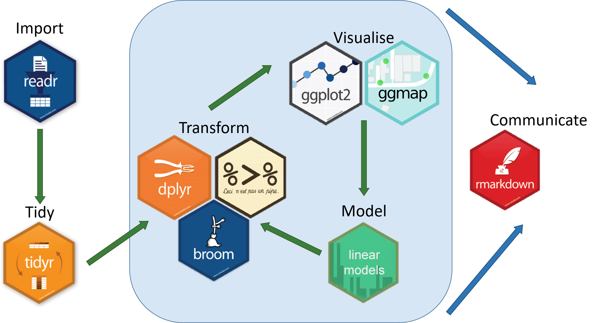

A useful R package for data science is <b>dplyr</b> created by Hadley
Wickham (hadley.nz), which provides step-by-step tools for transforming
this data, such as filtering, sorting, and summarizing it.


## 1.1. Gapminder

For this, we will use the dataset Gapminder. Gapminder tracks economic
and social indicators like life expectancy and the GDP per capita of
countries over time.

<https://github.com/jennybc/gapminder>

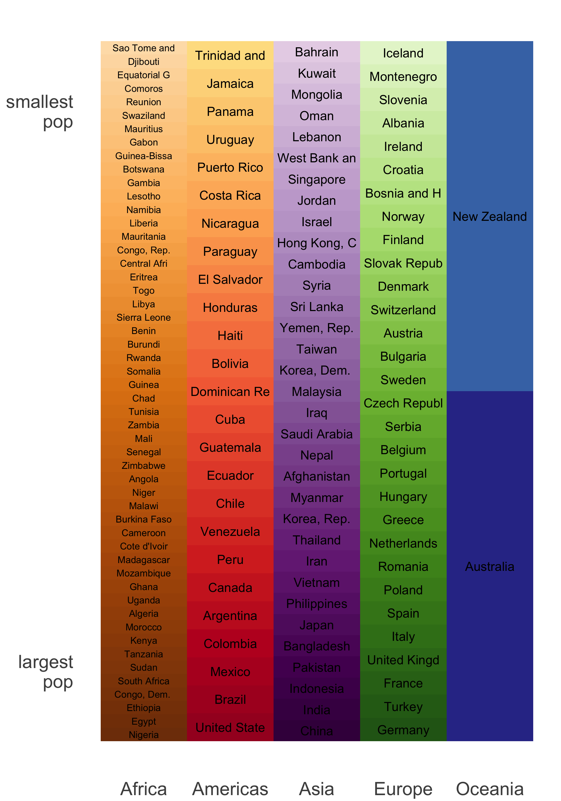

what kinds of questions emerge from these data and how to answer them?

Let's starts

```{r}
#install.packages("gapminder")
```

```{r}
library(gapminder)
```

```{r}
a <- gapminder
```

```{r}
str(gapminder)

```

Gapminder is structured as a data frame. A data frame keeps rectangular
data in rows and columns, similar to a spreadsheet, or a table in a SQL
database. Most data analyses in R are centered around data frames.

```         
gapminder

A tibble: 1704 × 6
```

This tells you the <b>tibble</b> has one 1704 rows, each of which we
call an <b>observation</b>. It has six columns, each of which we call a
<b>variable</b>. It's important in an analysis to understand what each
observation, or row, represents.

Here, each represents a unique pair of a country and a year. For
example, the first observation represents country statistics for
Afghanistan in 1952, the second for Afghanistan in 1957, and so on. For
each combination of a country and year, the dataset contains several
variables, or columns, describing the country's demographics.

We see the continent - in this case, Asia - the life expectancy in
years, the population, and the GDP per capita. The GDP per capita is the
country's total economic output (Gross Domestic Product) divided by its
population, and it's a common measure of how wealthy a country is. Each
variable is of one consistent data type: some are numbers, like life
expectancy and population and some are categorical, like country and
continent.

```{r}
library(gapminder)
library(dplyr)

gapminder %>% dplyr::glimpse()
```

## 1.2. Count()

The count() function in R is a powerful tool that allows you to
determine the frequency or count of unique values within a numerical
variable. This means you can quickly and easily find out how many times
each distinct value appears in your dataset. This can be particularly
useful for understanding the distribution of your data or identifying
common patterns within it.

```{r}
library(gapminder)
library(dplyr)

gapminder %>% count()
```

```{r}
library(gapminder)
library(dplyr)

h <- gapminder %>% count(year)
h

```

```{r}
library(gapminder)
library(dplyr)

h <- gapminder %>% count(year, continent)

h
```

```{r}
library(gapminder)
library(dplyr)
a <- gapminder %>% count(year, sort = F)
a

```

The weight option in the count function of the dplyr package in R is
used to assign weights to the rows in a data frame or tibble when
counting the occurrences of unique values in one or more columns. This
is particularly useful when you want to give different importance or
frequencies to individual rows while computing counts.

```{r}
library(gapminder)
library(dplyr)

h <- gapminder %>% count(year, wt = pop)
h
```

## 1.3. Select()

select() function is used to choose a subset of variables (columns) from
a data frame. It is particularly helpful when you have a large dataset
with many variables, and you want to focus only on a subset of those
variables for analysis or visualization.

```{r}
library(gapminder)
library(dplyr)

a <- gapminder %>% select(continent)
a
```

```{r}
library(gapminder)
library(dplyr)

a <- gapminder %>% select(continent, year)
a
```

```{r}
library(gapminder)
library(dplyr)

h <- gapminder %>% select(country:year)
h
```

```{r}
library(gapminder)
library(dplyr)

gapminder %>% select(-year)
```

```{r}
library(gapminder)
library(dplyr)

gapminder %>% select(starts_with("co"))

#gapminder %>% select(ends_with("co"))
```

```{r}
library(gapminder)
library(dplyr)

gapminder %>% select(contains("e"))
```

```{r}
library(gapminder)
library(dplyr)

a <- gapminder %>% select(2:last_col())
a
```

```{r}
library(gapminder)
library(dplyr)

gapminder %>% select(1:last_col()-1)
```

we can even change the name of a variable

```{r}
library(gapminder)
library(dplyr)

a <- gapminder %>% select(continente = continent)
a
```

## 1.4. Rename()

In dplyr, the rename() function is used to rename columns in a data
frame. It allows you to change the names of one or more variables
(columns) to new names.

```{r}
library(gapminder)
library(dplyr)

a <- gapminder %>% rename(population = pop)
a
```

## 1.5. Filter()

You use filter when you want to look only at a subset of your
observations, based on a particular condition. Filtering data is a
common first step in an analysis.

A pipe: %\>% says "take whatever is before it, and feed it into the next
step.

```{r}
#install.packages('dplyr')
library(gapminder)
library(dplyr)

a <- gapminder %>% filter(continent == "Asia") %>% 
  filter(year == 2007)

a
```

```{r}
#install.packages('dplyr')
library(gapminder)
library(dplyr)

gapminder %>% filter(continent == "Asia", year == 2007) 
```

Notice that now, we have only 142 rows: that's how many countries are in
the dataset. It's important to note that you're not removing any rows
from the original gapminder data. You can still use the gapminder object
for other analyses.

```{r}
a <- gapminder %>%
filter(country == "Chile")
```

### 1.5.1 Multiple conditions

```{r}
a <- gapminder %>%
filter(year <= 2007, continent == "Asia")
```

```{r}

a <- gapminder %>%
filter(continent %in% c("Asia", "Europe"))
```

## 1.6. Arrange()

arrange sorts the observations in a dataset, in ascending or descending
order based on one of its variables. This is useful, for example, when
you want to know the most extreme values in a dataset.

```{r}
library(dplyr)
a <- gapminder %>% arrange(gdpPercap)
```

The observations are now sorted in ascending order, with the lowest GDP
per capita appearing first. Look at the rightmost column: notice that it
starts with 241, the smallest value in the dataset, then keeps
increasing.

You can see that the country-year pair with the lowest GDP per capita
was the Democratic Republic of the Congo in 2002.

Just like with filter, the gapminder object itself is unchanged: arrange
is just giving you a new, sorted dataset.

Arrange also lets you sort in descending order.

```{r}
a <- gapminder %>%
arrange(desc(gdpPercap))
```

Looking across all countries and all years might not be that useful.
Suppose you wanted to find the highest GDP-per-capita countries in just
one year.

### 1.6.1 Combining filter and arrange

```{r}
library(gapminder)
library(dplyr)


a <- gapminder %>%
filter(country == "Lesotho") %>%
arrange(desc(year))
```

## 1.7. Mutate()

Suppose you want to change one of the variables in your dataset, based
on the other ones. Or suppose you want to add a new variable. For that,
you would use the mutate function.

### 1.7.1. Modifying a variable with mutate

```{r}
#gapminder

a <- gapminder %>%
mutate(pop = pop/10e6)
```

This is how you manipulate existing variables in the table. That's often
necessary during data processing and cleaning. Just like filter and
arrange, you're not altering the original gapminder data, you're just
changing the value in this new data frame.

### 1.7.2. Adding a new variable with mutate

you may want to add a new variable. For instance, you currently have the
GDP per capita: that's the Gross Domestic Product of the country divided
by the current population. But in your analysis, you may want to know
the total GDP. You'd have to multiply the population by the GDP per
capita to find this.

```{r}
a <- gapminder %>%
mutate(gdp = gdpPercap * pop)
```

### 1.7.3. Combining filter, arrange and mutate

Suppose we wanted to know the countries with the highest total GDP in
the year 2007. We would do this in three steps- create the column,
filter for 2007, then sort. We use mutate to create the total GDP
column. Then we'd use filter to restrict our analysis to only the year
2007. Then we'd use arrange to sort the data in descending order of our
new GDP variable.

```{r}
a <- gapminder %>%
mutate(gdp = gdpPercap * pop) %>%
filter(year == 2007) %>%
arrange(desc(gdp))
```

```{r}
# Measure the time taken for the code block
timing_result <- system.time({
  result <- gapminder %>%
    mutate(gdp = gdpPercap * pop) %>%
    filter(year == 2007) %>%
    arrange(desc(gdp))
})

# Print the result and timing information
print(result)
print(timing_result)
```

```{r}
# Measure the time taken for the code block
timing_result <- system.time({
  result <- gapminder %>%
    filter(year == 2007) %>%
    mutate(gdp = gdpPercap * pop) %>%
    arrange(desc(gdp))
})

# Print the result and timing information
print(result)
print(timing_result)
```

## 1.8. Transmute()

The transmute() function, part of the dplyr package in R, is used for
creating new columns and modifying existing ones in a data frame or
tibble, all within a single step. It's particularly useful when you want
to transform your data and keep only the newly created or modified
columns, discarding the rest.

```{r}
result <- gapminder %>%
    filter(year == 2007) %>%
    transmute(gdp = gdpPercap * pop) 

result
```

```{r}
result <- gapminder %>%
    filter(year == 2007) %>%
    transmute(year, country, gdp = gdpPercap * pop) 

result
```

## 1.9. Lag() function

The lag() function in R is used to create a new column in a data frame
or tibble that contains lagged (shifted) values from an existing column.
A lagged value is the previous value in the same column. This function
is particularly useful for time series analysis and for comparing data
points with their previous values.

```{r}
sel_chile <- gapminder %>%
filter(country == "Chile") %>%
mutate(diff = lifeExp - lag(lifeExp))
#%>%
#mutate(ratio = lifeExp / lag(lifeExp))

sel_chile
```

# 2. Visualizing with ggplot2

Previously, you used the dplyr package to answer some questions about
the gapminder dataset. You've been able to filter for particular
observations, arrange to find the highest or lowest values, and mutate
to add new columns. However, so far you've engaged with the results only
as a table printed out from your code. Often a better way to understand
and present this kind of data is as a graph.

Now, we will learn the essential skill of data visualization using the
ggplot2 package. Here, we will see how the dplyr and ggplot2 packages
work closely together to create informative graphs.

When you're working with just a subset, it's useful to save the filtered
data, as a new data frame.

```{r}
library(dplyr)
gapminder_2007 <- gapminder %>%
filter(year == 2007)

gapminder_2007
```

We can see that it's another table. But this one has only 142 rows, and
they come only from the year 2007. Now that you've saved this variable,
you can use it to create our visualization.

Suppose you want to examine the relationship between a country's wealth
and its life expectancy. You could do this with a scatterplot comparing
two variables in our gapminder dataset: GDP per capita on the X axis and
life expectancy on the y-axis.

```{r}
#install.packages("ggplot2")
library(ggplot2)
library(dplyr)
```

```{r}
ggplot(gapminder_2007, aes(x = gdpPercap, y = lifeExp)) +
      geom_point()
#?geom_smooth
```

## 2.1. Scatter plots

### 2.1.1. What is a scatter plot?

A scatter plot (aka scatter chart, scatter graph) uses dots to represent
values for two different numeric variables.

The position of each dot on the horizontal and vertical axis indicates
values for an individual data point.

Scatter plots are used to observe relationships between variables such
as GDP per capita and life expectancy in gapminder dataset.

### 2.1.2. When you should use a scatter plot

Scatter plots' primary uses are to observe and show relationships
between two numeric variables. The dots in a scatter plot not only
report the values of individual data points, but also patterns when the
data are taken as a whole.

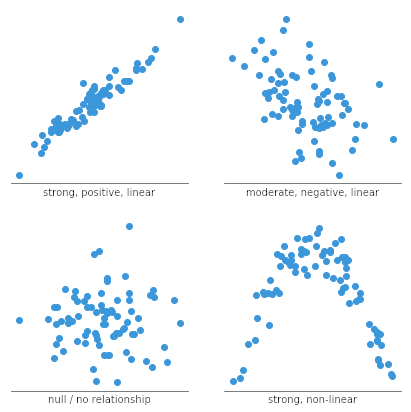

A scatter plot can also be useful for identifying other patterns in
data. We can divide data points into groups based on how closely sets of
points cluster together. Scatter plots can also show if there are any
unexpected gaps in the data and if there are any outlier points. This
can be useful if we want to segment the data into different parts.

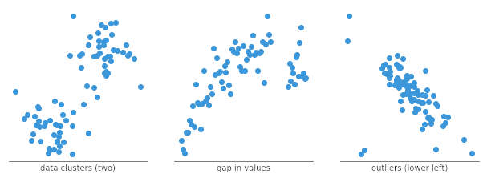

### 2.1.3. Common issues when using scatter plots

This is not so much an issue with creating a scatter plot as it is an
issue with its interpretation. Simply because we observe a relationship
between two variables in a scatter plot, it does not mean that changes
in one variable are responsible for changes in the other. This gives
rise to the common phrase in statistics that <b>correlation does not
imply causation</b>. It is possible that the observed relationship is
driven by some third variable that affects both of the plotted
variables, that the causal link is reversed, or that the pattern is
simply coincidental.

### 2.1.4. Common scatter plot options

#### 2.1.4.1. Add a trend line

When a scatter plot is used to look at a predictive or correlational
relationship between variables, it is common to add a trend line to the
plot showing the mathematically best fit to the data. This can provide
an additional signal as to how strong the relationship between the two
variables is, and if there are any unusual points that are affecting the
computation of the trend line.

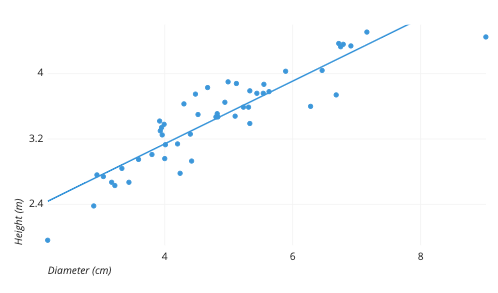

```{r}
ggplot(gapminder_2007, aes(x = gdpPercap, y = lifeExp)) +
      geom_point() + 
    geom_smooth(method="lm")

#geom_smooth(method="lm")
#?geom_smooth
```

#### 2.1.4.2. Categorical third variable

A common modification of the basic scatter plot is the addition of a
third variable. Values of the third variable can be encoded by modifying
how the points are plotted. For a third variable that indicates
categorical values (like geographical region or gender), the most common
encoding is through point color. Giving each point a distinct hue makes
it easy to show membership of each point to a respective group.

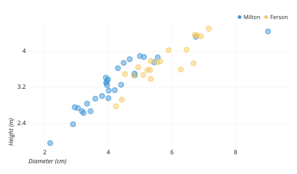

One other option that is sometimes seen for third-variable encoding is
that of shape. One potential issue with shape is that different shapes
can have different sizes and surface areas, which can have an effect on
how groups are perceived. However, in certain cases where color cannot
be used (like in print), shape may be the best option for distinguishing
between groups.


#### 2.1.4.3. Numeric third variable

For third variables that have numeric values, a common encoding comes
from changing the point size. A scatter plot with point size based on a
third variable actually goes by a distinct name, the <b>bubble
chart</b>. Larger points indicate higher values.

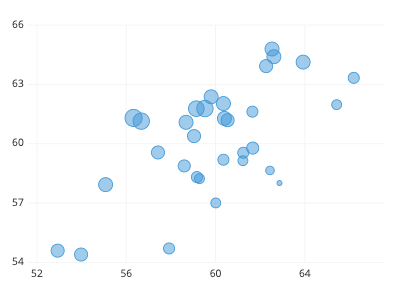

Another alternative. Rather than using distinct colors for points like
in the categorical case, we want to use a continuous sequence of colors,
so that, for example, darker colors indicate higher value. Note that,
for both size and color, a legend is important for interpretation of the
third variable, since our eyes are much less able to discern size and
color as easily as position.

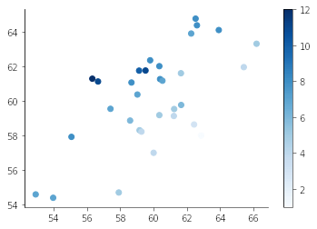

as homework, find out how to implement points 2.1.4.1 to 2.1.4.3 in
ggplot

explore outliers

```{r}
library(ggplot2)
library(gapminder)
library(dplyr)

gapminder_1952 <- gapminder %>%
  filter(year == 1952)

# Change to put pop on the x-axis and gdpPercap on the y-axis
ggplot(gapminder_1952, aes(x = pop , y = gdpPercap)) +
  geom_point() 
```

## 2.2. Logarithmic scales

Let plot comparing the GDP per capita of each country to its life
expectancy.

```{r}
library(ggplot2)
library(gapminder)
library(dplyr)


ggplot(gapminder_1952, aes(x = pop , y = gdpPercap)) +
  geom_point() +
  scale_x_log10() 
```

This plot communicates some interesting information: we can see that
higher income countries tend to have higher life expectancy. One problem
with this plot, however, is that a lot of countries get crammed into the
leftmost part of the x-axis. This is because the distribution of GDP per
capita spans several orders of magnitude, with some countries in the
tens of thousands of dollars and others in the hundreds. When one of
your axes has that kind of distribution, it's useful to work with a
<b>logarithmic scale</b>

<https://www.youtube.com/watch?v=W_BZb_va6jY&list=WL&index=2>

```{r}
ggplot(gapminder, aes(x = gdpPercap , y = lifeExp)) +
  geom_point() +
scale_x_log10() +
geom_smooth(method="lm")


gdpPercap.lm = lm(gdpPercap ~ lifeExp, data=gapminder)

summary(gdpPercap.lm)$r.squared
```

On this scale, the relationship between GDP per capita and life
expectancy looks more linear: and you can more easily distinguish the
countries at the lower end of the spectrum.

### 2.2.1. When should use Logarithmic scales?

There are one main reason to use logarithmic scales in charts and
graphs:

- To respond to skewness towards large values; i.e., cases in which one
  or a few points are much larger than the bulk of the data.

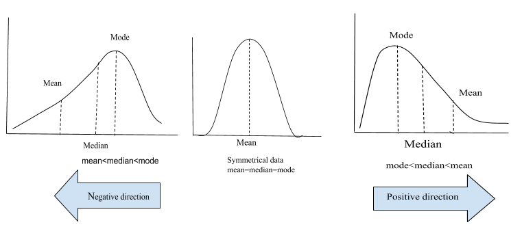

<b>It is extremely useful when graphing a large variance in data!.</b>

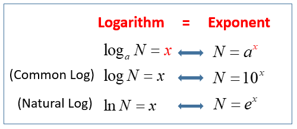

To refresh your memory of school math, logs are just another way of
writing exponential equations, one that allows you to separate the
exponent on one side of the equation.

The equation:
$$x = log_{a} (N)$$

means that <b>x</b> is the power or exponent that <b>a</b> is raised to
in order to get <b>N</b>.

The common base for logarithmic scales is the base 10. However, other
bases are also useful. While a base of ten is useful when the data range
over several orders of magnitude.

## 2.3. Additional aesthetics in ggplot2

Previously, we plot to compare two variables within your data using two
visual aesthetics: GDP per capita on the x-axis, and life expectancy on
the y-axis.

But these aren't the only variables in the gapminder dataset: for
example, you also have continent and population. You may want to examine
relationships among all these variables in the same plot.

<b>You already used the x-axis to represent GDP per capita and the
y-axis to represent life expectancy. Now you'll learn to add two more
aesthetics- color and size- to communicate even more information in your
scatter plot.

```{r}
library(gapminder)
library(dplyr)
library(ggplot2)
summary(gapminder)

```

<b>Continent is a categorical variable: it has a few specific values,
such as Asia and Europe. A good way to represent a categorical variable
in a scatterplot is the color of your points.

```{r}
gapminder_2007 <- gapminder %>%
  filter(year == 2007)

# Change to put pop on the x-axis and gdpPercap on the y-axis
ggplot(gapminder_2007, aes(x = gdpPercap , y = lifeExp, color = continent)) +
  geom_point() +
scale_x_log10()
```

This communicates a lot about differences between continents. The
average life expectancy and GDP per capita tends to be lowest for
African countries, shown in red, and highest for European countries,
shown in blue.

<b>Another variable you may want to include in the graph is population,
represented by the pop variable in the dataset. This is a numeric
variable, so a good way to represent it is with the size of the points
in the scatterplot.

```{r}
gapminder_2007 <- gapminder %>%
  filter(year == 2007)

# Change to put pop on the x-axis and gdpPercap on the y-axis
ggplot(gapminder_2007, aes(x = gdpPercap , y = lifeExp, color = continent, size = pop)) +
  geom_point() +
scale_x_log10()
```

<b>ggplot2 lets you divide your plot into subplots to get one smaller
graph for each continent</b>: Africa, the Americas, and so on. This is
called faceting, and it's another powerful way to communicate
relationships within your data.

```{r}
gapminder_2007 <- gapminder %>%
  filter(year == 2007)

# Change to put pop on the x-axis and gdpPercap on the y-axis
ggplot(gapminder_2007, aes(x = gdpPercap , y = lifeExp, color=continent, size = pop)) +
  geom_point() +
scale_x_log10() +
facet_wrap(~ continent, nrow=5, ncol=1)
```

In R, the tilde (\~) symbol typically means "by"

```{r}
gapminder_2007 <- gapminder %>%
  filter(year == 1952)

# Change to put pop on the x-axis and gdpPercap on the y-axis
ggplot(gapminder_2007, aes(x = gdpPercap , y = lifeExp, color = continent, size = pop)) +
  geom_point() +
scale_x_log10() +
facet_wrap(~ continent, nrow=5, ncol=1)
```

```{r}
a <- gapminder %>%
filter(gapminder$continent == "Africa") 

a <- a %>%
  mutate(pop_group = case_when(
    pop <= 3000000 ~ 1,
    pop > 3000000 & pop < 10000000 ~ 2,
    pop >= 10000000 ~ 3
  ))


a$pop_group <- as.factor(a$pop_group)
summary(a)
```

```{r}
b <- a %>%
filter(pop_group == "1")

A <- ggplot(b, aes(x = gdpPercap , y = lifeExp, color = country, size = pop)) +
  geom_point() +
scale_x_log10() +
facet_wrap(~ year)

A

ggsave(filename = "plot_A.tiff", plot = A, device = "tiff", dpi = 1000, width = 13, height = 6, units = "in")

```

```{r}
summary(gapminder)
str(gapminder)
glimpse(gapminder)
```

# 3. Continue with Tidyverse (dplyr)

## 3.1. Summarize()

Analyses will usually involve a cycle between these steps of data
transformation and visualization, as well as additional components of
the data science workflow.

Now you'll learn how to summarize many observations into a single data
point.

For example, suppose you want to know the average life expectancy across
all countries and years in the dataset. You would do this with the
summarize function.

```{r}
gapminder
```

```{r}
library(ggplot2)
library(gapminder)
library(dplyr)

gapminder %>% 
summarize(meanLifeExp = mean(lifeExp))
```

In the output, we see the answer to our question: the mean life
expectancy was about 59.47 years.

If you think about it, it doesn't really make sense to summarize across
all countries and across all years. It may make more sense to ask
questions about averages in a particular year, such as 2007.

To answer this, you can combine the summarize verb with filter: filter
your data for a particular year first, then summarize the result.

```{r}
gapminder %>%
filter(year == 1952) %>%
summarise(meanLifeExp = mean(lifeExp))
```

This shows you that the average life expectancy in the year 2007 was
about 67 years.

You can create multiple summaries at once with the summarize. For
example, suppose that along with finding the average life expectancy in
2007, you want to find the total population in that year.

```{r}
library(dplyr)
library(gapminder)
a <- gapminder

gapminder %>%
filter(year == 2007) %>%
summarise(meanLifeExp = mean(lifeExp),
         totalpop = sum(as.numeric(pop))
         )
```

```{r}
str(gapminder)
```

```{r}
#help(summarise)
?summarise
```

Useful functions

- Center: mean(), median()

- Spread: sd(), IQR(), mad()

- Range: min(), max(), quantile()

- Position: first(), last(), nth(),

- Count: n(), n_distinct()

- Logical: any(), all()

## 3.2. Group_by()

We use the summarize function to answer questions about the entire
dataset, or about a particular year. For example, here you're finding
the average life expectancy and the total population in the year 2007.

What if we weren't interested just in the average for the year 2007, but
for each of the years in the dataset?

You could rerun this code and change the year each time, but that's very
tedious...or

we can use the group_by function

```{r}

a <- gapminder
```

```{r}
a <- gapminder %>%
filter(gapminder$continent == "Americas")  %>%
group_by(country) %>%
summarise(meanLifeExp = mean(gdpPercap))

a
```

This shows us that the total population started at 2.4 billion, and went
up to 6.25 billion in 2007.

We can also see that average life expectancy went up from 49 years in
1952 to 67 in 2007.

How to determinate the average life expectancy and the total population
in 2007 within each continent.

```{r}
a <- gapminder %>%
filter(year == 1952) %>%
group_by(continent) %>%
summarise(meanLifeExp = mean(lifeExp),
         totalpop = sum(as.numeric(pop)))

b <- gapminder %>%
filter(year == 2007) %>%
group_by(continent) %>%
summarise(meanLifeExp = mean(lifeExp),
         totalpop = sum(as.numeric(pop)))


```

We can see that Europe and Oceania have the highest life expectancy, and
that Asia and Africa are lower.

Now that you've calculated these statistics for each continent in 2007,
you might be interested in how they changed for each continent over
time.

```{r}
c <- gapminder %>% 
group_by(continent, year) %>%
summarise(meanLifeExp = mean(lifeExp),
         totalpop = sum(as.numeric(pop)))


```

## 3.3. Slice()

slice() lets you index rows by their (integer) locations. It allows you
to select, remove, and duplicate rows. It is accompanied by a number of
helpers for common use cases:

slice_head() and slice_tail() select the first or last rows.

slice_sample() randomly selects rows.

slice_min() and slice_max() select rows with the smallest or largest
values of a variable.

```{r}
a <- gapminder %>%
group_by(continent) %>% 
slice_head(n = 3)
```

```{r}
gapminder %>%
group_by(continent) %>% 
slice_tail(n = 2)

```

```{r}
a <- gapminder %>%
group_by(continent) %>% 
slice_min(lifeExp, n = 1)
```

```{r}
a <- gapminder %>%
group_by(continent) %>% 
slice_max(lifeExp, n = 1)
```

The slice_sample() function in the dplyr package is used to randomly
sample rows from a data frame. It is useful when you want to obtain a
random subset of rows from your data.

```{r}
a <- gapminder %>%
group_by(continent) %>% 
slice_sample(n = 3, replace = TRUE)
```

# 4. Visualizing summarized data

```{r}
by_year <- gapminder %>%
group_by(year) %>%
summarise(meanLifeExp = mean(lifeExp),
         totalpop = sum(as.numeric(pop)))

by_year
```

```{r}
library(ggplot2)
ggplot(by_year, aes(x = year, y = totalpop)) +
geom_point()+
geom_smooth(method="lm")
```

The resulting graph of population by year shows the change in the total
population, which is going up over time. ggplot2 puts the y-axis is in
scientific notation, since showing it with nine zeros would be hard to
read.

```{r}
ggplot(by_year, aes(x = year, y = totalpop)) +
geom_point() +
expand_limits(y = 0) +
geom_smooth(method="lm")
```

```{r}
library(ggplot2)
library(gapminder)
library(dplyr)


by_year_continent <- gapminder %>%
group_by(year, continent) %>%
summarise(meanLifeExp = mean(lifeExp),
         totalpop = sum(as.numeric(pop)))

#by_year_continent

ggplot(by_year_continent, aes(x = year, 
                              y = totalpop, 
                              color = continent)) +
geom_point() +
expand_limits(y = 0) 
```

This lets us see that Asia was always the most populated continent and
has been growing the most rapidly, that Oceania has a slower rate of
growth, and that Africa has grown to surpass both Europe and the
Americas in terms of population.

```{r}
by_year <- gapminder %>%
  group_by(year) %>%
  summarize(medianLifeExp = median(lifeExp),
            maxGdpPercap = max(gdpPercap))

by_year

ggplot(by_year, aes(x = year, y = medianLifeExp)) +
geom_point() +
expand_limits(y = 0)
```

```{r}
by_year_continent <- gapminder %>%
  group_by(continent, year) %>%
  summarize(meanGdpPercap = mean(gdpPercap))

ggplot(by_year_continent, aes(x = year, y = meanGdpPercap, color = continent)) +
geom_point() +
expand_limits(y = 0)
```

```{r}
by_continent_2007 <- gapminder %>%
filter(year == 2007) %>%
  group_by(continent) %>%
  summarize( medianLifeExp = median(lifeExp),
      medianGdpPercap = median(gdpPercap))

by_continent_2007

ggplot(by_continent_2007, aes(x = medianGdpPercap, y = medianLifeExp, color = continent)) +
geom_point() 
```

# 5. Types of visualizations

```{r}
library(ggplot2)
library(gapminder)
library(dplyr)
```

## 5.1 Line plots

Line plots, which are useful for showing change over time.

### 5.1.1. What is a line plot?

A line chart (aka line plot, line graph) uses points connected by line
segments from left to right to demonstrate changes in value. The
horizontal axis depicts a continuous progression, often that of time,
while the vertical axis reports values for a metric of interest across
that progression.

### 5.1.2. When you should use a line plot?

You will use a line chart when you want to emphasize changes in values
for one variable (plotted on the vertical axis) for continuous values of
a second variable (plotted on the horizontal). This emphasis on patterns
of change is sold by line segments moving consistently from left to
right and observing the slopes of the lines moving up or down.

<b>On the horizontal axis, you need a variable that depicts continuous
values that have a regular interval of measurement</b>. Very commonly,
this variable is a temporal one, generating an observation every minute,
hour, day, week, or month. The choice of interval size, or bin, is a
decision that the analyst will usually need to make for the data.

<b>On the vertical axis, you will report the value of a second numeric
variable</b> for points that fall in each of the intervals defined by
the horizontal-axis variable. Often, this will be a statistical summary
like a total or average value across events within each bin.

<b>Multiple lines can also be plotted in a single line chart to compare
the trend between series</b>. A common use case for this is to observe
the breakdown of the data across different subgroups. The ability to
plot multiple lines also provides the line chart a special use case
where it might not usually be selected. Normally, we would use a
histogram to depict the frequency distribution of a single numeric
variable. However, since it's tricky to plot two histograms on the same
set of axes, the line chart serves as a good mode of comparison as a
substitute.

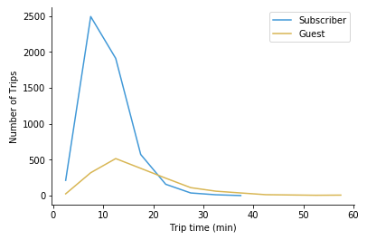

To use a line chart, data often needs to be aggregated into a table with
two or more columns. Values in the first column indicate positions for
points on the horizontal axis for each line to be plotted. Each
following column indicates the vertical position for points of a single
line.

```{r}
library(gapminder)
library(dplyr)
#gapminder


gapminder %>%
filter(country == "Chile") 
```

### 5.1.3. Choose an appropriate measurement interval

An important aspect of creating a line chart is selecting the right
interval or bin size. For temporal data, a too-broad of a measurement
interval may mean that it takes too long to see where the data trend is
leading, hiding away the useful signal. On the flip side of the coin, a
too-short a measurement interval may only reveal noise rather than
signal.

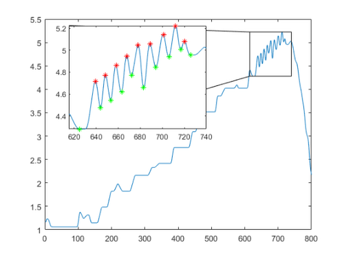

### 5.1.4. Don't plot too many lines

While there is the technical capacity to put many lines onto a single
line chart, it is a good idea to be judicious in the amount of data that
you plot. A good rule of thumb is to limit yourself to five or fewer
lines.

If you find the need to plot more lines than can be read in a single
axis, then you might consider faceting the plots into a grid of smaller
line charts. It will be more difficult to see details in these plots, so
it's a good idea to sort them by some important characteristic (like
average or final value) to help draw out important points. If you are
using a tool that allows for interactive plots.

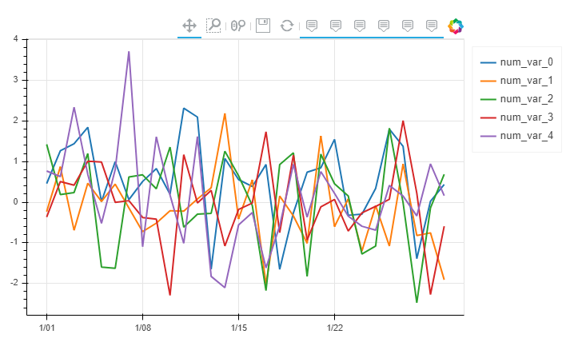

### 5.1.5. Strictly using a zero-value baseline

Despite the zero baseline for the vertical axis being a requirement for
bar charts and histograms, you do not need to include a zero baseline
for a line chart. Recall that the main goal of a line chart is to
emphasize changes in value, rather than the magnitude of the values
themselves. In cases where a zero line is not meaningful or useful, it's
fine to zoom the vertical axis range into what will make the changes in
value most informative.

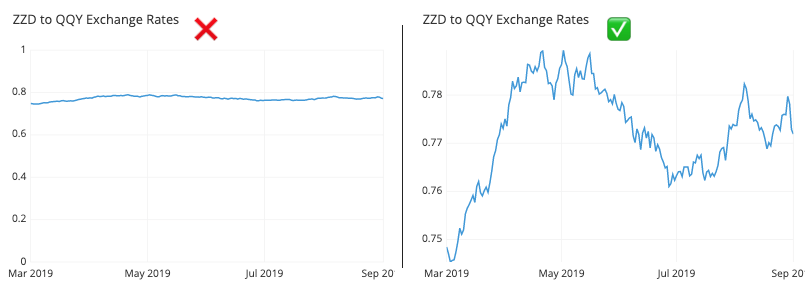

### 5.1.6. Failing to identify uneven gaps between points

When the line chart is missing information for certain bins, gaps in the
record may be interpreted as phantom values if the line does not include
distinct dots at each observation. When there aren't many points to
plot, try showing all of the points and not just the line. If including
the points would muddy up the interpretability of the plot, another
alternative is to include a gap in the line to show where there are
missing values.

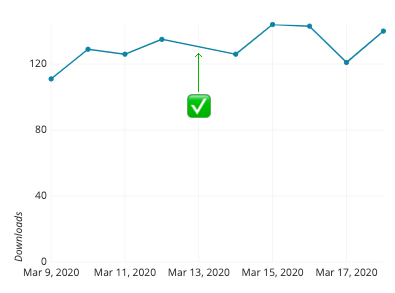

### 5.1.7. Using a misleading dual axis

Examples of line charts with multiple lines have thus far had each line
be part of the same domain, and thus plottable on the same axis. There's
nothing that limits each line to depict values on the same units,
however. When a line plot includes two series, each depicting a summary
of a different variable, then we end up with a dual axis plot.

The problem with a dual-axis plot is that it can easily be manipulated
to be misleading. Depending on how each axis is scaled, the perceived
relationship between the two lines can be changed.

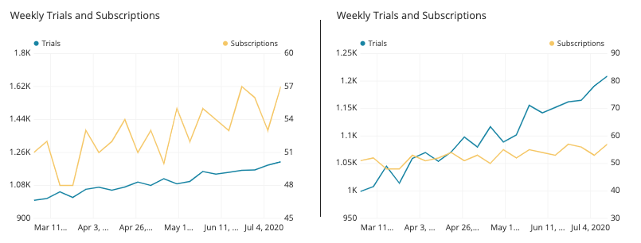

Instead, faceting the two lines into separate plots still allows for the
general patterns of change to be observed for both variables, while
reducing the temptations to compare them in misleading ways.

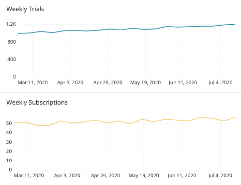

### 5.1.8. let us go back to the code in R!

```{r}
library(ggplot2)
library(gapminder)
library(dplyr)


by_year_continent <- gapminder %>%
  group_by(continent, year) %>%
  summarize(medianGdpPercap = median(gdpPercap))

by_year_continent


ggplot(by_year_continent, aes(x = year, y = medianGdpPercap, color = continent)) +
geom_point() +
expand_limits(y = 0)
```

```{r}
library(ggplot2)
library(gapminder)
library(dplyr)


by_year_continent <- gapminder %>%
  group_by(continent, year) %>%
  summarize(medianGdpPercap = median(gdpPercap))

ggplot(by_year_continent, aes(x = year, y = medianGdpPercap, color = continent)) +
geom_line() +
#geom_point() +
expand_limits(y = 0) 
```

it's a bit easier to understand as a line plot, where the observations
within each continent are connected. This makes it clearer that what we
care about is the upward or downward trend over time.

```{r}
by_year <- gapminder %>%
group_by(year) %>%
summarise(medianGdpPercap = median(gdpPercap))

ggplot(by_year, aes(x = year, y = medianGdpPercap)) +
geom_line() +
expand_limits(y = 0)
```

```{r}
by_year_continent <- gapminder %>%
group_by(year, continent) %>%
summarise(LifeExp = mean(lifeExp))


ggplot(by_year_continent, aes(x = year, y = LifeExp, color = continent)) +
geom_line() 
#expand_limits(y = 0)
```

```{r}
a1 <- gapminder %>%
filter(continent == "Americas") %>%
select(country, year, pop)


ggplot(a1, aes(x = year, y = pop, color = country)) +
geom_line() +
expand_limits(y = 0)

```

## 5.2. Bar plots

Bar plots, which are good at comparing statistics for each of several
categories.

### 5.2.1. What is a bar plot?

A bar chart (aka bar graph, column chart) plots numeric values for
levels of a categorical feature as bars. Levels are plotted on one chart
axis, and values are plotted on the other axis. <b>Each categorical
value claims one bar, and the length of each bar corresponds to the
bar's value. Bars are plotted on a common baseline to allow for easy
comparison of values.

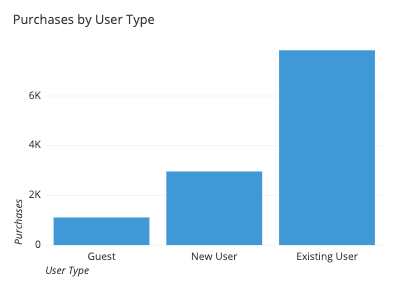

### 5.2.2. When you should use a bar chart?

A bar chart is used when you want to show a distribution of data points
or perform a comparison of metric values across different subgroups of
your data. From a bar chart, we can see which groups are highest or most
common, and how other groups compare against the others. Since this is a
fairly common task, bar charts are a fairly ubiquitous chart type.

The primary variable of a bar chart is its categorical variable. A
categorical variable takes discrete values, which can be thought of as
labels. Examples include state or country, industry type, website access
method (desktop, mobile), and visitor type (free, basic, premium). Some
categorical variables have ordered values, like dividing objects by size
(small, medium, large). In addition, some non-categorical variables can
be converted into groups, like aggregating temporal data based on date
(eg. dividing by quarter into 20XX-Q1, 20XX-Q2, 20XX-Q3, 20XX-Q4, etc.)
The important point for this primary variable is that the groups are
distinct.

In contrast, the secondary variable will be numeric in nature. The
secondary variable's values determine the length of each bar. These
values can come from a great variety of sources. In its simplest form,
the values may be a simple frequency count or proportion for how much of
the data is divided into each category. Other times, the values may be
an average, total, or some other summary measure computed separately for
each group.

### 5.2.3. Example of data structure

Data rendered as a bar chart might come in a compact form like the above
table, with one column for the categories and the second column for
their values.

```{r}
america <- gapminder %>%
filter(continent == "Americas") %>%
group_by(country) %>%
summarise(averagepop = mean(pop)) 

america
```

Other times, data may come in its unaggregated form...

```{r}
america <- gapminder %>%
filter(continent == "Americas") %>%
group_by(country) %>%
select(country, pop)

america
```

### 5.2.4. Use a common zero-valued baseline

First and foremost, make sure that all of your bars are being plotted
against a zero-value baseline. Not only does that baseline make it
easier for readers to compare bar lengths, it also maintains the
truthfulness of your data visualization. A bar chart with a non-zero
baseline or some other gap in the axis scale can easily misrepresent the
comparison between groups since the ratio in bar lengths will not match
the ratio in actual bar values.

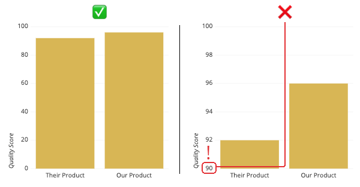


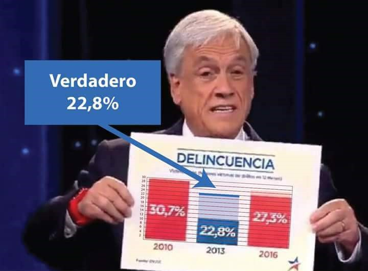

### 5.2.5. Consider the ordering of category levels

One consideration you should have when putting together a bar chart is
what order in which you will plot the bars. A standard convention to
take is to sort the bars from longest to shortest: while it is always
possible to compare the bar lengths no matter the order, this can reduce
the burden on the reader to make those comparisons themselves. The major
exception to this is if the category labels are inherently ordered in
some way.

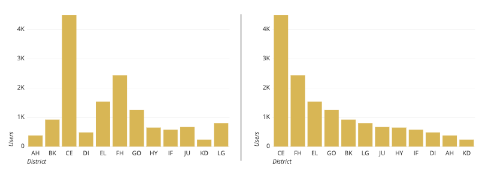

### 5.2.6. Use color wisely

Another consideration is on how you should use color in your bar charts.
Certain tools will color each bar differently by default, but this can
distract the reader by implying additional meaning where none exists.
Instead, color should be used with purpose. For example, you might use
color to highlight specific columns for storytelling. Colors can also be
used if they are meaningful for the categories posted (e.g. to match
company or team colors).

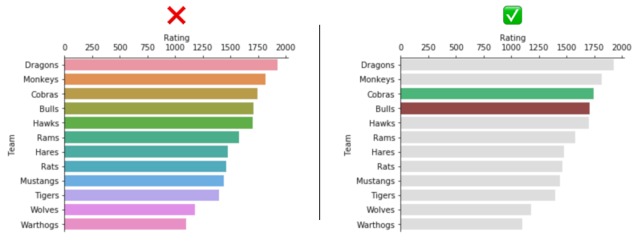

### 5.2.7. Horizontal bars vs. vertical bars

A common bar chart variation is whether or not the bar chart should be
oriented vertically (with categories on the horizontal axis) or
horizontally (with categories on the vertical axis). While the vertical
bar chart is usually the default, it's a good idea to use a horizontal
bar chart when you are faced with long category labels. In a vertical
chart, these labels might overlap, and would need to be rotated or
shifted to remain legible; the horizontal orientation avoids this issue.

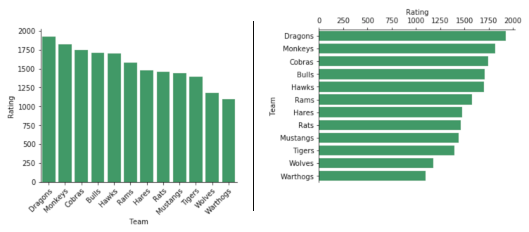

### 5.2.8. Include value annotations

A common addition to bar charts are value annotations. While it is
fairly easy for readers to compare bar lengths and gauge approximate
values from a bar chart, exact values aren't necessarily easy to state.
Annotations can report these values where they are important, and are
usually placed in the middle of the bar or at their ends.

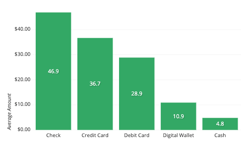

### 5.2.9. Include variability whiskers

When the numeric values are a summary measure, a frequent consideration
is whether or not to include error bars in the plot. Error bars are
additional whiskers added to the end of each bar to indicate variability
in the individual data points that contributed to the summary measure.
Since there are many choices for uncertainty measure (e.g. standard
deviation, confidence interval, interquartile range) it is important
that when you display error bars, that you note in an annotation or
comment what the error bars represent.

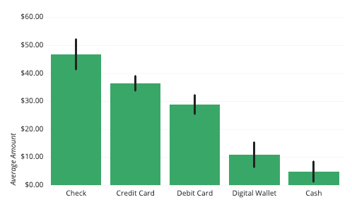

### 5.2.10. let us go back to the code in R!

```{r}
by_continent <- gapminder %>%
filter(year == 2007) %>%
group_by(continent) %>%
summarise(meanLifeExp = mean(lifeExp))

by_continent
```

This code finds the average life expectancy within each continent in the
year 2007. That creates a table that looks like this, with one
observation for each continent. Instead of just printing the table, you
might want to represent the summary visually. For that, you would use a
bar plot.

```{r}
ggplot(by_continent, aes(x= continent, y = meanLifeExp)) +
geom_col()
```

```{r}
by_continent1 <- gapminder %>%
filter(year == 2007) %>%
group_by(continent) %>%
summarise(medianGdpPercap = median(gdpPercap), 
          meanGdpPercap = mean(gdpPercap))

#by_continent1

ggplot(by_continent1, aes(x= continent, y = medianGdpPercap)) +
geom_col(fill="#7ABE6F") + 
  coord_flip()

#ggplot(by_continent1, aes(x= continent, y = meanGdpPercap, fill=continent)) +
#geom_col()+ coord_flip()
```

```{r}
oceania <- gapminder %>%
filter(continent == "Oceania") %>%
group_by(country) %>%
summarise(meanGdpPercap = mean(gdpPercap), 
          sdGdpPercap = sd(gdpPercap))

oceania

# Create a bar plot with labels
#ggplot(oceania, aes(x= country, y = meanGdpPercap, fill = country)) +
#geom_col() +
#geom_label(aes(x=country, label=meanGdpPercap))
#geom_text(aes(label = meanGdpPercap), vjust = -1) 

# Create a bar plot with errors
ggplot(oceania, aes(x= country, y = meanGdpPercap, fill = country)) +
geom_col() +
geom_errorbar(aes(ymin=meanGdpPercap-sdGdpPercap, 
                  ymax=meanGdpPercap+sdGdpPercap), 
                  width=.1,
                 position=position_dodge(.9)) 

```

```{r}
?geom_label
```

```{r}
america <- gapminder %>%
filter(year == 2007, continent == "Americas") 


# Create a bar plot of gdpPercap by country
ggplot(america, aes(x= country, y = gdpPercap)) +
geom_col(fill = "blue") + 
coord_flip() +
theme(axis.text = element_text(size = 10))
```

```{r}
#Sorting????

america2 <- gapminder %>%
filter(year == 2007, continent == "Americas") %>%
arrange(gdpPercap)

america2

# Create a bar plot of gdpPercap by country
ggplot(america2, aes(x= country, y = gdpPercap)) +
geom_col(fill = "black") + 
coord_flip()  +
theme(axis.text = element_text(size = 15))
```

```{r}
#Now is sorted

america3 <- gapminder %>%
filter(year == 2007, continent == "Americas")

america3

# Create a bar plot of gdpPercap by country
ggplot(america3, aes(x= reorder(country, gdpPercap), y = gdpPercap)) +
geom_col(fill = "red") + 
coord_flip()  +
theme(axis.text = element_text(size = 10))
```

```{r}
?reorder
```

## 5.3. Stacked Bar plots

### What is a stacked bar chart?

The stacked bar chart (aka stacked bar graph) extends the standard bar
chart from looking at numeric values across two or more categorical
variables. Each bar in a standard bar chart is divided into a number of
sub-bars stacked end to end, each one corresponding to a level of the
second categorical variable.

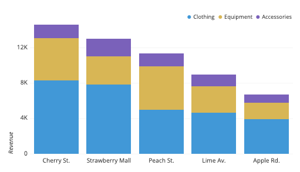

The stacked bar chart above depicts revenue from a fictional fitness
retailer for a particular period of time, across two categorical
variables: store location and department. The primary categorical
variable is store location: we can see from the sorted overall bar
heights that the Cherry St. location has the highest revenue and Apple
Rd. lowest. Each bar is subdivided based on levels of the second
categorical variable, department. We can see that for most locations,
clothing is quite a bit larger in sales than equipment, which in turn is
larger than accessories. The Strawberry Mall location appears to have a
lower proportion of revenue attributed to equipment, while equipment has
a larger share for Peach St.

### 5.3.1. When you should use a stacked bar chart

The main objective of a standard bar chart is to compare numeric values
between levels of a categorical variable. One bar is plotted for each
level of the categorical variable, each bar's length indicating numeric
value. A stacked bar chart also achieves this objective, but also
targets a second goal.

We want to move to a stacked bar chart when we care about the relative
decomposition of each primary bar based on the levels of a second
categorical variable. Each bar is now comprised of a number of sub-bars,
each one corresponding with a level of a secondary categorical variable.
The total length of each stacked bar is the same as before, but now we
can see how the secondary groups contributed to that total.

### 5.3.2. Order of categorical variables

One important consideration in building a stacked bar chart is to decide
which of the two categorical variables will be the primary variable
(dictating major axis positions and overall bar lengths) and which will
be the secondary (dictating how each primary bar will be subdivided).
The most 'important' variable should be the primary; use domain
knowledge and the specific type of categorical variables to make a
decision on how to assign your categorical variables. As another
consideration, variables with more levels are generally better as
primary variables; we want to limit the number of secondary levels to a
fairly small amount to make the stack breakdowns easier to read.

### 5.3.3. Maintain a zero-baseline

When a standard bar chart encounters a negative value, the corresponding
bar just gets plotted below or to the left of the baseline (depending on
if the bars are vertically or horizontally oriented, respectively). In a
stacked bar chart, a similar representation can be performed, just
stacking bars in the negative direction.

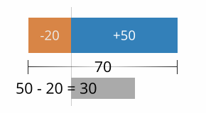

However, when positive bars and negative bars are combined, it is no
longer the case that the overall length of the bar corresponds to the
bar's total value. When this occurs, it is a good idea to plot an
additional line or series of points on top of the bars to show the true
total: the difference between the lengths of the positive bars and
negative bars.

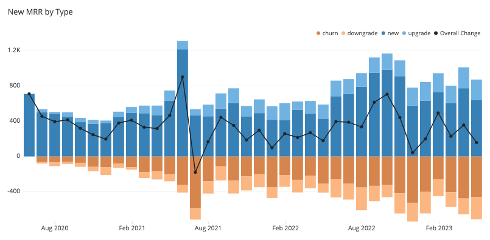

### 5.3.4. Ordering of category levels

With a stacked bar chart, you will need to consider the order of
category levels for both categorical variables to be plotted. The rule
of thumb for standard bar charts can be applied in both variables: order
the bars from largest to smallest unless there is an intrinsic order of
levels.

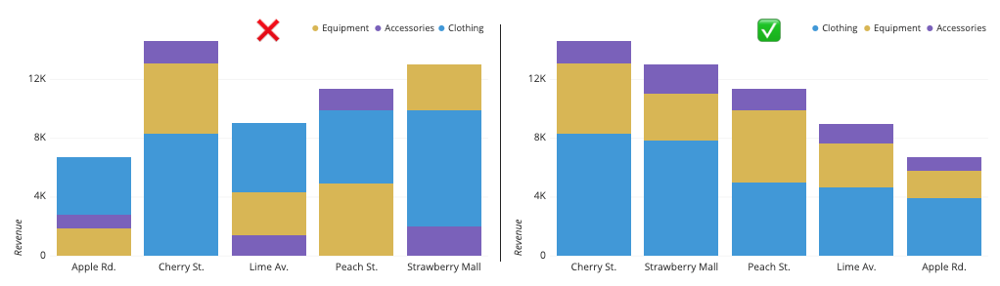

### 5.3.5. Choosing effective colors

While the general recommendation is to stick with a single color in a
standard bar chart, use of color to distinguish secondary variable
levels is an inevitability for a stacked bar chart. The important point
is to make sure that the choice of color palette to assign to each
categorical level matches the variable type: a qualitative palette for
purely categorical variables, and sequential, or diverging for variables
with a meaningful order.

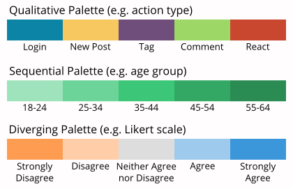

### 5.3.6. Interpreting values on individual groups in a stacked area chart

While it is straightforward to compare the total numeric values across
the levels of the primary categorical variable, it is less
straightforward to gauge other divisions or comparisons using the
secondary categorical variable. If we want to see the change in a
secondary level across the primary categorical variable, this can only
be easily done for the level plotted against the baseline. For all other
secondary levels, their baseline will experience shifts, making it more
difficult to judge how the sub-bar lengths change across primary bars.
In the below example, it can be difficult to tell that the central
yellow group is actually decreasing slightly over time.

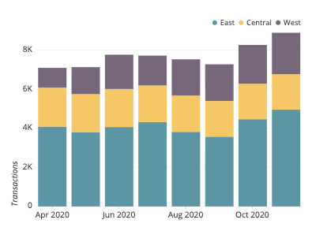

Even trying to compare sub-bars within each primary bar can be
difficult. Even when following a guideline to sort secondary category
levels by overall size, this presents no guarantee that they will be
sorted by size within a particular primary bar. In the same image above,
it can be hard to tell where the purple "West" group overtakes the
yellow "Central" group in size.

Keep in mind that one of the standard goals of a stacked bar chart is to
make relative judgements about the secondary categorical variable, and
that making precise judgments are not as important. If comparing the
sub-groups is important, then a different chart type like the <b>line
chart</b> or <b>grouped bar chart</b> is warranted.

### 5.3.7. Common stacked bar chart options

#### 5.3.7.1. Horizontal stacked bar chart

Just like the standard bar chart, the bars in a stacked bar chart can be
oriented horizontally (with primary categories on the vertical axis) as
well as vertically (with primary categories on the horizontal axis). The
horizontal orientation serves the same benefits as before, allowing for
the easy display of long category levels without rotation or truncation.

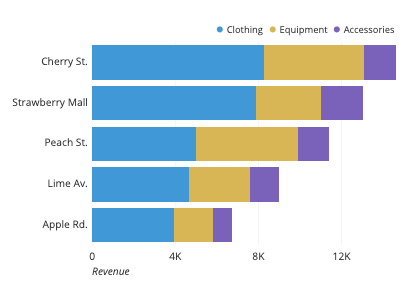

#### 5.3.7.2. Percentage stacked bar chart

Another common option for stacked bar charts is the percentage, or
relative frequency, stacked bar chart. Here, each primary bar is scaled
to have the same height, so that each sub-bar becomes a percentage
contribution to the whole at each primary category level. This removes
our ability to compare the primary category levels' totals, but allows
us to perform a better analysis of the secondary groups' relative
distributions. The fixing of the heights of each primary bar to be the
same also creates another baseline at the top of the chart where a
second subgroup can be tracked across primary bars.

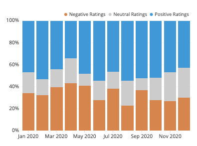

```{r}
Americas <- gapminder %>%
filter(continent == "Americas", year >= 1997, year <= 2007) 

#Americas

# Create a bar plot with labels
ggplot(Americas, aes(x= country, y = lifeExp, fill = year)) +
geom_bar(position = "fill", stat = "identity") +
coord_flip()  +
theme(axis.text = element_text(size = 15))

```

#### 5.3.7.3.Stacked bar

```{r}
Americas <- gapminder %>%
filter(continent == "Americas", year >= 2002, year <= 2007) 

#Americas

# Create a bar plot with labels
ggplot(Americas, aes(x= year, y = lifeExp, fill = country)) +
geom_bar(position = "stack", stat = "identity") +
coord_flip()  +
theme(axis.text = element_text(size = 15))
```

This plot sucks cause there are too many levels in the secondary
category!. A better way is:

```{r}
Americas <- gapminder %>%
filter(continent == "Americas", year >= 1997, year <= 2007) 

#Americas

# Create a bar plot with labels
ggplot(Americas, aes(x= country, y = lifeExp, fill = year)) +
geom_bar(position = "stack", stat = "identity") +
coord_flip()  +
theme(axis.text = element_text(size = 15))
```

#### 5.3.7.4. Grouped stack bar

A grouped bar chart (aka clustered bar chart, multi-series bar chart)
extends the bar chart, plotting numeric values for levels of two
categorical variables instead of one. Bars are grouped by position for
levels of one categorical variable, with color indicating the secondary
category level within each group.

```{r}

Americas <- gapminder %>%
filter(continent == "Americas", year >= 1997, year <= 2007) 

#Americas

# Create a bar plot with labels
ggplot(Americas, aes(x= country, y = lifeExp, fill = year)) +
geom_bar(position = position_dodge(), stat = "identity") +
coord_flip()  +
theme(axis.text = element_text(size = 15))
```

The plot dont work cause the year variable must be categorical (factor),
for this:

```{r}
library(gapminder)
library(ggplot2)
library(dplyr)

Americas <- gapminder %>%
filter(continent == "Americas", year >= 1997, year <= 2007) 

#Americas

# Create a bar plot with labels
ggplot(Americas, aes(x= country, y = lifeExp, fill = as.factor(year))) +
geom_bar(position = position_dodge(), stat = "identity") +
coord_flip()  +
theme(axis.text = element_text(size = 15))
```

## 5.4 Histograms

Histograms, which describe the distribution of a one-dimensional numeric
variable.

### 5.4.1. What is a histogram?

A histogram is a chart that plots the distribution of a numeric
variable's values as a series of bars. Each bar typically covers a range
of numeric values called a bin or class; a bar's height indicates the
frequency of data points with a value within the corresponding bin.

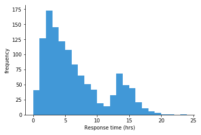

### 5.4.2. When you should use a histogram?

Histograms are good for showing general distributional features of
dataset variables. You can see roughly where the peaks of the
distribution are, whether the distribution is skewed or symmetric, and
if there are any outliers.

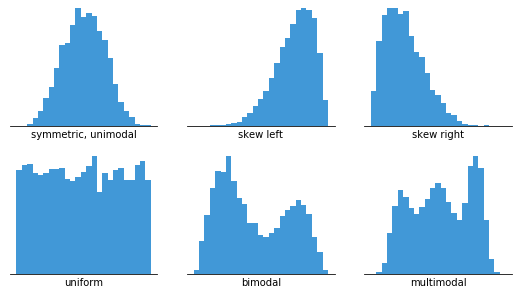

In order to use a histogram, we simply require a variable that takes
continuous numeric values. This means that the differences between
values are consistent regardless of their absolute values. For example,
even if the score on a test might take only integer values between 0 and
100, a same-sized gap has the same meaning regardless of where we are on
the scale: the difference between 60 and 65 is the same 5-point size as
the difference between 90 to 95.

Information about the number of bins and their boundaries for tallying
up the data points is not inherent to the data itself. Instead, setting
up the bins is a separate decision that we have to make when
constructing a histogram. The way that we specify the bins will have a
major effect on how the histogram can be interpreted

### 5.4.3. Example of data structure

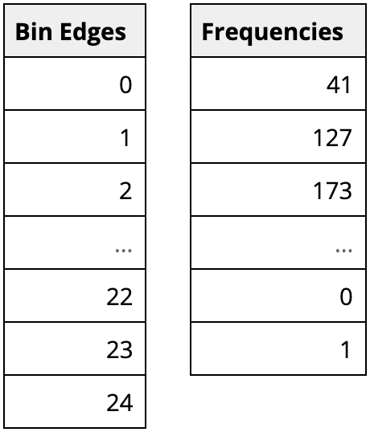

One way that visualization tools can work with data to be visualized as
a histogram is from a summarized form like above. Here, the first column
indicates the bin boundaries, and the second the number of observations
in each bin. Alternatively, certain tools can just work with the
original, unaggregated data column, then apply specified binning
parameters to the data when the histogram is created.

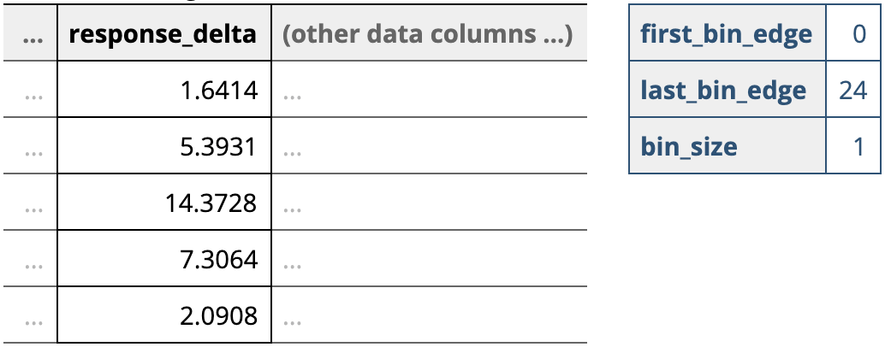

### 5.4.4. Use a zero-valued baseline

An important aspect of histograms is that they must be plotted with a
zero-valued baseline. Since the frequency of data in each bin is implied
by the height of each bar, changing the baseline or introducing a gap in
the scale will skew the perception of the distribution of data.

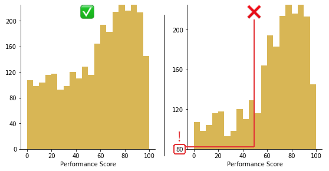

### 5.4.5. Choose an appropriate number of bins

While tools that can generate histograms usually have some default
algorithms for selecting bin boundaries, you will likely want to play
around with the binning parameters to choose something that is
representative of your data.

Choice of bin size has an inverse relationship with the number of bins.
The larger the bin sizes, the fewer bins there will be to cover the
whole range of data. With a smaller bin size, the more bins there will
need to be. It is worth taking some time to test out different bin sizes
to see how the distribution looks in each one, then choose the plot that
represents the data best. If you have too many bins, then the data
distribution will look rough, and it will be difficult to discern the
signal from the noise. On the other hand, with too few bins, the
histogram will lack the details needed to discern any useful pattern
from the data.

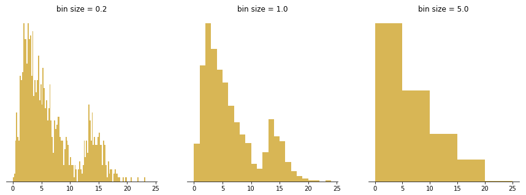

### 5.4.6. Measured variable is not continuous numeric

As noted in the opening sections, a histogram is meant to depict the
frequency distribution of a continuous numeric variable. When our
variable of interest does not fit this property, we need to use a
different chart type instead: a bar chart. A variable that takes
categorical values, like user type (e.g. guest, user) or location are
clearly non-numeric, and so should use a bar chart. However, there are
certain variable types that can be trickier to classify: those that take
on discrete numeric values and those that take on time-based values.

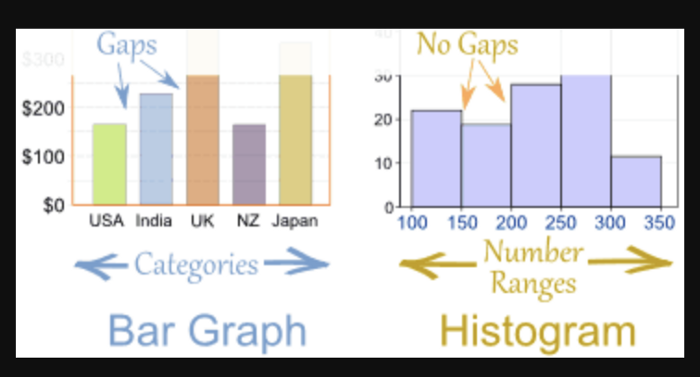

### 5.4.7. Using unequal bin sizes

When data is sparse, such as when there's a long data tail, the idea
might come to mind to use larger bin widths to cover that space.
However, creating a histogram with bins of unequal size is not strictly
a mistake, but doing so requires some major changes in how the histogram
is created and can cause a lot of difficulties in interpretation.

The technical point about histograms is that the total area of the bars
represents the whole, and the area occupied by each bar represents the
proportion of the whole contained in each bin. When bin sizes are
consistent, this makes measuring bar area and height equivalent. In a
histogram with variable bin sizes, however, the height can no longer
correspond with the total frequency of occurrences. Doing so would
distort the perception of how many points are in each bin, since
increasing a bin's size will only make it look bigger.

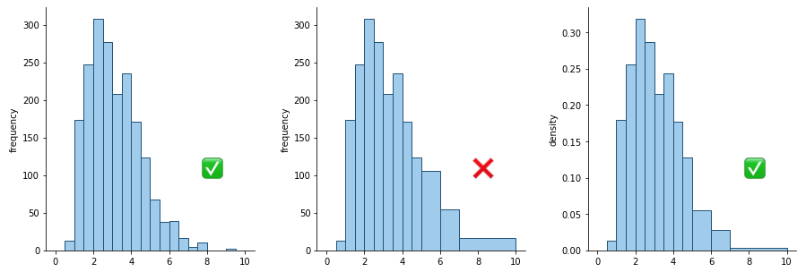

### 5.4.8. let us go back to the code in R!

```{r}
library(ggplot2)
library(gapminder)
library(dplyr)


ggplot(gapminder, aes(x = lifeExp)) +
geom_histogram(fill = "black")+
theme(axis.text = element_text(size = 15))
```

```{r}
library(gapminder)
gapminder
```

```{r}
library(dplyr)
library(gapminder)
library(ggplot2)

gapminder_1952 <- gapminder %>%
  filter(year == 1952)

# Create a histogram of population (pop_by_mil)
ggplot(gapminder_1952, aes(x = lifeExp)) +
geom_histogram(fill = "black", bins = 15) +
theme(axis.text = element_text(size = 15)) 
#scale_x_log10() 
```

```{r}
gapminder_2007 <- gapminder %>%
  filter(year == 2007)

# Create a histogram of population (pop_by_mil)
ggplot(gapminder_2007, aes(x = lifeExp)) +
geom_histogram(fill = "black", bins = 20)
```

```{r}
library(dplyr)
library(ggplot2)
library(gapminder)
gapminder_2007 <- gapminder %>%
  filter(year == 2007)

# Create a histogram of population (pop_by_mil)
ggplot(gapminder_2007, aes(x = lifeExp)) +
geom_histogram(bins = 30, fill = "black" ) +
theme(axis.text = element_text(size = 15))
```

```{r}
gapminder_1952 <- gapminder %>%
  filter(year == 1952)

# Create a histogram of population (pop), with x on a log scale
ggplot(gapminder_1952, aes(x = pop)) +
geom_histogram(fill = "black") +
theme(axis.text = element_text(size = 15))
```

```{r}
gapminder_1952 <- gapminder %>%
  filter(year == 1952)

# Create a histogram of population (pop), with x on a log scale
ggplot(gapminder_1952, aes(x = pop)) +
geom_histogram(fill = "black")+
scale_x_log10() +
theme(axis.text = element_text(size = 15),  
      axis.title.x = element_text(size = 16), 
      axis.title.y = element_text(size = 16))
```

## 5.5. Box plots

Box plots, which compare the distribution of a numeric variable among
several categories.

### 5.5.1. What is a box plot?

A box plot (aka box and whisker plot) uses boxes and lines to depict the
distributions of one or more groups of numeric data. Box limits indicate
the range of the central 50% of the data, with a central line marking
the median value. Lines extend from each box to capture the range of the
remaining data, with dots placed past the line edges to indicate
outliers.

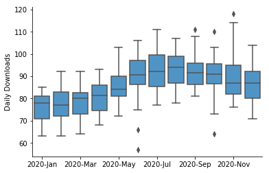

The example box plot above shows daily downloads for a fictional digital
app, grouped together by month. From this plot, we can see that
downloads increased gradually from about 75 per day in January to about
95 per day in August. There also appears to be a slight decrease in
median downloads in November and December. Points show days with outlier
download counts: there were two days in June and one day in October with
low downloads compared to other days in the month. The box and whiskers
plot provides a cleaner representation of the general trend of the data,
compared to the equivalent line chart.

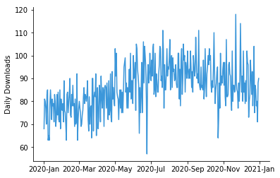

### 5.5.2. When you should use a box plot

Box plots are used to show distributions of numeric data values,
especially when you want to compare them between multiple groups. They
are built to provide high-level information at a glance, offering
general information about a group of data's symmetry, skew, variance,
and outliers. It is easy to see where the main bulk of the data is, and
make that comparison between different groups.

On the downside, a box plot's simplicity also sets limitations on the
density of data that it can show. With a box plot, we miss out on the
ability to observe the detailed shape of distribution, such as if there
are oddities in a distribution's modality (number of 'humps' or peaks)
and skew.

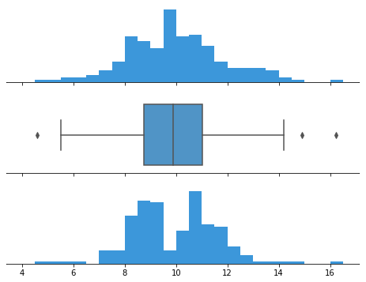

### 5.5.3. Interpreting a box and whiskers

Construction of a box plot is based around a dataset's quartiles, or the
values that divide the dataset into equal fourths. The <b>first quartile
(Q1)</b> is greater than 25% of the data and less than the other 75%.
The <b>second quartile (Q2)</b> sits in the middle, dividing the data in
half. Q2 is also known as the <b>median</b>. The <b>third quartile
(Q3)</b> is larger than 75% of the data, and smaller than the remaining
25%. In a box and whiskers plot, the ends of the box and its center line
mark the locations of these three quartiles.

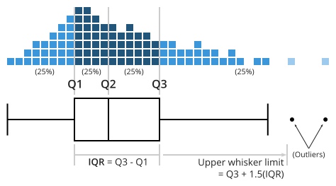

The distance between Q3 and Q1 is known as the interquartile range (IQR)
and plays a major part in how long the whiskers extending from the box
are. Each whisker extends to the furthest data point in each wing that
is within 1.5 times the IQR. Any data point further than that distance
is considered an outlier, and is marked with a dot. There are other ways
of defining the whisker lengths, which are discussed below.

<https://muse.union.edu/dvorakt/what-drives-the-length-of-whiskers-in-a-box-plot/>

<https://towardsdatascience.com/why-1-5-in-iqr-method-of-outlier-detection-5d07fdc82097>

When a data distribution is symmetric, you can expect the median to be
in the exact center of the box: the distance between Q1 and Q2 should be
the same as between Q2 and Q3. Outliers should be evenly present on
either side of the box. If a distribution is skewed, then the median
will not be in the middle of the box, and instead off to the side. You
may also find an imbalance in the whisker lengths, where one side is
short with no outliers, and the other has a long tail with many more
outliers.

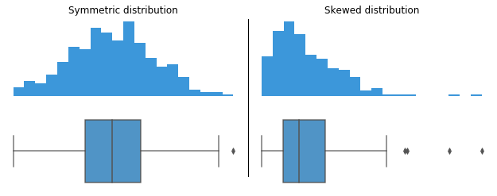

### 5.5.4. Consider the order of groups

If the groups plotted in a box plot do not have an inherent order, then
you should consider arranging them in an order that highlights patterns
and insights. One common ordering for groups is to sort them by median
value.

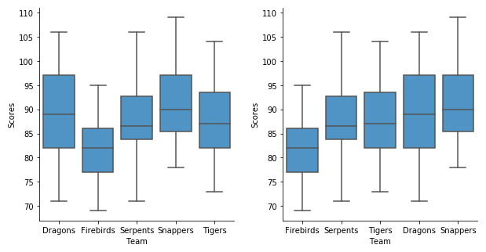

```{r}
library(gapminder)
library(ggplot2)
library(dplyr)

ggplot(gapminder, aes(x = continent, y = lifeExp, fill = continent)) + 
geom_boxplot() + 
theme(axis.text = element_text(size = 16),  
      axis.title.x = element_text(size = 16), 
      axis.title.y = element_text(size = 16),
#      legend.title = element_text(size = 16),
     legend.text = element_text(size = 16)) +
scale_y_log10()
```

```{r}
gapminder_1952 <- gapminder %>%
  filter(year == 1952)

# Create a boxplot comparing gdpPercap among continents
ggplot(gapminder_1952, aes(x = continent, y = gdpPercap, fill = continent)) + 
geom_boxplot() + 
theme(axis.text = element_text(size = 16),  
      axis.title.x = element_text(size = 16), 
      axis.title.y = element_text(size = 16),
     legend.title = element_text(size = 16),
     legend.text = element_text(size = 16)) 
```

```{r}
gapminder_1952 <- gapminder %>%
  filter(year == 1952)

# Create a boxplot comparing gdpPercap among continents
ggplot(gapminder_1952, aes(x = continent, y = gdpPercap, fill = continent)) + 
geom_boxplot() + 
scale_y_log10() +
theme(axis.text = element_text(size = 16),  
      axis.title.x = element_text(size = 16), 
      axis.title.y = element_text(size = 16),
     legend.title = element_text(size = 16),
     legend.text = element_text(size = 16)) +
  labs(title = "Comparing GDP per capita across continents")
```

<https://r-graph-gallery.com/89-box-and-scatter-plot-with-ggplot2.html>

## 5.6. Violin plot

A violin plot depicts distributions of numeric data for one or more
groups using density curves. The width of each curve corresponds with
the approximate frequency of data points in each region. Densities are
frequently accompanied by an overlaid chart type, such as box plot, to
provide additional information.

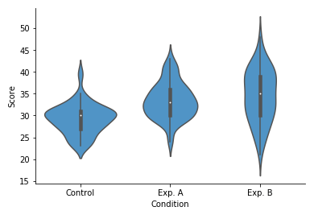

The example violin plot above depicts the results of a fictional
experiment with one control group and two experimental conditions. In
the middle of each density curve is a small box plot, with the rectangle
showing the ends of the first and third quartiles and central dot the
median. We can see from the plot that the two experimental techniques
provided different benefits compared to the control. However, the second
experimental condition (B) has a much more elongated distribution
compared to the other two groups, without a distinct peak. The latter
fact would have been missed with the box plot alone

### 5.6.1. When you should use a violin plot

Violin plots are used when you want to observe the distribution of
numeric data, and are especially useful when you want to make a
comparison of distributions between multiple groups. The peaks, valleys,
and tails of each group's density curve can be compared to see where
groups are similar or different. Additional elements, like box plot
quartiles, are often added to a violin plot to provide additional ways
of comparing groups, and will be discussed below.

### 5.6.2. A brief explanation of density curves

The density curve, aka kernel density plot or kernel density estimate
(KDE), is a less-frequently encountered depiction of data distribution,
compared to the more common histogram. Below, we'll perform a brief
explanation of how density curves are built.

In a KDE, each data point contributes a small area around its true
value. The shape of this area is called the kernel function. Kernels can
take different shapes from smooth bell curves to sharp triangular peaks.
In addition, kernels can have different width, or bandwidth, affecting
the influence of each individual data point. Bandwidth size is usually
determined by using mathematical rules of thumb, but can be tweaked
depending on the shape and skew of the data to be plotted.

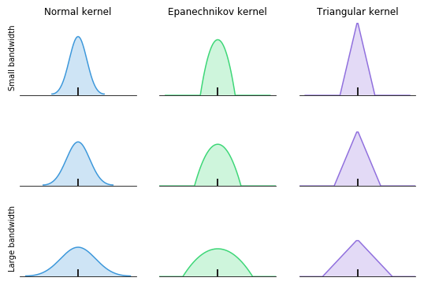

To build the final density curve, the areas for all data points are
stacked up into a complete whole. Each data point has an equivalent
influence on the final distribution. As there are more data points in a
region, the height of the density curve in that area will increase.

Kernel density estimation is best used when a fair amount of data is
available, resulting in more stable density estimates. With few data
points available, it can be easy to be misled by the smoothness of the
curve or the length of the tails past the largest and smallest points.

In a violin plot, individual density curves are built around center
lines, rather than stacked on baselines. Other than this difference in
display pattern, curves in a violin plot follow the exact same
construction and interpretation.

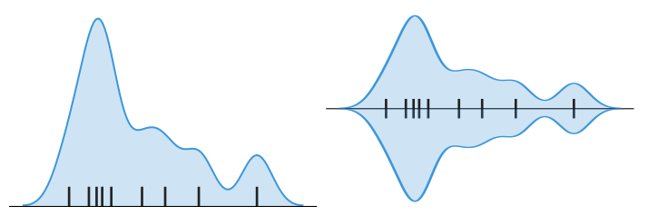

```{r}
library(ggplot2)
library(gapminder)
ggplot(gapminder, aes(x = continent, y = pop, fill = continent)) + 
geom_boxplot() + 
scale_y_log10() +
theme(axis.text = element_text(size = 16),  
      axis.title.x = element_text(size = 16), 
      axis.title.y = element_text(size = 16),
     legend.title = element_text(size = 16),
     legend.text = element_text(size = 16)) +
  geom_jitter(width = 0.1, height = 0.1, colour = "black")
```

```{r}
ggplot(gapminder, aes(x = continent, y = pop, fill = continent))  + 
geom_violin() + 
scale_y_log10() +
geom_boxplot(width=0.1, color="black", alpha=0.2) +
theme(axis.text = element_text(size = 16),  
      axis.title.x = element_text(size = 16), 
      axis.title.y = element_text(size = 16),
     legend.title = element_text(size = 16),
     legend.text = element_text(size = 16)) 

```


```{r}
#install.packages("ggdist")
```

```{r}
library(ggdist)
```

```{r}
ggplot(gapminder_2007, aes(x = continent, y = pop)) + 
  ## add half-violin from {ggdist} package
  ggdist::stat_halfeye(
    ## custom bandwidth
    adjust = .5, 
    ## adjust height
    width = .6, 
    ## move geom to the right
    justification = -.2, 
    ## remove slab interval
    .width = 0, 
    point_colour = NA
  ) + 
  geom_boxplot(
    width = .12, 
    ## remove outliers
    outlier.color = NA ## `outlier.shape = NA` works as well
  ) +
  ## add dot plots from {ggdist} package
  ggdist::stat_dots(
    ## orientation to the left
    side = "left", 
    ## move geom to the left
    justification = 1.1, 
    ## adjust grouping (binning) of observations 
    binwidth = .25
  ) + 
  ## remove white space on the left
  coord_cartesian(xlim = c(1.2, NA))
```

<https://www.cedricscherer.com/2021/06/06/visualizing-distributions-with-raincloud-plots-and-how-to-create-them-with-ggplot2/>

## 5.7. Pie plots

### 5.7.1. What is a pie chart?

A pie chart shows how a total amount is divided between levels of a
categorical variable as a circle divided into radial slices. Each
categorical value corresponds with a single slice of the circle, and the
size of each slice (both in area and arc length) indicates what
proportion of the whole each category level takes.


The pie chart above depicts the distribution of votes for a fictional
election for a small city. We can see that Reyes, represented by the
first blue slice, has just less than half of the votes. Chu (yellow) is
in second, with about a third of the votes, while Williams (purple) is
last, with about a fifth of the votes. The annotations in the upper
right give us a more precise judgment of the proportions, but the pie
chart tells the overarching story of where the votes fell.

### 5.7.2. When you should use a pie chart

Pie charts have a fairly narrow use-case that is encapsulated
particularly well by its definition. In order to use a pie chart, you
must have some kind of whole amount that is divided into a number of
distinct parts. Your primary objective in a pie chart should be to
compare each group's contribution to the whole, as opposed to comparing
groups to each other. If the above points are not satisfied, the pie
chart is not appropriate, and a different plot type should be used
instead.

The values that comprise a whole and the categories that divide the
whole generally come in two major varieties. First of all, is when the
'whole' represents a total count. Examples of this include votes in an
election divided by candidate, or number of transactions divided by user
type (e.g. guest, new user, existing user).


Data for a pie chart can be summarized in a table like the above, where
the first column indicates a category, and the second the proportion,
frequency, or amount of that category. Usually, the total does not need
to be specified separately unless it is to be listed somewhere else on a
generated figure.

### 5.7.3. Best practices for using a pie chart

#### 5.7.3.1. Include annotations

It is actually very difficult to discern exact proportions from pie
charts, outside of small fractions like 1/2 (50%), 1/3 (33%), and 1/4
(25%). Furthermore, if the slice values are meant to depict amounts
rather than proportions, pie charts typically lack the tick marks to
allow for estimation of values directly from slice sizes. It is for
these reasons that annotations are a standard inclusion for pie charts.

#### 5.7.3.2. Consider the order of slices

A good order for slices can make it much easier for a reader to
understand what the plot is saying. A typical ordering goes from the
largest slice to the smallest slice, very useful when there are
categories with very similar values. However, if the category levels
have an inherent ordering, then plotting slices in that order is usually
better.

#### 5.7.3.3. Limit the number of pie slices

Pie charts with a large number of slices can be difficult to read. It
can be difficult to see the smallest slices, and it can be difficult to
choose enough colors to make all of the slices distinct. Recommendations
vary, but if you have more than about five categories, you might want to
think about using a different chart type. As another option, you might
consider lumping small slices into a single 'other' slice, colored in a
neutral gray.


#### 5.7.3.4. Avoid distorting effects

Reading a pie chart accurately requires that the slices' areas, arc
lengths, and angles all point to an accurate representation of the data.
While avoiding 3-d effects is a good idea for any plot, it is especially
important for pie charts. Squashing or stretching the circle or adding
unnecessary depth can easily distort how large each slice compares to
the whole.

Another distortion can come from the 'exploded' pie chart, where slices
are pulled out from the center for emphasis. This emphasis comes with a
cost, where the gaps can make it more difficult to actually gauge the
part-to-whole comparison.


#### 5.7.3.5. Fitting a pie to incompatible data

One of the most common mistakes with using a pie chart is to fit it to
data that does not represent a parts-to-whole comparison. This confusion
occurs most often when the values to be plotted are percentages or
proportions, but don't comprise a complete whole. The example below
shows how frequently the people surveyed used each of four applications,
but since many people used multiple apps, the proportions sum to much
more than 100%.


#### 5.7.3.6. Using pie charts to compare groups to one another

If you want to make comparisons between groups rather than from each
group to the whole, then you are better off with a different chart type.
Even when sorting slices by size, it can be difficult to tell how
different two slices are, especially when they move away from the start
/ end point. In the below example, you might assume that the second
slice is larger than the third due to order, but the corresponding bar
chart actually shows the opposite. The main thing that you can really
say from the pie chart is that both slices are approximately the same
proportions from the whole.


#### 5.7.3.8. Comparing values across multiple pie charts

here may be cases where you will want to compare multiple pies to one
another: for example, comparing user demographic distribution across
multiple years. However, this runs into a similar issue as the previous
section, where you want to compare groups to one another. Even worse,
it's a comparison between pies, so you can't rely on the order of slices
as easily for the comparison. Expressing the data using a different
plot, like stacked bar chart, grouped bar chart, or line chart, is often
a better choice when this kind of group-to-group comparison is desired.


<b>Now it is your turn to put into practice the lessons we have been
learning in this course. Using the gapminder dataset, select two
variables to display as a pie chart

a clue:

```{r}
# Create Data
Prop <- c(3,7,9,1,2)
 
# Make the default Pie Plot
pie(Prop)
```

There is no specific <b>geom</b> to build piechart with <b>ggplot2</b>.
The trick is to build a barplot and use <b>coord_polar</b> to make it
circular. This is why the pie() function described above is probably a
better alternative.

```{r}
# Load ggplot2
library(ggplot2)

# Create Data
data <- data.frame(
  group=LETTERS[1:5],
  value=c(13,7,9,21,2)
)

data 

# Basic piechart
ggplot(data, aes(x="", y=value, fill=group)) +
  geom_bar(stat="identity", width=1, color="white") +
  coord_polar("y", start=0) +
  
  theme_void() # remove background, grid, numeric labels
```

```{r}
# Load ggplot2
library(ggplot2)
library(dplyr)

# Create Data
data <- data.frame(
  group=LETTERS[1:5],
  value=c(13,7,9,21,2)
)

# Compute the position of labels
data <- data %>% 
  arrange(desc(group)) %>%
  mutate(prop = value / sum(data$value) *100) %>%
  mutate(ypos = cumsum(prop)- 0.5*prop )

data
# Basic piechart
ggplot(data, aes(x="", y=prop, fill=group)) +
  geom_bar(stat="identity", width=1, color="black") +
  coord_polar("y", start=0) +
  theme_void() + 
  theme(legend.position="none") +
  
  geom_text(aes(y = ypos, label = group), color = "white", size=6) +
  scale_fill_brewer(palette="Set1")
```

```{r}
library(ggplot2)
 
# Create test data.
data <- data.frame(
  category=c("A", "B", "C"),
  count=c(10, 60, 30)
)
 
# Compute percentages
data$fraction = data$count / sum(data$count)

# Compute the cumulative percentages (top of each rectangle)
data$ymax = cumsum(data$fraction)

# Compute the bottom of each rectangle
data$ymin = c(0, head(data$ymax, n=-1))
 
# Make the plot
ggplot(data, aes(ymax=ymax, ymin=ymin, xmax=4, xmin=3, fill=category)) +
     geom_rect() +
     coord_polar(theta="y") + # Try to remove that to understand how the chart is built initially
     xlim(c(2, 4)) # Try to remove that to see how to make a pie chart

#https://r-graph-gallery.com/128-ring-or-donut-plot.html
```

## 5.8. Heatmap

### 5.8.1 What is a heatmap?

A heatmap (aka heat map) depicts values for a main variable of interest
across two axis variables as a grid of colored squares. The axis
variables are divided into ranges like a bar chart or histogram, and
each cell's color indicates the value of the main variable in the
corresponding cell range.


The example heatmap above depicts the daily precipitation distribution,
grouped by month, and recorded over eleven years in Seattle, Washington.
Each cell reports a numeric count, like in a standard data table, but
the count is accompanied by a color, with larger counts associated with
darker colorings. From the heat map, we can see from the darkest
colorings in the left-most column that most days had no precipitation
across the entire year. The pattern in cell colors across months also
shows that rain is more common in the winter from November to March, and
least common in the summer months of July and August.

### 5.8.2. 2-d density plots

The term heatmap is also used in a more general sense, where data is not
constrained to a grid. For example, tracking tools for websites can be
set up to see how users interact with the site, like studying where a
user clicks, or how far down a page readers tend to scroll.

Every click (or other tracking event) is associated with a position,
which radiates a small amount of numeric value around its location.
These values are totaled together across all events and then plotted
with an associated colormap. The visual language of these tools' output,
associating value with color, is similar to the type of heatmap defined
at the top, just without a grid-based structure. Heatmaps of this type
are sometimes also known as 2-d density plots.


### 5.8.3. When you should use a heatmap

Heatmaps are used to show relationships between two variables, one
plotted on each axis. By observing how cell colors change across each
axis, you can observe if there are any patterns in value for one or both
variables.

The variables plotted on each axis can be of any type, whether they take
on categorical labels or numeric values. In the latter case, the numeric
value must be binned like in a histogram in order to form the grid cells
where colors associated with the main variable of interest will be
plotted.

Cell colorings can correspond to all manner of metrics, like a frequency
count of points in each bin, or summary statistics like mean or median
for a third variable. One way of thinking of the construction of a
heatmap is as a table or matrix, with color encoding on top of the
cells. In certain applications, it is also possible for cells to be
colored based on non-numeric values (e.g. general qualitative levels of
low, medium, high).


Different visualization applications can have different ways of
accepting data for plotting as a heatmap. In one major form, data can be
supplied in the same way it would be naturally displayed as a table. The
first column will hold values for one axis of the heatmap, while the
names of the remaining columns will correspond with bins for the
remaining axis. Values in those columns will be encoded into the heatmap
itself.

The other common form for heatmap data sets it up in a three-column
format. Each cell in the heatmap is associated with one row in the data
table. The first two columns specify the 'coordinates' of the heat map
cell, while the third column indicates the cell's value.


### 5.8.4. Best practices for using a heatmap

#### 5.8.4.1. Choose an appropriate color palette

Color is a core component of this chart type, so it's worth making sure
that you choose an appropriate color palette to match the data. Most
frequently, there will be a sequential color ramp between value and
color, where lighter colors correspond to smaller values and darker
colors to larger values, or vice versa. However, a diverging color
palette may be used when values have a meaningful zero point.

.png)

#### 5.8.4.2. Include a legend

As an associated note, it is generally required for a heatmap to include
a legend for how colors map to numeric values. Since color on its own
has no inherent association with value, a key is vital for viewers to
grasp the values in a heatmap. An exception for including a legend can
come when the absolute association of value to color is not important,
only the relative patterns of data plotted.


#### 5.8.4.3. Show values in cells

There is a lack of precision for mapping color to value, especially
compared to other encodings like position or length. Where possible, it
is a good idea to add cell value annotations to the heatmap as a double
encoding of value.

#### 5.8.4.4. Sort levels by similarity or value

When one or both axis variables in a plot are categorical in nature, it
can be worth considering changing the order in which those axis variable
levels are plotted. If the categories do not have an inherent ordering,
we might want to choose an order that best helps the reader grasp
patterns in the data. A common option is to sort categories by their
average cell value from largest to smallest.


#### 5.8.4.5. Select useful tick marks

For numeric axis variables, choices can be made in how bins are set up
and how they are indicated in the chart. If there are few bins, it is
fine to keep tick marks on each bin like for a categorical axis
variable. However, when there are a lot of bins, a better option is to
plot tick marks between sets of bins to avoid overcrowding. The number
of bins that you should use and how large they are will depend on the
nature of the data, so it can be a good idea to experiment with
different settings.


### 5.8.5. Common heatmap options

#### 5.8.5.1. Clustered heatmap

Instead of having the horizontal axis represent levels or values of a
single variable, it is a common variation to have it represent
measurements of different variables or metrics. If we set the vertical
axis as individual observations, we end up with something resembling a
standard data table, where each row is an observation and the columns
the entity's value on each measured variable.

This type of heatmap is sometimes known as a clustered or clustering
heatmap, since the goal of this kind of chart is to build associations
between both the data points and their features. We want to see which
individuals are similar or different from each other, with a similar
objective for variables. Analysis tools that construct this type of
heatmap will usually implement clustering as part of their process. This
use case is found in areas like the biological sciences, such as when
studying similarities in gene expression across individuals.


### 5.9. Correlogram

A correlogram is a variant of the heatmap that replaces each of the
variables on the two axes with a list of numeric variables in the
dataset. Each cell depicts the relationship between the intersecting
variables, such as a linear correlation.

Correlograms are often seen in an exploratory role, helping analysts
understand relationships between variables in service of building
descriptive or predictive statistical models.


<b>Now it is your turn to put into practice the lessons we have been
learning in this course. Using the gapminder dataset, select variables
to display as a heatmap

a clue:

The heatmap() function is natively provided in R. It produces high
quality matrix and offers statistical tools to normalize input data, run
clustering algorithm and visualize the result with dendrograms. It is
one of the very rare case where I prefer base R to ggplot2.

ggplot2 allows to build heatmaps thanks to geom_tile(). However, I
personally prefer the heatmap() function above since only it offers
option for normalization, clustering and Dendrogram.

```{r}
library(gapminder)
# The mtcars dataset:

data2 <- gapminder %>% select(continent, lifeExp, year)

# data <- as.matrix(mtcars)
data3 <- as.matrix(data2)

head(data3)

# Default Heatmap
# heatmap(data3[,2])

ggplot(data3, aes(x = continent, y = year, fill = lifeExp)) + 
  geom_tile() 
```

```{r}
head(gapminder)
```

Note that it takes as input a matrix. If you have a data frame, you can
convert it to a matrix with as.matrix(), but you need numeric variables
only.

<b>Normalizing</b> the matrix is done using the scale argument of the
heatmap() function. It can be applied to row or to column. Here the
column option is chosen, since we need to absorb the variation between
column.

```{r}
# Use 'scale' to normalize
a <- mtcars

data <- as.matrix(a)

data

heatmap(data, scale="column")

heatmap(data, scale="row")
```

You may have noticed that order of both rows and columns is different
compare to the native mtcar matrix. This is because heatmap() reorders
both variables and observations using a clustering algorithm: it
computes the distance between each pair of rows and columns and try to
order them by similarity.

Moreover, the corresponding dendrograms are provided beside the heatmap.
We can avoid it and just visualize the raw matrix: use the Rowv and Colv
arguments as follow.

```{r}
# No dendrogram nor reordering for neither column or row
heatmap(data, Colv = NA, Rowv = NA, scale="column")
```

Color palette

There are several ways to custom the color palette:

use the native palettes of R: \* terrain.color()

- rainbow()

- heat.colors()

- topo.colors()

- cm.colors()

```{r}
# 1: native palette from R
heatmap(data, scale="column", col = cm.colors(256))
heatmap(data, scale="column", col = terrain.colors(256))
 
# 2: Rcolorbrewer palette
library(RColorBrewer)
coul <- colorRampPalette(brewer.pal(8, "PiYG"))(25)
heatmap(data, scale="column", col = coul)
```

<https://r-graph-gallery.com/215-the-heatmap-function.html>

<https://r-graph-gallery.com/correlogram.html>

## 6.0 R graph gallery

### <https://r-graph-gallery.com/>

GGPLOT themes:

<https://ggplot2.tidyverse.org/reference/ggtheme.html?s=09>
