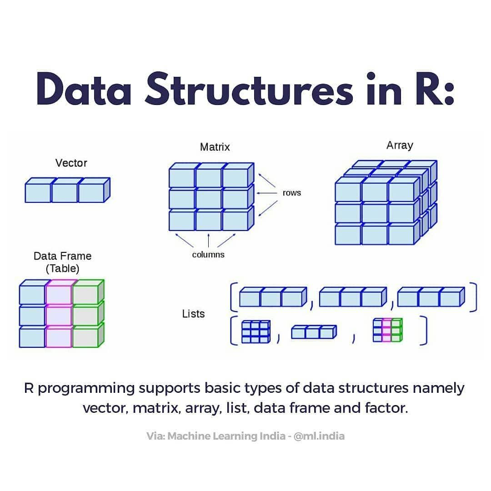
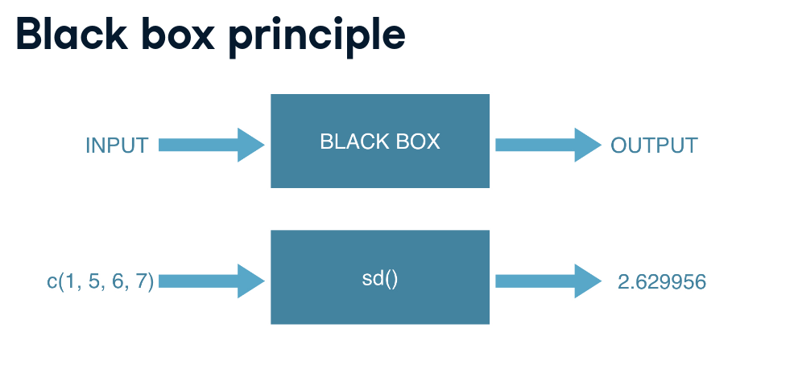

#### 

# Intro to basics

R makes use of the \# sign to add comments.

```{r}
# This is a comment

#install.packages("devtools")
# IRkernel::installspec()
```

It is possible to make calculations without call any library

```{r}
 2^4
```

## Arithmetic with R

In its most basic form, R can be used as a simple calculator. Consider
the following arithmetic operators:

- Addition: +
- Subtraction: -
- Multiplication: \*
- Division: /
- Exponentiation: \^
- Modulo: %%

The \^ operator raises the number to its left to the power of the number
to its right: for example 3\^2 is 9.

The modulo returns the remainder of the division of the number to the
left by the number on its right, for example 5 modulo 3 or 5 %% 3 is 2.

```{r}
 3^3
```

```{r}
12 %% 5
```

## Variable assignment

A basic concept in (statistical) programming is called a variable.

A variable allows you to store a value (e.g. 4) or an object (e.g. a
function description) in R. You can then later use this variable's name
to easily access the value or the object that is stored within this
variable.

You can assign a value 4 to a variable my_var with the command

```{r}
my_var <- "HOLA JOSEFA"

my_var
```

Now, let to print the result

```{r}
my_var
```

```{r}
my_var <- 9
```

```{r}
my_var
```

### Variable assignment (2)

Suppose you have a fruit basket with five apples. As a data analyst in
training, you want to store the number of apples in a variable with the
name my_apples.

```{r}
my_apples <- 5
```

```{r}
my_apples
```

### Variable assignment (3)

Every tasty fruit basket needs pears, so you decide to add six pears. As
a data analyst, your reflex is to immediately create the variable
my_pears and assign the value 6 to it. Next, you want to calculate how
many pieces of fruit you have in total. Since you have given meaningful
names to these values, you can now code this in a clear way:

```{r}

my_pears <- 7
my_apples + my_pears
```

```{r}
my_pears <- 6
```

```{r}
my_apples + my_pears
```

```{r}
my_fruit <- my_apples + my_pears
```

```{r}
my_fruit
```

Common knowledge tells you not to add apples and pears. But hey, that is
what you just did, no :-)? The my_apples and my_pears variables both
contained a number in the previous exercise. The + operator works with
numeric variables in R. If you really tried to add "apples" and "pears",
and assigned a text value to the variable my_pears, you would be trying
to assign the addition of a numeric and a character variable to the
variable my_fruit. This is not possible.

```{r}
my_pears <- "six" 

a <- "gjkld"

my_pears + a
```

```{r}
#my_fruit <- my_apples + my_pears
```

## Basic data types in R

R works with numerous data types. Some of the most basic types to get
started are:

- Decimal values like 4.5 are called numerics.

- Whole numbers like 4 are called integers. Integers are also numerics.

- Boolean values (TRUE or FALSE) are called logical.

- Text (or string) values are called characters.

Note how the quotation marks in the editor indicate that "some text" is
a string.

```{r}
# Change my_numeric to be -4512
my_numeric <- 42

# Change my_character to be "multiverse"
my_character <- "universe"

# Change my_logical to be TRUE
my_logical <- F
```

What's that data type?

Do you remember that when you added 5 + "six", you got an error due to a
mismatch in data types? You can avoid such embarrassing situations by
checking the data type of a variable beforehand. You can do this with
the class() function, as the code in the editor shows.

```{r}
# Check class of my_numeric
class(my_numeric)

# Check class of my_character
class(my_character)

# Check class of my_logical
class(my_logical)
```

### Vectors

#### Create a vector

Now, you on a trip to the City of Sins, also known as Statisticians
Paradise!

Thanks to R and your new data-analytical skills, you will learn how to
uplift your performance at the tables and fire off your career as a
professional gambler. This chapter will show how you can easily keep
track of your betting progress and how you can do some simple analyses
on past actions.

On your way from rags to riches, you will make extensive use of vectors.
Vectors are one-dimension arrays that can hold numeric data, character
data, or logical data. In other words, a vector is a simple tool to
store data. For example, you can store your daily gains and losses in
the casinos.

In R, you create a vector with the combine function <b>c()</b>. You
place the vector elements separated by a comma between the parentheses.
For example:

```{r}
numeric_vector <- c(1, 10, 49)

character_vector <- c("hvhdxjckvlbñ", "b", "c")

numeric_vector

character_vector
```

Once you have created these vectors in R, you can use them to do
calculations.

Complete the code such that <b>boolean_vector</b> contains the three
elements: TRUE, FALSE and TRUE (in that order).

```{r}
boolean_vector <- c(T, F, T)

boolean_vector
```

After one week in Las Vegas and still zero Ferraris in your garage, you
decide that it is time to start using your statistical superpowers.

Before doing a first analysis, you decide to first collect all the
winnings and losses for the last week:

**For poker_vector:**

- On Monday you won \$140

- Tuesday you lost \$50

- Wednesday you won \$20

- Thursday you lost \$120

- Friday you won \$240

**For roulette_vector:**

- On Monday you lost \$24

- Tuesday you lost \$50

- Weesday you won \$100

- Thursday you lost \$350

- Friday you won \$10

```{r}
# Poker winnings from Monday to Friday
poker_vector <- c(140, -50, 20, -120, 240)

poker_vector
```

```{r}
# Roulette winnings from Monday to Friday
roulette_vector <-  c(-24, -50, 100, -350, 10)

roulette_vector
```

As a data analyst, it is important to have a clear view on the data that
you are using. Understanding what each element refers to is therefore
essential.

#### Naming a vector

In the previous exercise, we created a vector with your winnings over
the week. Each vector element refers to a day of the week but it is hard
to tell which element belongs to which day. It would be nice if you
could show that in the vector itself.

You can give a name to the elements of a vector with the <b>names()</b>
function. Have a look at this example:

```{r}
# Assign days as names of poker_vector
names(poker_vector) <- c("Monday", "Tuesday", "Wednesday", "Thursday", "Friday")
```

```{r}
poker_vector
```

In the previous exercises you probably experienced that it is boring and
frustrating to type and retype information such as the days of the week.
However, when you look at it from a higher perspective, there is a more
efficient way to do this, namely, to assign the days of the week vector
to a variable!

```{r}
# The variable days_vector
days_vector <- c("Monday", "Tuesday", "Wednesday", "Thursday", "Friday")


```

```{r}
# Assign the names of the day to roulette_vector and poker_vector
names(poker_vector) <-   days_vector
names(roulette_vector) <- days_vector
```

```{r}
poker_vector

roulette_vector
```

#### Adding vectors

Lets calculate some properties

- How much has been your overall profit or loss per day of the week?
- Have you lost money over the week in total?
- Are you winning/losing money on poker or on roulette?

To get the answers, you have to do arithmetic calculations on vectors.

It is important to know that if you sum two vectors in R, it takes the
element-wise sum. For example, the following three statements are
completely equivalent:

```{r}
c(1, 8, 3) + c(4, 5, 6)
c(1 + 4, 8 + 5, 3 + 6)
c(5, 13, 9)
```

You can also do the calculations with variables that represent vectors:

```{r}
a <- c(1, 8, 3) 
b <- c(4, 5, 6)
c <- a + b
```

```{r}
c
```

How much has been your overall profit or loss per day of the week?

```{r}
# Poker and roulette winnings from Monday to Friday:
poker_vector <- c(140, -50, 20, -120, 240)
roulette_vector <- c(-24, -50, 100, -350, 10)
days_vector <- c("Monday", "Tuesday", "Wednesday", "Thursday", "Friday")
names(poker_vector) <- days_vector
names(roulette_vector) <- days_vector
```

```{r}
# Assign to total_daily how much you won/lost on each day
total_daily <- poker_vector + roulette_vector
```

```{r}
total_daily
```

Based on the previous analysis, it looks like you had a mix of good and
bad days. This is not what your ego expected, and you wonder if there
may be a very tiny chance you have lost money over the week in total?

A function that helps you to answer this question is **sum().** It
calculates the sum of all elements of a vector. For example, to
calculate the total amount of money you have lost/won with poker you do:

```{r}
# Total winnings with poker
total_poker <- sum(poker_vector)
total_poker 
```

```{r}
# Total winnings with roulette
total_roulette <- sum(roulette_vector)
total_roulette
```

```{r}
# Total winnings overall
total_week <- total_poker + total_roulette

# Print out total_week
  total_week
```

Oops, it seems like you are losing money. Time to rethink and adapt your
strategy! This will require some deeper analysis...

you realize that a possible explanation might be that your skills in
roulette are not as well developed as your skills in poker. So maybe
your total gains in poker are higher (or \> ) than in roulette.

```{r}
# Calculate total gains for poker and roulette
total_poker <- sum(poker_vector)
total_roulette <- sum(roulette_vector)

# Check if you realized higher total gains in poker than in roulette
total_poker < total_roulette
```

#### Vector selections

Your hunch seemed to be right. It appears that the poker game is more
your cup of tea than roulette.

Another possible route for investigation is your performance at the
beginning of the working week compared to the end of it.

To answer that question, you only want to focus on a selection of the
total_vector. In other words, our goal is to select specific elements of
the vector. To select elements of a vector (and later matrices, data
frames, ...), you can use square brackets.

Between the square brackets, you indicate what elements to select. For
example, to select the first element of the vector, you type
**poker_vector[1]**. To select the second element of the vector, you
type **poker_vector[2]**, etc. Notice that the first element in a vector
has **index 1, not 0** as in many other programming languages.

```{r}
# Poker and roulette winnings from Monday to Friday:
poker_vector <- c(140, -50, 20, -120, 240)
roulette_vector <- c(-24, -50, 100, -350, 10)
days_vector <- c("Monday", "Tuesday", "Wednesday", "Thursday", "Friday")
names(poker_vector) <- days_vector
names(roulette_vector) <- days_vector

days_vector
```

```{r}
# Define a new variable based on a selection
poker_monday <- poker_vector["Monday"]
```

```{r}
poker_monday
```

To select multiple elements from a vector, you can add square brackets
at the end of it. You can indicate between the brackets what elements
should be selected. For example: suppose you want to select the first
and the fifth day of the week: use the vector c(1, 5) between the square
brackets. For example, the code below selects the first and fifth
element of poker_vector:

```{r}
poker_vector[c(3:5)]

```

```{r}
# Define a new variable based on a selection
poker_midweek <- poker_vector[c(3,4,2)]
```

```{r}
poker_midweek
```

Another way

```{r}
poker_midweek <- poker_vector[c(2:4)]
```

```{r}
poker_midweek
```

Another way to tackle the previous exercise is by using the names of the
vector elements (Monday, Tuesday, ...) instead of their numeric
positions. For example,

```{r}
poker_vector["Friday"]
```

```{r}
# Select poker results for Monday, Tuesday and Wednesday
poker_start <- poker_vector[c("Monday", "Tuesday", "Wednesday")]
  

poker_start

# Calculate the average of the elements in poker_start
mean(poker_start)


?mean()
```

##### Selection by comparison

By making use of comparison operators, we can approach the previous
question in a more proactive way.

The (logical) comparison operators known to R are:

- \< for less than
- \> for greater than
- \<= for less than or equal to
- \>= for greater than or equal to
- == for equal to each other
- != not equal to each other

```{r}
c(4, 5, 6) != 5
```

This command tests for every element of the vector if the condition
stated by the comparison operator is TRUE or FALSE.

```{r}
# Which days did you make money on poker?
selection_vector <- poker_vector > 0
  
# Print out selection_vector
selection_vector
```

Working with comparisons will make your data analytical life easier.
Instead of selecting a subset of days to investigate yourself (like
before), you can simply ask R to return only those days where you
realized a positive return for poker.

In the previous exercises you used **selection_vector \<- poker_vector
\> 0** to find the days on which you had a positive poker return. Now,
you would like to know not only the days on which you won, but also how
much you won on those days.

You can select the desired elements, by putting selection_vector between
the square brackets that follow poker_vector:

```{r}
poker_vector[selection_vector]
```

R knows what to do when you pass a logical vector in square brackets: it
will only select the elements that correspond to TRUE in
selection_vector.

### Matrix

In R, a matrix is a collection of elements of the same data type
(numeric, character, or logical) arranged into a fixed number of rows
and columns. Since you are only working with rows and columns, a matrix
is called two-dimensional.

You can construct a matrix in R with the **matrix()** function. Consider
the following example:

```{r}
matrix(1:10, byrow = F, nrow = 2)

#?matrix()
```

```{r}
matrix(1:9, byrow = F, nrow = 2)
```

In the matrix() function:

- The first argument is the collection of elements that R will arrange
  into the rows and columns of the matrix. Here, we use 1:9 which is a
  shortcut for c(1, 2, 3, 4, 5, 6, 7, 8, 9).

- The argument byrow indicates that the matrix is filled by the rows. If
  we want the matrix to be filled by the columns, we just place byrow =
  FALSE.

- The third argument nrow indicates that the matrix should have three
  rows.

In the following exercises you will analyze the box office numbers of
the Star Wars franchise.

```{r}
# Box office Star Wars (in millions!)
new_hope <- c(460.998, 314.4)
empire_strikes <- c(290.475, 247.900)
return_jedi <- c(309.306, 165.8)
```

Three vectors are defined. Each one represents the box office numbers
from the first three Star Wars movies. The first element of each vector
indicates the US box office revenue, the second element refers to the
Non-US box office.

to combine the three vectors into one vector

```{r}
# Create box_office
box_office <- c(new_hope, empire_strikes, return_jedi)
```

```{r}
box_office
```

Construct a matrix, where each row represents a movie (ordered by rows).
The first argument is the vector box_office.

```{r}
# Construct star_wars_matrix
star_wars_matrix <- matrix(box_office, nrow = 3, byrow = TRUE)

star_wars_matrix

#class(star_wars_matrix)
```

#### Naming a matrix

To help you remember what is stored in star_wars_matrix, you would like
to add the names of the movies for the rows. Not only does this help you
to read the data, but it is also useful to select certain elements from
the matrix.

Similar to vectors, you can add names for the rows and the columns of a
matrix:

rownames(my_matrix) \<- row_names_vector

colnames(my_matrix) \<- col_names_vector

```{r}
# Box office Star Wars (in millions!)
new_hope <- c(460.998, 314.4)
empire_strikes <- c(290.475, 247.900)
return_jedi <- c(309.306, 165.8)

# Construct matrix
star_wars_matrix <- matrix(c(new_hope, empire_strikes, return_jedi), nrow = 3, byrow = TRUE)

#star_wars_matrix

# Vectors region and titles, used for naming
region <- c("US", "non-US")
titles <- c("A New Hope", "The Empire Strikes Back", "Return of the Jedi")

# Name the columns with region
rownames(star_wars_matrix) <- titles

# Name the rows with titles
colnames(star_wars_matrix) <- region

# Print out star_wars_matrix
star_wars_matrix
```

To calculate the total box office revenue for the three Star Wars
movies, you have to take the sum of the US revenue column and the non-US
revenue column.

In R, the function **rowSums()** conveniently calculates the totals for
each row of a matrix. This function creates a new vector:

```{r}
rowSums(star_wars_matrix)
```

**rowSums()** has a **colSums()**

```{r}
colSums(star_wars_matrix)
```

In the previous exercise you calculated the vector that contained the
worldwide box office receipt for each of the three Star Wars movies.
However, this vector is not yet part of star_wars_matrix.

You can add a column or multiple columns to a matrix with the
**cbind()** function, which merges matrices and/or vectors together by
column. For example:

```{r}
# Construct star_wars_matrix
box_office <- c(460.998, 314.4, 290.475, 247.900, 309.306, 165.8)
region <- c("US", "non-US")
titles <- c("A New Hope", 
            "The Empire Strikes Back", 
            "Return of the Jedi")
               
star_wars_matrix <- matrix(box_office, 
                      nrow = 3, byrow = TRUE,
                      dimnames = list(titles, region))

# The worldwide box office figures
worldwide_vector <- rowSums(star_wars_matrix)
income_source <- colSums(star_wars_matrix)

#star_wars_matrix
#worldwide_vector
income_source

# Bind the new variable worldwide_vector as a column to star_wars_matrix
#all_wars_matrix <- cbind(star_wars_matrix, worldwide_vector)
#all_wars_matrix

all_wars_matrix2 <- rbind(star_wars_matrix, income_source)

all_wars_matrix2
```

```{r}
all_wars_matrix <- cbind(star_wars_matrix, worldwide_vector)

all_wars_matrix
```

Just like every action has a reaction, every <b>cbind</b> has an
<b>rbind</b>

```{r}
all_wars_matrix2 <- rbind(star_wars_matrix, income_source)

all_wars_matrix2
```

Similar to vectors, you can use the square brackets [ ] to select one or
multiple elements from a matrix. Whereas vectors have one dimension,
matrices have two dimensions. You should therefore use a comma to
separate the rows you want to select from the columns. For example:

my_matrix[1,2] selects the element at the first row and second column.

my_matrix[1:3,2:4] results in a matrix with the data on the rows 1, 2, 3
and columns 2, 3, 4.

If you want to select all elements of a row or a column, no number is
needed before or after the comma, respectively:

my_matrix[,1] selects all elements of the first column.

my_matrix[1,] selects all elements of the first row.

```{r}
# Box office Star Wars (in millions!)
new_hope <- c(460.998, 314.4)
empire_strikes <- c(290.475, 247.900)
return_jedi <- c(309.306, 165.8)
The_Phantom_Menace <- c(474.5, 552.5)
Attack_of_the_Clones <-   c(310.7, 338.7)
Revenge_of_the_Sith   <-  c(380.3, 468.5)

# Construct matrix
all_wars_matrix <- matrix(c(new_hope, empire_strikes, return_jedi, 
                            The_Phantom_Menace, Attack_of_the_Clones, 
                            Revenge_of_the_Sith), 
                           nrow = 6, 
                           byrow = TRUE)

# Vectors region and titles, used for naming
region <- c("US", "non-US")
titles <- c("A New Hope", "The Empire Strikes Back", "Return of the Jedi", "The Phantom Menace", "Attack of the Clones", "Revenge of the Sith")

# Name the columns with region
rownames(all_wars_matrix) <- titles

# Name the rows with titles
colnames(all_wars_matrix) <- region

all_wars_matrix
```

Select the non-US revenue for all movies (the entire second column of
all_wars_matrix), store the result as non_us_all.

```{r}
non_us_all <- all_wars_matrix[,2]
non_us_all
```

Calculate the average non-US revenue

```{r}
f <- all_wars_matrix[,1]
mean(f)
```

Select the non-US revenue for first two movies

```{r}
non_us_some <- all_wars_matrix[1:2, 2]
non_us_some 
```

#### A little arithmetic with matrices

Similar to what you have learned with vectors, the standard operators
like +, -, /, \*, etc. work in an element-wise way on matrices in R.

For example, 2 \* my_matrix multiplies each element of my_matrix by two.

As a newly-hired data analyst for Lucasfilm, it is your job to find out
how many visitors went to each movie for each geographical area. You
already have the total revenue figures in **all_wars_matrix**. Assume
that the price of a ticket was 5 dollars. Simply dividing the box office
numbers by this ticket price gives you the number of visitors.

Divide all_wars_matrix by 5, giving you the number of visitors in
millions. Assign the resulting matrix to visitors

```{r}

# Estimate the visitors
visitors <- all_wars_matrix/6
  
# Print the estimate to the console
visitors
```

Just like 2 \* my_matrix multiplied every element of my_matrix by two,
**my_matrix1 \* my_matrix2** creates a matrix where each element is the
**product** of the corresponding elements in my_matrix1 and my_matrix2.

### Factors

The term factor refers to a statistical data type used to store
categorical variables. The difference between a categorical variable and
a continuous variable is that a categorical variable can belong to a
limited number of categories. A continuous variable, on the other hand,
can correspond to an infinite number of values.

It is important that R knows whether it is dealing with a continuous or
a categorical variable, as the statistical models you will develop in
the future treat both types differently.

A good example of a categorical variable is sex. In many circumstances
you can limit the sex categories to "Male" or "Female". (Sometimes you
may need different categories. For example, you may need to consider
chromosomal variation, hermaphroditic animals, or different cultural
norms, but you will always have a finite number of categories.)

To create factors in R, you make use of the function **factor()**. First
thing that you have to do is create a vector that contains all the
observations that belong to a limited number of categories. For example,
sex_vector contains the sex of 5 different individuals:

```{r}
sex_vector <- c("Male","Female","Female","Male","Male")
sex_vector


```

It is clear that there are two categories, or in R-terms 'factor
levels', at work here: "Male" and "Female".

The function factor() will encode the vector as a factor:

```{r}
factor_sex_vector <- factor(sex_vector)
factor_sex_vector

summary(factor_sex_vector)
```

There are two types of **categorical variables: a nominal categorical
variable and an ordinal categorical variable**.

A **nominal variable** is a categorical variable without an implied
order. This means that it is impossible to say that 'one is worth more
than the other'. For example, think of the categorical variable
animals_vector with the categories "Elephant", "Giraffe", "Donkey" and
"Horse". Here, it is impossible to say that one stands above or below
the other.

In contrast, **ordinal variables** do have a natural ordering. Consider
for example the categorical variable temperature_vector with the
categories: "Low", "Medium" and "High". Here it is obvious that "Medium"
stands above "Low", and "High" stands above "Medium".

```{r}
# Animals
animals_vector <- c("Elephant", "Giraffe", "Donkey", "Horse")
factor_animals_vector <- factor(animals_vector)


# Temperature
temperature_vector <- c("High", "Low", "High","Low", "Medium")
factor_temperature_vector <- factor(temperature_vector, order = TRUE, levels = c("Low", "Medium", "High"))
#factor_temperature_vector

#summary(factor_animals_vector)
summary(factor_temperature_vector)
```

When you first get a dataset, you will often notice that it contains
factors with specific factor levels. However, sometimes you will want to
change the names of these levels for clarity or other reasons. R allows
you to do this with the function **levels()**.

levels(factor_vector) \<- c("name1", "name2",...)

A good illustration is the raw data that is provided to you by a survey.
A common question for every questionnaire is the sex of the respondent.
Here, for simplicity, just two categories were recorded, "M" and "F".

```{r}
survey_vector <- c("M", "F", "F", "M", "M")
```

Recording the sex with the abbreviations "M" and "F" can be convenient
if you are collecting data with pen and paper, but it can introduce
confusion when analyzing the data. At that point, you will often want to
change the factor levels to "Male" and "Female" instead of "M" and "F"
for clarity.

**Watch out:** the order with which you assign the levels is important.
If you type levels(factor_survey_vector), you'll see that it outputs [1]
"F" "M". If you don't specify the levels of the factor when creating the
vector, R will automatically assign them alphabetically. To correctly
map "F" to "Female" and "M" to "Male", the levels should be set to
c("Female", "Male"), in this order.

```{r}
# Code to build factor_survey_vector
survey_vector <- c("M", "F", "F", "M", "M")
factor_survey_vector <- factor(survey_vector)
factor_survey_vector

# Specify the levels of factor_survey_vector
levels(factor_survey_vector) <- c("Female", "Male")

factor_survey_vector
```

#### Summarizing a factor

After finishing this course, one of your favorite functions in R will be
**summary()**. This will give you a quick overview of the contents of a
variable:

summary(my_var)

```{r}
# Build factor_survey_vector with clean levels
survey_vector <- c("M", "F", "F", "M", "M")
factor_survey_vector <- factor(survey_vector)
levels(factor_survey_vector) <- c("Female", "Male")


# Generate summary for survey_vector
summary(survey_vector)

# Generate summary for factor_survey_vector
summary(factor_survey_vector)
```

Since "Male" and "Female" are unordered (or nominal) factor levels, R
returns a warning message, telling you that the greater than operator is
not meaningful. As seen before, R attaches an equal value to the levels
for such factors.

But this is not always the case! Sometimes you will also deal with
factors that do have a natural ordering between its categories. If this
is the case, we have to make sure that we pass this information to R...

Let us say that you are leading a research team of five data analysts
and that you want to evaluate their performance. To do this, you track
their speed, evaluate each analyst as "slow", "medium" or "fast", and
save the results in speed_vector.

As a first step, assign speed_vector a vector with 5 entries, one for
each analyst. Each entry should be either "slow", "medium", or "fast".
Use the list below:

- Analyst 1 is medium,

- Analyst 2 is slow,

- Analyst 3 is slow,

- Analyst 4 is medium and

- Analyst 5 is fast.

No need to specify these are factors yet.

```{r}
# Create speed_vector
speed_vector <- c("medium", "slow", "slow", "medium", "fast")
```

speed_vector should be converted to an **ordinal factor** since its
categories have a natural ordering. By default, the function factor()
transforms speed_vector into an unordered factor. To create an ordered
factor, you have to add two additional arguments: **ordered** and
**levels**.

factor(some_vector, ordered = TRUE, levels = c("lev1", "lev2" ...))

```{r}
# Create speed_vector
speed_vector <- c("medium", "slow", "slow", "medium", "fast")

# Convert speed_vector to ordered factor vector
factor_speed_vector <- factor(speed_vector, ordered = T, levels = c("slow", "medium", "fast"))

# Print factor_speed_vector
factor_speed_vector
summary(factor_speed_vector)
```

#### Comparing ordered factors

Having a bad day at work, 'data analyst number two' enters your office
and starts complaining that 'data analyst number five' is slowing down
the entire project. Since you know that 'data analyst number two' has
the reputation of being a smarty-pants, you first decide to check if his
statement is true.

The fact that factor_speed_vector is now ordered enables us to compare
different elements (the data analysts in this case). You can simply do
this by using the well-known operators.

```{r}
# Create factor_speed_vector
speed_vector <- c("medium", "slow", "slow", "medium", "fast")
factor_speed_vector <- factor(speed_vector, ordered = TRUE, levels = c("slow", "medium", "fast"))

# Factor value for second data analyst
da2 <- factor_speed_vector[2]

# Factor value for fifth data analyst
da5 <- factor_speed_vector[5]

# Is data analyst 2 faster than data analyst 5?
da2 > da5
```

### Data frames

You may remember from the chapter about matrices that all the elements
that you put in a matrix should be of the same type. Back then, your
dataset on Star Wars only contained numeric elements.

When doing a market research survey, however, you often have questions
such as:

- 'Are you married?' or 'yes/no' questions (logical)

- 'How old are you?' (numeric)

- 'What is your opinion on this product?' or other 'open-ended'
  questions (character)

- ...

The output, namely the respondents' answers to the questions formulated
above, is a dataset of different data types. You will often find
yourself working with datasets that contain different data types instead
of only one.

A data frame has the variables of a dataset as columns and the
observations as rows. This will be a familiar concept for those coming
from different statistical software packages such as SAS or SPSS even
Excel or csv files.

```{r}
# Print out built-in R data frame
d <- mtcars
class(d)
#mtcars

#https://rstudio-pubs-static.s3.amazonaws.com/61800_faea93548c6b49cc91cd0c5ef5059894.html
```

Working with large datasets is not uncommon in data analysis. When you
work with (extremely) large datasets and data frames, your first task as
a data analyst is to develop a clear understanding of its structure and
main elements. Therefore, it is often useful to show only a small part
of the entire dataset.

So how to do this in R? Well, the function **head()** enables you to
show the first observations of a data frame. Similarly, the function
**tail()** prints out the last observations in your dataset.

Both head() and tail() print a top line called the 'header', which
contains the names of the different variables in your dataset.

```{r}
# Call head() on mtcars
#head(d)
d <- tail(mtcars)
?head
```

Another method that is often used to get a rapid overview of your data
is the function str(). The function str() shows you the structure of
your dataset. For a data frame it tells you:

- The total number of observations (e.g. 32 car types)

- The total number of variables (e.g. 11 car features)

- A full list of the variables names (e.g. mpg, cyl ... )

- The data type of each variable (e.g. num)

- The first observations

Applying the **str()** function will often be the first thing that you
do when receiving a new dataset or data frame. It is a great way to get
more insight in your dataset before diving into the real analysis.

```{r}
# Investigate the structure of mtcars
str(mtcars)
```

```{r}
summary(mtcars)
```

#### Creating a data frame

As a first goal, you want to construct a data frame that describes the
main characteristics of eight planets in our solar system. The main
features of a planet are:

- The type of planet (Terrestrial or Gas Giant).

- The planet's diameter relative to the diameter of the Earth.

- The planet's rotation across the sun relative to that of the Earth.

- If the planet has rings or not (TRUE or FALSE).

After doing some high-quality research on Wikipedia, you feel confident
enough to create the necessary vectors: name, type, diameter, rotation
and rings.

You construct a data frame with the data.frame() function. As arguments,
you pass the vectors from before: they will become the different columns
of your data frame. Because every column has the same length, the
vectors you pass should also have the same length. But don't forget that
it is possible (and likely) that they contain different types of data.

```{r}
# Definition of vectors
name <- c("Mercury", "Venus", "Earth", 
          "Mars", "Jupiter", "Saturn", 
          "Uranus", "Neptune")

type <- c("Terrestrial planet", 
          "Terrestrial planet", 
          "Terrestrial planet", 
          "Terrestrial planet", "Gas giant", 
          "Gas giant", "Gas giant", "Gas giant")

diameter <- c(0.382, 0.949, 1, 0.532, 
              11.209, 9.449, 4.007, 3.883)

rotation <- c(58.64, -243.02, 1, 1.03, 
              0.41, 0.43, -0.72, 0.67)

rings <- c(FALSE, FALSE, FALSE, FALSE, TRUE, TRUE, TRUE, TRUE)

# Create a data frame from the vectors
planets_df <- data.frame(name, type, diameter, rotation, rings)
planets_df
```

```{r}
head(planets_df)
```

```{r}
?head
```

The planets_df data frame should have 8 observations and 5 variables.

```{r}
# Check the structure of planets_df
str(planets_df)
```

```{r}
#summary(planets_df)

planets_df$type <- as.factor(planets_df$type)

summary(planets_df)
```

#### Selection of data frame elements

Similar to vectors and matrices, you select elements from a data frame
with the help of square brackets [ ]. By using a comma, you can indicate
what to select from the rows and the columns respectively. For example:

- my_df[1,2] selects the value at the first row and second column in
  my_df.

- my_df[1:3,2:4] selects rows 1, 2, 3 and columns 2, 3, 4 in my_df.

Sometimes you want to select all elements of a row or column.

- For example, my_df[1, ] selects all elements of the first row.

```{r}
# The planets_df data frame from the previous exercise is pre-loaded
#planets_df

# Print out diameter of Mercury (row 1, column 3)
planets_df$rotation[3]
```

Instead of using numerics to select elements of a data frame, you can
also use the variable names to select columns of a data frame.

Suppose you want to select the first three elements of the type column.
One way to do this is

```{r}
#planets_df
planets_df[6:8,4]
```

A possible disadvantage of this approach is that you have to know (or
look up) the column number of type, which gets hard if you have a lot of
variables. It is often easier to just make use of the variable name:

```{r}
planets_df[1:3,"rings"]
```

```{r}
# The planets_df data frame from the previous exercise is pre-loaded
planets_df

# Select first 5 values of diameter column
planets_df[1:5,"diameter"]
```

You will often want to select an entire column, namely one specific
variable from a data frame. If you want to select all elements of the
variable diameter, for example, both of these will do the trick:

```{r}
planets_df[,3]
```

```{r}
planets_df[,"diameter"]
```

However, there is a short-cut. If your columns have names, you can use
the \$ sign:

```{r}
planets_df$rotation

#mtcars$gear
```

You probably remember from high school that some planets in our solar
system have rings and others do not. Unfortunately you can not recall
their names. Could R help you out?

```{r}
rings_vector <- planets_df$rings

rings_vector
```

This means that the first four observations (or planets) do not have a
ring (FALSE), but the other four do (TRUE).

Let's try to use rings_vector to select the data for the four planets
with rings.

```{r}
a <- planets_df[!rings_vector, ]

a
```

So what exactly did you learn in the previous exercises? You selected a
subset from a data frame (planets_df) based on whether or not a certain
condition was true (rings or no rings).

Now, let us move up one level and use the function **subset()**. You
should see the subset() function as a short-cut to do exactly the same
as what you did in the previous exercises.

subset(my_df, subset = some_condition)

The first argument of subset() specifies the dataset for which you want
a subset. By adding the second argument, you give R the necessary
information and conditions to select the correct subset.

The code below will give the exact same result as you got in the
previous exercise, but this time, you didn't need the rings_vector

```{r}
subset(planets_df, subset = rings)
```

```{r}
# Select planets with diameter < 1
subset(planets_df, subset = diameter < 1)
```

#### Sorting

In data analysis you can sort your data according to a certain variable
in the dataset. In R, this is done with the help of the function
**order()**.

order() is a function that gives you the ranked position of each element
when it is applied on a variable, such as a vector for example:

```{r}
a <- c(100, 10, 1000)
order(a, decreasing = TRUE)
```

10, which is the second element in a, is the smallest element, so 2
comes first in the output of order(a). 100, which is the first element
in a is the second smallest element, so 1 comes second in the output of
order(a).

This means we can use the output of order(a) to reshuffle a:

```{r}
a[order(a, decreasing = F)]

#?order
```

Alright, now that you understand the order() function, let us do
something useful with it. You would like to rearrange your data frame
such that it starts with the smallest planet and ends with the largest
one. A sort on the diameter column.

```{r}
planets_df

# Use order() to create positions
positions <-  order(planets_df$diameter, decreasing = T)
positions

# Use positions to sort planets_df
h <- planets_df[positions, ]
h
```

### Lists

A list in R is similar to your to-do list at work or school: the
different items on that list most likely differ in length,
characteristic, and type of activity that has to be done.

A list in R allows you to gather a variety of objects under one name
(that is, the name of the list) in an ordered way. These objects can be
matrices, vectors, data frames, even other lists, etc. It is not even
required that these objects are related to each other in any way.

You could say that a list is some kind super data type: you can store
practically any piece of information in it!

#### Creating a list

Let us create our first list! To construct a list you use the function
**list()**

my_list \<- list(comp1, comp2 ...)

The arguments to the list function are the list components. Remember,
these components can be matrices, vectors, other lists, ...

```{r}
# Vector with numerics from 1 up to 10
my_vector <- 1:10 

# Matrix with numerics from 1 up to 9
my_matrix <- matrix(1:9, ncol = 3)

# First 10 elements of the built-in data frame mtcars
my_df <- mtcars[1:10,]

# Construct list with these different elements:
my_list <- list(my_vector, my_matrix, my_df)
my_list
```

#### Creating a named list

Just like on your to-do list, you want to avoid not knowing or
remembering what the components of your list stand for. That is why you
should give names to them:

my_list \<- list(name1 = your_comp1, name2 = your_comp2)

This creates a list with components that are named name1, name2, and so
on. If you want to name your lists after you've created them, you can
use the **names()** function as you did with vectors. The following
commands are fully equivalent to the assignment above:

Change the code of the previous exercise by adding names to the
components. Use for my_vector the name vec, for my_matrix the name mat
and for my_df the name df.

Print out my_list so you can inspect the output.

```{r}
# Vector with numerics from 1 up to 10
my_vector <- 1:10 

# Matrix with numerics from 1 up to 9
my_matrix <- matrix(1:9, ncol = 3)

# First 10 elements of the built-in data frame mtcars
my_df <- mtcars[1:10,]

# Adapt list() call to give the components names
my_list <- list(my_vector, my_matrix, my_df)

#name the list
names(my_list) <- c("vec", "mat", "df")

# Print out my_list
my_list
```

#### Selecting elements from a list

Your list will often be built out of numerous elements and components.
Therefore, getting a single element, multiple elements, or a component
out of it is not always straightforward.

One way to select a component is using the numbered position of that
component. For example, to "grab" the first component of shining_list
you type

my_list[[1]]

A quick way to check this out is typing it in the console. Important to
remember: to select elements from vectors, you use single square
brackets: [ ]. Don't mix them up!

You can also refer to the names of the components, with [[ ]] or with
the \$ sign. Both will select the data frame representing the reviews:

```{r}
my_list[["df"]]
```

```{r}
my_list$df$drat
```

Besides selecting components, you often need to select specific elements
out of these components

```{r}
my_list[["df"]][1,]
```

```{r}
my_list$df[1,]
```

```{r}
movie_title <- c("The Departed")

movie_actors <- c("Leonardo DiCaprio", 
                  "Matt Damon", 
                  "Jack Nicholson", 
                  "Mark Wahlberg", 
                  "Vera Farmiga" )

scores <- c(4.6, 5, 4.8, 5, 4.2)

comments <- c("I would watch it again",
              "Amazing!",
              "I liked it", 
              "One of the best movies",
              "Fascinating plot")

# Save the average of the scores vector as avg_review
avg_review <- mean(scores)
#avg_review

# Combine scores and comments into the reviews_df data frame
reviews_df <- data.frame(scores, comments, movie_actors)
#reviews_df

# Create and print out a list, called departed_list
departed_list <- list(movie_title, movie_actors, reviews_df, avg_review)

departed_list
```

### Summarizing data types



# Intermediate R

## Conditionals and Control Flow

Relational operators, or comparators are operators which help us see how
one R object relates to another. For example, you can check whether two
objects are equals with "=="

```{r}
TRUE == TRUE
```

```{r}
"hello" == "bye"
```

The opposite of the equality operator is the inequality "!="

```{r}
"hello" != "bye"
```

Of course, there are also cases where you need more than simply equality
and inequality operators. What about checking if an R object is less
than or greater than anoter R object?

```{r}
3 < 5
```

```{r}
5 > 3
```

For numerics this make sense, but how would this work for character
strings and logical values?

```{r}
"Hello" > "GoodBye"
```

Why is Hello greater than GoodBye? It's because R uses alphabet to sort
character strings, sinces "H" comes after to "G" in the alphabet, then
Hello \> GoodBye.

How about logical values? Is TRUE less than FALSE?

```{r}
TRUE < FALSE
```

That's because, TRUE correspond to 1 and FALSE to 0.

"greater or equal than" .....or..... "less or equal than"

```{r}
5 >= 3
```

### Relational operators and vectors

```{r}
 linkedin <- c(16, 9, 13, 5, 2, 17, 14)
linkedin
```

```{r}
linkedin > 10
```

```{r}
facebook <- c(17, 7, 5, 16, 8, 13, 14)
facebook
```

```{r}
facebook < linkedin
```

In this case, the comparison is done for every element of the vector,
one by one.

```{r}
# Comparison of numerics
-6*14 != 17-101

# Comparison of character strings
"useR" != "use"

# Compare a logical with a numeric
TRUE == 1

# Comparison of numerics
-6 * 5 + 2 > -10 + 1

# Comparison of character strings
"raining" <= "raining dogs"

# Comparison of logicals
TRUE > FALSE
```

#### Compare matrices

R's ability to deal with different data structures for comparisons does
not stop at vectors. Matrices and relational operators also work
together seamlessly.

Instead of in vectors, the LinkedIn and Facebook data (number of views
per day) is now stored in a matrix called views. The first row contains
the LinkedIn information; the second row the Facebook information. The
original vectors facebook and linkedin are still available as well.

```{r}
# The social data has been created 
linkedin <- c(16, 9, 13, 5, 2, 17, 14)
facebook <- c(17, 7, 5, 16, 8, 13, 14)

views <- matrix(c(linkedin, facebook), nrow = 2, byrow = TRUE)
views

```

When were the views exactly equal to 13? Use the views matrix to return
a logical matrix.

```{r}
views == 13
```

When is views less than or equal to 14?

```{r}
views <= 14
```

```{r}
names <- c("mon", "tue", "wen", "thu", "fri", "sat", "sun")
names
colnames(views) <- names
views

views <= 14
```

### Logical operators

#### AND operator "&"

The **AND operator (&)** works just as you would expect. It typically
takes two logical values and returns TRUE only if both the logical
values are TRUE themselves. This means that

TRUE and TRUE evaluates to TRUE,

but that FALSE and TRUE, TRUE and FALSE and FALSE and FALSE all evaluate
to FALSE.

Instead of using logical values, we can of course use the results of
comparisons.

Suppose we have a variable x, equal to 12. To check if this variable is
greater than 5 but less than 15, we can use x greater than 5 and x less
than 15. As you already learned, the first part will evaluate to TRUE.
The second part, will also evaluate to TRUE. So the result of this
expression is TRUE. This makes sense, because 12 lies between 5 and 15.
However, if x were equal to 17, the expression x greater than 5 & x less
than 15 would simplify to TRUE and FALSE. which results in this
expression being FALSE.

```{r}
#x <- 12
#x >= 5 & x <= 15

x <- 17
x >= 5 & x <= 15
```

#### OR operator "\|"

The **OR operator (\|)** works similarly, but the difference is that
only at least one of the logical values it uses should be equal to TRUE
for the entire OR operation to evaluate to TRUE. This means that,

TRUE or TRUE equals TRUE,

but that also TRUE or FALSE and FALSE or TRUE evaluate to TRUE.

When both logicals are FALSE in an OR operation, so in the case of FALSE
or FALSE, the result is FALSE.

Remember that the OR operation is not an exclusive or operation, so TRUE
or TRUE equals TRUE as well.

Just as for AND operators, we can use comparisons together with the OR
operator. Suppose we have a variable y, equal to 4 this time. To see if
this variable is less than 5 or greater than 15, we can use this
expression. R will first carry out the comparisons, resulting in TRUE or
FALSE, which in turn results in TRUE. Now, let's have y equal 14. The
expression y less than 5 or y greater than 15 now evaluates to FALSE or
FALSE. Neither one of the comparisons are TRUE, so the result is FALSE.

```{r}
y <- 4

y <= 4 | y >= 15

#y <- 14

#y <= 4 | y >= 15
```

#### NOT operator "!"

The **NOT operator (\|)**, represented by an exclamation mark, simply
negates the logical value it's used on. So exclamation mark TRUE
evaluates to FALSE, while exclamation mark FALSE evaluates to TRUE. Just
as the OR and AND operators, you can use the NOT operator in combination
with logical operators. This is not always necessary, however, because
this line of code is exactly the same as this one.

```{r}
!TRUE
```

```{r}
z <- 100

!(z < 5)

z >= 5
```

```{r}
is.numeric(4)

!is.numeric(5)

is.numeric("Hello")

!is.numeric("Hello")
```

#### Logical operators and vectors

```{r}
c(TRUE, TRUE, FALSE) & c(TRUE, FALSE, FALSE)

#c(TRUE, TRUE, FALSE) | c(TRUE, FALSE, FALSE)

#!c(TRUE, TRUE, FALSE)
```

#### "&" vs "&&", "\|" vs "\|\|"

The difference between a single and a double ampersand or vertical bar.
In R you can use both the single sign version or the double sign
version, but the result of the logical operation you're carrying out can
be different. The biggest difference occurs when you use the two types
of operations on vectors. As we've seen before, this expression,
evaluates to a vector containing TRUE, FALSE and FALSE. However, if we
use a double ampersand, we simply get TRUE. That's because the double
ampersand operation only examines the first element of each vector. In
this case the first elements are TRUE and TRUE, so the expression
returns TRUE.

```{r}
c(TRUE, TRUE, FALSE) & c(TRUE, FALSE, FALSE)

#c(TRUE, TRUE, FALSE) & c(TRUE, FALSE, FALSE)


c(TRUE, TRUE, FALSE) | c(TRUE, FALSE, FALSE)

#c(TRUE, TRUE, FALSE) || c(TRUE, FALSE, FALSE)
```

```{r}
# The linkedin and last variable 
linkedin <- c(16, 9, 13, 5, 2, 17, 14)
last <- tail(linkedin, 1)
last
```

Is last under 5 or above 10?

```{r}
last < 5 | last > 10
```

Is last between 15 (exclusive) and 20 (inclusive)?

```{r}
last >= 15 & last <=20
```

```{r}
# The social data has been created 
linkedin <- c(16, 9, 13, 5, 2, 17, 14)
facebook <- c(17, 7, 5, 16, 8, 13, 14)

views <- matrix(c(linkedin, facebook), nrow = 2, byrow = TRUE)
views

```

When did LinkedIn views exceed 10 and did Facebook views fail to reach
10 for a particular day?

```{r}
linkedin > 10 & facebook < 10
```

When were one or both of your LinkedIn and Facebook profiles visited at
least 12 times?

```{r}
linkedin >=12 | facebook >=12
```

When is the views matrix equal to a number between 11 and 14, excluding
11 and including 14?

```{r}
views > 11 & views <=14
```

```{r}
x <- 5
y <- 7
!(!(x < 4) & !!!(y > 12))
```

## Conditional Statments

### if statement

The if statement takes a condition; if the condition evaluates to TRUE,
the R code associated with the if statement is executed. The condition
to check appears inside parentheses, while the R code that has to be
executed if the condition is TRUE, follows in curly brackets.

if(condition) {

```         
expr
```

}

```{r}
x <- -3

if(x < 0){
    print("x is a negative number")
}
    
```

### else statement

```{r}
x <- 3

if(x < 0){
    print("x is a negative number")
} else {
    print("x is a positive number")
}
    
```

### else if statement

```{r}
x <- 0

if(x < 0){
    print("x is a negative number")
} else if( x == 0){
    print("x is zero")
} else {
    print("x is a positive number")
}
  
```

Remember that as soon as R stumbles upon a condition that evaluates to
TRUE, R executes the corresponding code and then ignores the rest of the
control structure. This becomes important if the conditions you list are
not mutually exclusive.

```{r}
x <- 6

if(x %% 2 == 0) {
    print("divisible by 2")
} else if(x %% 3 == 0) {
    print("divisible by 3")
} else {
    print("not divisible by 2 or 3")
}
```

Remember your vectors with social profile views? Let's look at it from
another angle. The medium variable gives information about the social
website; the num_views variable denotes the actual number of views that
particular medium had on the last day of your recordings. Both variables
have been pre-defined for you.

```{r}
# Variables related to your last day of recordings
medium <- "LinkedIn"
num_views <- 14
```

Examine the if statement that prints out "Showing LinkedIn information"
if the medium variable equals "LinkedIn".

```{r}
if(medium == "LinkedIn"){
    print("Showing LinkedIn information")
}
```

Code an if statement that prints "You are popular!" to the console if
the num_views variable exceeds 1500.

```{r}
if(num_views > 1500){
    print("You are popular!")
}
```

Add an else statement to both control structures, such that

- "Unknown medium" gets printed out to the console when the if-condition
  on medium does not hold.

- R prints out "Try to be more visible!" when the if-condition on
  num_views is not met.

```{r}
if(medium == "LinkedIn"){
    print("Showing LinkedIn information")
}else {
    print("Unknown medium")
}
```

```{r}
if(num_views > 1500){
    print("You are popular!")
}else {
    print("Try to be more visible!")
}
```

Add code to both control structures such that:

- R prints out "Showing Facebook information" if medium is equal to
  "Facebook". Remember that R is case sensitive!

- "Your number of views is average" is printed if num_views is between
  15 (inclusive) and 10 (exclusive).

```{r}
if(medium == "LinkedIn"){
    print("Showing LinkedIn information")
}else if(medium == "Facebook"){
    print("Showing Facebook information")
}else {
    print("Unknown medium")
}
```

```{r}
# Control structure for num_views
if (num_views > 15) {
  print("You're popular!")
} else if (num_views <= 15 & num_views > 10) {
  print("Your number of views is average")
} else {
  print("Try to be more visible!")
}
```

```{r}
number <- 2500
if (number < 10) {
  if (number < 5) {
    result <- "extra small"
  } else {
    result <- "small"
  }
} else if (number < 100) {
  result <- "medium"
} else {
  result <- "large"
}
print(result)
```

## Loops

### While loop

The syntax of a while loop is pretty similar to the if statement, as you
can see here. Let's have a look at a very simple example: we'll simply
make R increment a counter until it reaches the value 7.

```{r}
# ?paste

ctr <- 0

while(ctr <= 7){
    print(paste("ctr is set to:", ctr))
    ctr <- ctr + 1
}
```

The line of code to increment ctr is crucial, suppose to remove this
line, what's happen?

?paste

ctr \<- 0

while(ctr \<= 7){ print(paste("ctr is set to:", ctr)) }

The **break** statement simply breaks out of the while loop.

```{r}
ctr <- 0

while(ctr <= 7){
    if(ctr == 3){
        break
    }
    print(paste("ctr is set to:", ctr))
    ctr <- ctr + 1
}
```

### For loops

The for loop is somewhat different from the while loop. This can be read
as: for each var, a variable, in seq, a sequence, execute expressions.

for(var in seq){

```         
 expr
```

}

Makes sense? Let's see how this actually works with an example.

```{r}
cities <- c("New York", "Paris",
           "London", "Tokyo",
           "Rio de Janeiro", "Talca")

#we can print cities
cities
```

But suppose we want to have a different printout for every element in
the vector

```{r}
for(c in cities){
    print(c)
}
```

How does R handle this code? At the start of the loop, R evaluates the
seq element, being cities in our case. It realizes that it is a vector
containing 6 elements. Next, R stores the first element of this sequence
in the variable city, so city equals "New York" now.

Then, the expression, print(city), is executed, printing out "New York"
to the console.

After the execution, R stores the second element of the cities vector,
"Paris", in city and re-runs the code. This process repeats itself until
all cities in the cities vector are iterated over.

The for loop does not only work on vectors: it also works with lists for
example.

```{r}
cities <- list("New York", "Paris",
           "London", "Tokyo",
           "Rio de Janeiro", "Talca")
cities
```

```{r}
for(city in cities){
    print(city)
}
```

The exact same for loop as we've been using before can be used for
lists, and the result is exactly the same. So there's no need to worry
about the difference between subsetting vectors and lists, because the
for loop does this for us.

The **break** statement is a statement that you already know: just like
in the while loop, break in a for loop simply stops the execution of the
code and abandons the for loop altogether.

```{r}
cities <- list("New York", "Paris",
           "London", "Tokyo",
           "Rio de Janeiro", "Talca")
cities

for(a in cities){
    if(nchar(a) == 6){
        break
    }
    print(a)
}


#?nchar
```

The **next** statement also alters the flow of your for loop, but does
so in a slightly different way.

```{r}
cities <- list("New York", "Paris",
           "London", "Tokyo",
           "Rio de Janeiro", "Talca")
#cities

for(city in cities){
    if(nchar(city) == 6){
        next
    }
    print(city)
}
```

accessing to each index

```{r}
cities <- c("New York", "Paris",
           "London", "Tokyo",
           "Rio de Janeiro", "Talca")

for(i in 1:length(cities)){
    print(cities[i])
}
```

```{r}
cities <- c("New York", "Paris",
           "London", "Tokyo",
           "Rio de Janeiro", "Talca")

for(i in 1:length(cities)){
    print( paste(cities[i], "is on position", i, "in the cities vector"))
}
```

for in matrix

```{r}
a <- c("O", "NA", "X")
b <- c("NA", "O", "O")
c <- c("X", "NA", "X")
d <- c(a, b, c)

ttt <- matrix(d,  byrow = T, nrow = 3)
ttt


for (i in 1:nrow(ttt)) {
  for (j in 1:ncol(ttt)) {
    print(paste("On row", i, "and column", j, "the board contains", ttt[i,j]))
  }
}
```

## Functions

Not surprisingly, you've already used functions before. Remember the
time you created a list? You used the **list()** function. Or the time
you wanted to display the contents of a variable? You used the
**print()** function. But what are functions and how do they work?

You can think of a function as some kind of black box. You give an input
to the black box, the black box processes this input and it returns some
output

The R **sd** function calculates the standard deviation of a vector. Our
black box in this case is the sd function.



```{r}
sd(c(1,5,6,7))
```

How one specific function works?

- **help(sd)**

- ?sd

```{r}
?sd
```

Function documentation presents a lot of information. If we have a look
at the "Usage" section, we see that the sd function actually takes two
arguments, x and na.rm

```{r}
sd(c(1,5,6,7, NA))

?sd
```

```{r}
sd(c(1,5,6,7, NA), na.rm = TRUE)
```

```{r}
sd(c(1,5,6,7, NA), T)
```

### The args function

This is a function to learn about the arguments of a function without
having to read through the entire documentation

```{r}
args(mean)

?mean
```

```{r}
?mean
```

Default S3 method:

mean(x, trim = 0, na.rm = FALSE, ...)

```{r}
# The linkedin and facebook vectors have already been created for you
linkedin <- c(16, 9, 13, 5, 2, 17, 14)
facebook <- c(17, 7, 5, 16, 8, 13, 14)

# Calculate the mean of the sum
avg_sum <- mean(linkedin + facebook)

# Calculate the trimmed mean of the sum
avg_sum_trimmed <- mean(linkedin + facebook, trim=0.2)

# Inspect both new variables
avg_sum
avg_sum_trimmed
```

The sd() function has an optional argument, na.rm that specified whether
or not to remove missing values from the input vector before calculating
the standard deviation.

If you've had a good look at the documentation, you'll know by now that
the mean() function also has this argument, na.rm, and it does the exact
same thing. By default, it is set to FALSE, as the Usage of the default
S3 method shows:

```{r}
# The linkedin and facebook vectors have already been created for you
linkedin <- c(16, 9, 13, 5, NA, 17, 14)
facebook <- c(17, NA, 5, 16, 8, 13, 14)

# Basic average of linkedin
mean(linkedin)

# Advanced average of linkedin
mean(linkedin, 0, T)
```

### Functions inside functions

You already know that R functions return objects that you can then use
somewhere else. This makes it easy to use functions inside functions, as
you've seen before:

speed \<- 31

print(paste("Your speed is", speed))

```{r}
# The linkedin and facebook vectors have already been created for you
linkedin <- c(16, 9, 13, 5, NA, 17, 14)
facebook <- c(17, NA, 5, 16, 8, 13, 14)

# Calculate the mean absolute deviation
mean(abs(linkedin-facebook), 0, T)
```

```{r}
?read.table
```

```{r}
read.table("myfile.txt", "-", TRUE)
```

```{r}
read.table("myfile.txt", sep = "-", header = TRUE)
```

### Writing functions

A function typically serves a particular need or solves a particular
problem, without having to care about how the function does this.
Remember the 'black-box principle'

**my_func \<- function(arg1, arg2){**

**body**

**}**

```{r}
triple <- function(x){
    x * 3
}

#ls()
```

You see that triple function has been created in the workspace

```{r}
triple(6)
```

```{r}
triple <- function(x){
    y <- x * 3
    return(y)
}

triple(6)
```

### Optional argument

```{r}
math_magic <- function(a, b){
    a*b + a/b
}

#math_magic(2,3)
math_magic(2)
```

```{r}
math_magic <- function(a, b=1){
    a*b + a/b
}

math_magic(2)
```

but, what's happen when we use x, and 0

```{r}
math_magic <- function(a, b=1){
    a*b + a/b
}

math_magic(2,0)
```

That's cause 2/0 in infinite!, so:

```{r}
math_magic <- function(a, b=1){
    
    if(b == 0){
        return(0)
    }
    a*b + a/b
}

math_magic(2,0)
```

Note that **return** function is similar to **break**

There are situations in which your function does not require an input.
Let's say you want to write a function that gives us the random outcome
of throwing a fair die:

```{r}
throw_dice <- function() {
  number <- sample(1:6, size = 1)
  number
}

throw_dice()
```

**Function scoping** implies that variables that are defined inside a
function are not accessible outside that function

```{r}
pow_two <- function(x) {
  ydsa <- x ^ 2
  return(ydsa)
}
pow_two(4)

ydsa
```

```{r}
triple <- function(x) {
  x <- 3*x
  x
}
a <- 5
triple(a)
a
```

## R Packages

R packages are bundles of code, data, documentation, and tests that are
easy to share with others. For example, the **mean**, **list** and
**sample** functions are all part of the base package, which contains
the basic functionality to use R. Another example package, specifically
for data visualization, is the **ggvis package**. It contains functions
such as layer_points, scale_nominal and add_axis.

```{r}
#install.packages("ggvis")

head(mtcars)
str(mtcars)


```

```{r}
#installed.packages("ggplot2", dependences = T)
library(ggplot2)

mtcars %>% ggvis(~disp, ~mpg) %>% layer_points()
```

### Install packages

Before you can use a package, you will first have to install it. The
base package is automatically installed when you install R. The ggvis
package on the other hand won't come with the bundled R installation.
But fear not! You can easily install it:

**install.packages("ggvis")**

This function goes to CRAN. CRAN is short for the Comprehensive R
Archive Network, a repository where thousands of packages are available.
The function downloads the package file and installs the package on your
system.

### Load packages

To do that, we'll have to actually load the package into our current R
session. When R loads a package, it actually attaches it to the search
list. This is a list of packages and environments that R looks through
to find the variable or function you want to use. To have a look at this
list, you can use the search() function.

```{r}
search()
```

Whenever you execute code that depends on any other variable or
function, R goes through all these packages one after the other to find
it. Apart from all the packages that are loaded into our R session, we
also see ".GlobalEnv"; this is our own workspace, where the user-defined
R objects live.

You can also see that the search() path already contains a bunch of
packages. When R is started, it loads 7 packages on default, among which
is the base package. Others are the utils, datasets and methods package.
That's why, when you start R, you can use the mean function, or the
install.packages function without having to explicitly load the package.

The ggvis package that we've installed earlier, however, won't be loaded
automatically. If we try to access the ggvis function, for example, R
will return an error, telling us that the function ggvis could not be
found. That's because ggvis is not yet in the search list.

#### Load packages: library()

To access ggvis' functionality, we'll have to load the package using the
library command. This command takes the name of the package and adds the
package to the search list, right after the global environment, making
all the functions, data and pre-compiled code it contains available and
ready to be used.

library(ggvis)

#### Load packages: require()

Just like the l**ibrary()** function, require loads packages into your R
session. The only difference appears when you're trying to load a
package that is not yet installed. Let's say you want to load the
**data.table** package, a package to perform data manipulation, but that
this package is not yet installed. If you call **library(data.table)**.
R throws an error in this case. However, when you execute
require(data.table), you get a warning.

## Apply family

### lapply

When you're using R, you will often encounter vectors and lists
containing all sorts of information. You've seen before that the for
loop is there to help us iterate over all kinds of data structures. But
I'm glad to tell you there's an even easier way!

Let's have a look at some information related to New York City. It is
stored in a list.

```{r}
nyc <- list(pop = 8405837,
           boroughs = c("Manhattan", "Bronx", "Brooklyn", "Queens", "Staten Island"),
           capital = FALSE)
```

Suppose we want to find out the class of each element of this list. As
you already know, you could use a for loop that iterates over the
different elements of nyc, and call the **class() function**.

```{r}
for(info in nyc){
    print(class(info))
}
```

As expected, the first element is numeric, the second one is a character
string, and the third is a logical. This however is quite a bit of code
just to find out the class of elements of a list, isn't it?

**lapply** is here to rescue us from writing too much code for simple
tasks such as these.

```{r}
lapply(nyc, class)
```

**lapply** iterated over the inputted list, nyc, and on each element of
the list, applied the function class(). The output of lapply includes
the results of calling the class function over each of the list
elements. The first element in the output now contains the class of the
first element in nyc, namely "numeric".

The second element in the output contains the class of the second
element in nyc, "character", and the third element contains logical, the
class of the third input element. Also notice that the names of the
list, pop, boroughs and capital are maintained here, that's pretty
useful

Let's have a look at another example, now with a vector of city names.

```{r}
cities <- c("New York", "Paris", "london", "Tokyo", "Rio de Janeiro", "Talca")
```

Suppose we want to build a vector of the same length as cities,
containing the number of characters of each city name. We can do that by
using the following for loop. First, we create an empty vector, called
num_chars. Inside the for loop, using a looping index, we gradually fill
this vector up using the **nchar** function. We get the wanted result,
but it's a lot of code to do a simple thing.

```{r}
num_chars <- c()

for(i in 1:length(cities)){
    num_chars[i] <- nchar(cities[i])
}

num_chars
```

Fortunately, refactoring this code to use lapply is easy. As the input,
we use the cities vector as well as the function we want to apply on
each element in this vector: We get a list containing the number of
characters of the corresponding cities in the input vector. Notice here
that the output is a list, although the input was a vector. This is
something important about the lapply function: it always returns a list,
irrespective of the input data structure.

```{r}
lapply(cities, nchar)
```

If you want to convert this list to a vector, you can simply wrap this
lapply function inside the unlist() function which turns a list into a
vector.

```{r}
unlist(lapply(cities, nchar))
```

In a single one-liner, we have achieved the exact same thing as the
bulky for loop. Moreover, by using lapply our code looks much more
intuitive and readable.

In the previous examples we applied the functions class() and nchar() on
every element of the input vector or list, but lapply can also be used
with functions that you've written yourself.

```{r}
oil_prices <- list(2.37, 2.49, 2.18, 2.47, 2.32, 2.00, 1.99)

triple <- function(x){
    3 * x
}

result <- lapply(oil_prices, triple)

result

str(result)
```

Now let's try to make this triple function a bit more generic, and
instead call it multiply, and have it use an additional argument,
factor: We can now choose with which factor we want to multiply our
input. Calling triple is now the same as calling multiply with the
factor argument equal to three.

```{r}
oil_prices <- list(2.37, 2.49, 2.18, 2.47, 2.32, 2.00, 1.99)

multiply <- function(x, factor){
    factor * x
}

result <- lapply(oil_prices, multiply, factor=3)

result

str(result)
```

```{r}
oil_prices <- list(2.37, 2.49, 2.18, 2.47, 2.32, 2.00, 1.99)

multiply <- function(x, factor = 1){
    factor * x
}

result <- lapply(oil_prices, multiply, factor=3)

result
```

```{r}
?lapply
```

To put it generally, lapply takes a vector or list X, and applies the
function FUN to each of its members. If FUN requires additional
arguments, you pass them after you've specified X and FUN (...). The
output of lapply() is a list, the same length as X, where each element
is the result of applying FUN on the corresponding element of X.

```{r}
# The vector pioneers has already been created for you
pioneers <- c("GAUSS:1777", "BAYES:1702", "PASCAL:1623", "PEARSON:1857")
pioneers

# Split names from birth year
split_math <- strsplit(pioneers, split = ":")

split_math
class(split_math)


# Convert to lowercase strings: split_low
split_low <- lapply(split_math, tolower)


# Take a look at the structure of split_low
str(split_low)
```

```{r}
# Code from previous exercise:
pioneers <- c("GAUSS:1777", "BAYES:1702", "PASCAL:1623", "PEARSON:1857")
split <- strsplit(pioneers, split = ":")
split_low <- lapply(split, tolower)

split
#a <- split[[1]][2]
#a

# Write function select_first()
select_first <- function(x) {
  x[1]
}

# Apply select_first() over split_low: names
names <- lapply(split_low, select_first)

names

# Write function select_second()
select_second <- function(x) {
  x[2]
}


# Apply select_second() over split_low: years
years <- lapply(split_low, select_second)

years
```

#### anonymous functions

Previously, you learned that functions in R are objects in their own
right. This means that they aren't automatically bound to a name. When
you create a function, you can use the assignment operator to give the
function a name. It's perfectly possible, however, to not give the
function a name. This is called an **anonymous function:**

```{r}
# Named function
triple <- function(x) { 3 * x }

# Anonymous function with same implementation
function(x) { 3 * x }

# Use anonymous function inside lapply()
lapply(list(1,2,3), function(x) { 3 * x })
```

#### Apply functions that return NULL

In all of the previous exercises, it was assumed that the functions that
were applied over vectors and lists actually returned a meaningful
result. For example, the tolower() function simply returns the strings
with the characters in lowercase. This won't always be the case. Suppose
you want to display the structure of every element of a list. You could
use the str() function for this, which returns NULL:

```{r}
lapply(list(1, "a", TRUE), str)
```

This call actually returns a list, the same size as the input list,
containing all NULL values. On the other hand calling

### sapply

Before, I talked about how lapply can be used to apply a function over
each and every element of a list or a vector. The key thing of the
lapply function is that its output is always a list. That's because an R
function can return any R object. Also, the class of the R object it
returns can differ depending on the input. When lapply is used to apply
such a function over all elements in an input list or vector, it needs a
list to store these results, because a list is able to contain
heterogeneous content. However, you can think of many cases where the
function always returns the same type of object over and over.

```{r}
cities <- c("New York", "Paris", "london", "Tokyo", "Rio de Janeiro", "Talca")

lapply(cities, nchar)
```

We had a vector, cities. We used lapply with the nchar function. As a
result, we obtained a list with the length of each of the cities names.
But wait! These values could very well fit into a simple vector as well!
Because all have the same type.

```{r}
unlist(lapply(cities, nchar))
```

Even, we already tried to solve this by using the unlist function to
convert a list to a vector as follows: But behold! there's an easier way
to tackle the case in which all the results have the same type by using
the **sapply function**.

```{r}
sapply(cities, nchar)
```

```{r}
sapply(cities, nchar, USE.NAMES = FALSE)
```

Now, what would happen if the function you want to apply over the input,
each time returns a vector containing two values instead of one?

```{r}
cities <- c("New York", "Paris", "london", "Tokyo", "Rio de Janeiro", "Talca")


first_and_last <- function(name) {
    name <- gsub(" ", "", name)
    letters <- strsplit(name, split = "")[[1]]
    c(first = min(letters), last = max(letters))
   
}

sapply(cities, first_and_last)
```

### vapply

**vapply** is quite similar to sapply. Under the hood, it uses lapply
and then tries to simplify the result. However, when using vapply, you
have to **explicitly say what the type of the return value will be**. In
sapply, this is not required nor possible.

#### sapply() vs vapply()

Let's take a look at a case where sapply and vapply act quite similarly,

```{r}
cities <- c("New York", "Paris", "london", "Tokyo", "Rio de Janeiro", "Talca")

sapply(cities, nchar)

vapply(cities, nchar)
```

What happen?

```{r}
?vapply

#vapply(X, FUN, FUN.VALUE, ..., USE.NAMES = TRUE)
```

```{r}
vapply(cities, nchar, numeric(1))
```

**nchar** is a function that returns a single number, which is a numeric
vector of length 1. We can template this output using the **numeric()**
function, by setting **FUN.VALUE** to **numeric(1)**, which tells the
**vapply function that nchar() should return a single numerical value**.
The result is exactly the same as the sapply function from before.
However, this 'pre-specification' of FUN's return value makes vapply a
safer alternative to sapply.

To understand this, let's re-use another example from our discussion of
sapply, where we extracted the first and last letters of the cities'
names.

```{r}
cities <- c("New York", "Paris", "london", "Tokyo", "Rio de Janeiro", "Talca")


first_and_last <- function(name) {
    name <- gsub(" ", "", name)
    letters <- strsplit(name, split = "")[[1]]
    c(first = min(letters), last = max(letters))
   
}

sapply(cities, first_and_last)

vapply(cities, first_and_last, character(2))
```

## Some useful functions in R

You surely have some idea of the huge amount of useful functions that
are available in R. The functions of the apply family that you've
learned about before are just an illustration of this diversity.

### Mathematical functions

```{r}
a1 <- c(2.4, -8.1, 1.3, -3.4)
a2 <- c(-7.4, 2.6, 6.9, -5.0)

mean(c(sum(round(abs(a1))), sum(round(abs(a2)))))
```

### Data structure functions

```{r}
li <- list(log = TRUE,
          ch = "hello",
          int_vec = sort(rep(seq(8, 2, by= -2), times = 2)))

li
```

```{r}
a <- seq(8, 2, by = -2)

a
```

```{r}
b <- rep(c(8, 6, 4, 2), times = 2)

b
```

```{r}
c <- sort(c(8, 6, 4, 2, 8, 6, 4, 2))

c
```

#### str()

```{r}
str(li)
```

#### is.\*( ) and as.\*( )

```{r}
is.list(li)
```

```{r}
is.list(c(8, 6, 4, 2))
```

```{r}
li2 <- c(8, 6, 4, 2)

is.list(li2)

li2 <- as.list(c(8, 6, 4, 2))

is.list(li2)
```

#### append( ) and rev( )

```{r}
str(li)
str(append(li, rev(li)))
```
