# 1. Univariate analysis

Since high school, young people are taught the importance of measuring
and describing variables as elementary as height, weight, income
distribution or student achievement. **This are quantitative data
analysis**.

Analyzes of this type can be **univariate**, that is, assess a single
variable, **bivariate** when we focus on finding correlations between
two variables, or **multivariate**, which consists of studying more than
two variables.

When we analyze a variable and use **descriptive statistics** to
calculate measures of central tendency such as a mean, a median, and a
mode; Likewise, when we estimate **the dispersion or variability** as
variance or standard deviation, we use a **univariate analysis**.

## 1.1. What are dependent variables and independent variables?

In an investigation, the **independent variable** is a "controlled and
known" variable that we will manipulate in our study.

For example, measuring the dose of a drug that is believed to help
diabetics regulate blood sugar.

The **dependent variable**, on the other hand, is the result that will
be measured as the degree of sugar in the blood that will be obtained
after administering a medication.

If we want, for example, to know the effects of carbohydrate consumption
on the weight of young people, our "known" or **independent variable**
is the amount of carbohydrates that we will supply in grams. The
"result" or **dependent variable** will be the weight of the boys.

## 1.2. What is univariate analysis?

A univariate study is the simplest way to analyze data.

We perform a univariate study when we use **descriptive statistics** to
show the behavior of the variable.

We can thus analyze the average height of a group of students, their
weight or student performance. We generally emphasize one variable at a
time.

## 1.3. Descriptive statistics in categorical data

### 1.3.1. Frequency analysis

This involves calculating the frequency and proportion of each category
in the dataset. It can be done using basic summary statistics such as
counts and percentages.

```{r}
library(gapminder)
library(dplyr)
library(ggplot2)


summary(gapminder$continent)
```

```{r}
gapminder
```

We can explore categorical variables in the data using several functions
of the dplyr package. For example, we can count the unique values of a
categorical variable and sort them by relative frequency as follows:

```{r}
a <- gapminder %>%
  count(continent, year, sort = TRUE) %>%
  mutate(prop = n / sum(n))

a
```

This will give us a table that counts the number of countries in each
continent and their relative frequency. We can visualize this
information with a bar chart using ggplot2:

```{r}
library(ggplot2)

gapminder %>%
  filter(year == 2007) %>%
  count(continent) %>%
  ggplot(aes(x = reorder(continent, n), y = n, fill = continent)) +
  geom_col() +
  labs(x = "Continent", y = "# countries")
```

We can analyze categorical variables using dplyr's group_by() function.
For example, we can group the data by continent and calculate the mean
life expectancy using the following function:

```{r}
gapminder %>%
  group_by(continent) %>%
  summarise(mean_lifeExp = mean(lifeExp, na.rm = TRUE))
```

This will give us a table showing the average life expectancy for each
continent. We can visualize this information with a bar chart using
ggplot2:

```{r}
gapminder %>%
  group_by(continent) %>%
  summarise(mean_lifeExp = mean(lifeExp, na.rm = TRUE)) %>%
  ggplot(aes(x = continent, y = mean_lifeExp, fill = continent)) +
  geom_col() +
  labs(x = "Continent", y = "Mean life expectancy")
```

### 1.3.2. Cross-tabulation:

This involves examining the relationship between two or more categorical
variables by creating a contingency table that shows the frequency of
each combination of categories. Cross-tabulation can help identify
patterns and relationships between variables.

Suppose we want to explore the relationship between the continent and
year variables in the gapminder dataset. We can create a contingency
table that shows the frequency of each combination of categories using
the table() function:

```{r}

#table(gapminder$continent, gapminder$year)

#or

ct <- xtabs(~ continent + year, data = gapminder)
ct
```

```{r}
library(ggplot2)
ct <- xtabs(~ continent + year, data = gapminder)

ct

as.data.frame(ct)

ggplot(data = as.data.frame(ct), aes(x = year, y = continent, fill = Freq)) +
  geom_tile() +
  scale_fill_gradient(low = "#FEE08B", high = "#A50026") +
  labs(x = "Year", y = "Continent", fill = "Frequency")
```

A better example would be:

```{r}

# Set seed for reproducibility
set.seed(616145)

# Generate random data for the dataset
n <- 1000
sex <- sample(c("Male", "Female"), n, replace = TRUE)
smoker <- sample(c("Yes", "No"), n, replace = TRUE)
data <- data.frame(sex = sex, smoker = smoker)

data
```

```{r}
# Create contingency table
ct <- xtabs(~ sex + smoker, data = data)

ct 

# Create heatmap with ggplot2
ggplot(data = as.data.frame(ct), aes(x = smoker, y = sex, fill = Freq)) +
  geom_tile() +
  scale_fill_gradient(low = "#FEE08B", high = "#A50026") +
  labs(x = "Smoker", y = "Sex", fill = "Frequency")
```

### 1.3.3. Chi-square test:

This is a statistical test that can be used to determine if there is a
significant association between two categorical variables. The test
compares the observed frequencies in a contingency table to the expected
frequencies under the null hypothesis of no association.

Suppose we have a dataset called survey that contains information on the
smoking habits of students and faculty at a university. We want to test
whether there is an association between smoking status (smoking_status)
and gender (gender). We can do this using a chi-square test.

```{r}
# Set seed for reproducibility
set.seed(123)

# Create a vector of smoking statuses
smoking_status <- sample(c("Non-smoker", "Occasional smoker", "Regular smoker"),
                         size = 100, replace = TRUE)

# Create a vector of genders
gender <- sample(c("Male", "Female"), size = 100, replace = TRUE)

# Create a data frame with the generated data
survey <- data.frame(smoking_status = smoking_status, gender = gender)

# Print the first few rows of the survey data frame
survey
```

```{r}
# Load required library
library(stats)

# Create contingency table
ct <- table(survey$smoking_status, survey$gender)


# Conduct chi-square test
chisq.test(ct)
```

If the p-value is less than the chosen significance level (e.g., 0.05),
we can **reject the null hypothesis** and conclude that there is a
significant association between smoking_status and gender. If the
p-value is greater than the chosen significance level, we **fail to
reject the null hypothesis** and conclude that there is not enough
evidence to suggest an association between the two variables.

In the previous example, the significance level was not explicitly
defined in the code. By default, the chisq.test() function in R uses a
significance level of 0.05 for hypothesis testing.

### 1.3.4. Correspondence analysis:

This is a multivariate technique used to explore the relationships
between categorical variables. It produces a graphical representation of
the relationships between categories in a contingency table, which can
help identify patterns and trends in the data.

```{r}
# Set seed for reproducibility
set.seed(123)

# Create a vector of smoking statuses
smoking_status <- sample(c("Non-smoker", "Occasional smoker", "Regular smoker"), size = 100, replace = TRUE)

# Create a vector of age groups
age_group <- sample(c("18-24", "25-34", "35-44", "45-54", "55+"), size = 100, replace = TRUE)

# Create a data frame with the generated data
survey <- data.frame(smoking_status = smoking_status, age_group = age_group)

# Print the first few rows of the survey data frame
head(survey)
```

```{r}
# Load required libraries
library(FactoMineR)
library(factoextra)

# Create contingency table
ct <- table(survey$smoking_status, survey$age_group)

#ct

# Conduct correspondence analysis
ca <- CA(ct)

# Plot results
#fviz_ca(ca)


```

### 1.3.5. Contingency table

```{r}
# Library
library(ggplot2)

# Crear el data frame con tus datos
data <- data.frame(
  "Highly soluble" = c(0, 1, 2, 16, 22, 36, 56, 107),
  "Insoluble" = c(0, 0, 0, 2, 0, 1, 1, 4),
  "Moderately soluble" = c(37, 16, 7, 193, 127, 252, 784, 402),
  "Poorly soluble" = c(8, 4, 3, 47, 39, 64, 190, 126),
  "Soluble" = c(22, 29, 15, 141, 114, 210, 570, 570),
  "Very soluble" = c(3, 11, 6, 51, 44, 75, 162, 280),
  "Clinical_Phase" = c("Phase 1/Phase 2", "Withdrawn", "Phase 2/Phase 3", "Phase 1", "Phase 3", "Phase 2", "Preclinical", "Launched")
)

# Convertir el data frame a formato largo para ggplot2
data_long <- tidyr::gather(data, key = "A_ESOL_Class", value = "Freq", -Clinical_Phase)

# Crear el heatmap con valores de Freq en cada casilla
ggplot(data_long, aes(x = A_ESOL_Class, y = Clinical_Phase, fill = Freq)) +
  geom_tile() +
  geom_text(aes(label = Freq), vjust = 1) +  # Agregar etiquetas con los valores de Freq
  labs(title = "",
       x = "A_ESOL_Class",
       y = "Clinical Phase",
       fill = "Frequency") +
  scale_fill_gradient(low = "white", high = "blue") +
  theme_minimal() +
  theme(
    #legend.position = "top",
    legend.title = element_blank(),
    legend.text = element_text(color = "black", size = 12),
    axis.title = element_text(color = "black", face = "bold", size = 14),
    axis.text.x = element_text(colour = "black", size = 8, angle = 25),
    axis.text.y = element_text(colour = "black", size = 12),
    axis.ticks = element_line(colour = "black", size = 0.5),
    panel.border = element_rect(colour = "black", fill = NA, size = 1)
  )
```

## 2. Descriptive statistics in numerical data

### 2.1. Measures of central tendency

**Mean:** \* Add up all of the values to find a total.

-   Divide the total by the number of values you added together.

```{r}
v1 = c(2,9,1,5,3,7,8)
```

```{r}
sum1 = sum(v1)
sum1

mean = sum1/length(v1)
mean
```

At first glance, summarizing data might seem fairly trivial: just take
the mean of the data (see "Mean"). In fact, while the mean is easy to
compute and expedient to use, it may not always be the best measure for
a central value. For this reason, statisticians have developed and
promoted several alternative estimates to the mean.

A variation of the mean is a trimmed mean, which you calculate by
dropping a fixed number of sorted values at each end and then taking an
average of the remaining values. Representing the sorted values by x(1),
x(2),...,x(n), where x(1) is the smallest value and x(n) the largest,
the formula to compute the trimmed mean with P smallest and largest
values omitted is:

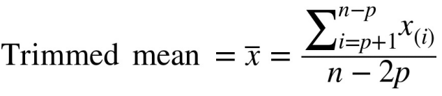

A trimmed mean eliminates the influence of extreme values. For example,
in international diving the top and bottom scores from five judges are
dropped, and the final score is the average of the three remaining
judges

This makes it difficult for a single judge to manipulate the score,
perhaps to favor his country's contestant. Trimmed means are widely
used, and in many cases, are preferable to use instead of the ordinary
mean

Another type of mean is a weighted mean, which you calculate by
multiplying each data value $\sf{x_{i}}$ bu a weight $\sf{w_{i}}$ and
dividing their sum by the sum of the weights. The formula for a weighted
mean is:

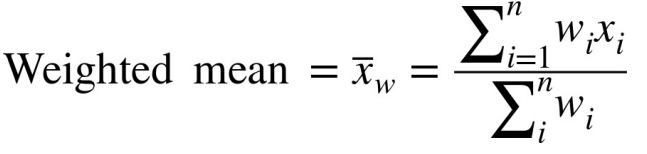

There are two main motivations for using a weighted mean:

-   Some values are intrinsically more variable than others, and highly
    variable observations are given a lower weight. For example, if we
    are taking the average from multiple sensors and one of the sensors
    is less accurate, then we might down weight the data from that
    sensor.

-   The data collected does not equally represent the different groups
    that we are interested in measuring. For example, because of the way
    an online experiment was conducted, we may not have a set of data
    that accurately reflects all groups in the user base. To correct
    that, we can give a higher weight to the values from the groups that
    were underrepresented.

**Median:**

Is the middle value of ordered data

-   Put all of the values into order.

-   The median if the middle value.

-   If there are two values in the middle, find the mean of these two
    values.

```{r}
median(v1)
```

The median is the middle number on a sorted list of the data. If there
is an even number of data values, the middle value is one that is not
actually in the data set, but rather the average of the two values that
divide the sorted data into upper and lower halves. Compared to the
mean, which uses all observations, the median depends only on the values
in the center of the sorted data. While this might seem to be a
disadvantage, since the mean is much more sensitive to the data, there
are many instances in which the median is a better metric for location.

The median is referred to as a robust estimate of location since it is
not influenced by outliers (extreme cases) that could skew the results.
An outlier is any value that is very distant from the other values in a
data set. The exact definition of an outlier is somewhat subjective,
although certain conventions are used in various data summaries and
plots ("Percentiles and Boxplots"). Being an outlier in itself does not
make a data value invalid or erroneous.

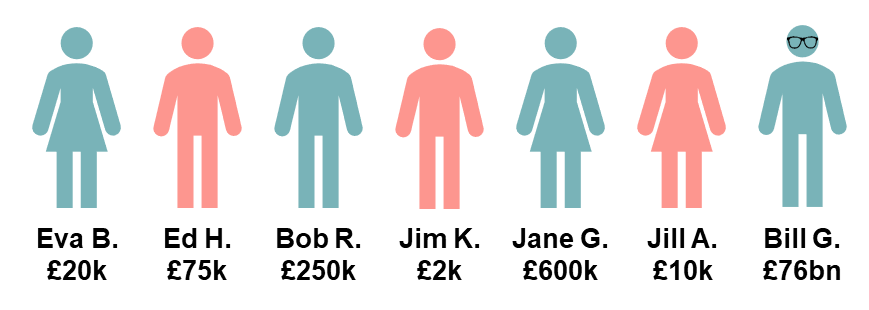

```{r}
incomes <- c(20000, 75000, 250000, 2000, 600000, 10000, 760000000000000000000000)
incomes
incomes_sorted <- sort(incomes)

incomes_sorted

print(paste("The mean is: ", mean(incomes_sorted)))

print(paste("The median is: ", median(incomes_sorted)))
```

Still, outliers are often the result of data errors such as mixing data
of different units (kilometers versus meters) or bad readings from a
sensor. When outliers are the result of bad data, the mean will result
in a poor estimate of location, while the median will be still be valid.
In any case, outliers should be identified and are usually worthy of
further investigation.

**Mode:**

Is the most frequen value.

-   Count how many of each value appears.

-   The mode is the value that appears the most.

-   You can have more than one mode.

R does not have a standard in-built function to calculate mode. So we
create a user function to calculate mode of a data set in R. This
function takes the vector as input and gives the mode value as output.

Unike mean and median, mode can have both numeric and character data.

```{r}
# Create the function.
getmode <- function(v) {
   uniqv <- unique(v)
   uniqv[which.max(tabulate(match(v, uniqv)))]
}

# Create the vector with numbers.
v1 <- c(2,1,2,3,1,2,3,4,1,5,5,3,2,3)

# Calculate the mode using the user function.
result <- getmode(v1)
print(result)

# Create the vector with characters.
charv <- c("o","it","the","it","it")

# Calculate the mode using the user function.
result <- getmode(charv)
print(result)
```

```{r}
incomes <- c(20000, 75000, 250000, 20000, 600000, 20000, 76000000000000, 600000, 75000, 75000, 75000)

# Contar las recurrencias de los ingresos
recurrencias <- table(incomes)

# Ordenar las recurrencias en orden descendente
recurrencias_ordenadas <- sort(recurrencias, decreasing = TRUE)

# Mostrar las recurrencias ordenadas
recurrencias_ordenadas
```

**Range:**

Is the difference between the lowest and highest value

-   Find the highest and lowest values.

-   Substract the lowest values from the highest.

```{r}
range(v1)
```

### 2.2. Measures of dispersion

**Standard deviation:**

-   Calculate the mean of the sample.

-   Find the difference each entry (x) and the mean.

-   Square the deviations from the mean.

-   Sum the squares of the deviations from the mean.

-   Divide the sum by (n-1) to get the variance.

-   Take the square root of the variance to get the standard deviation.

    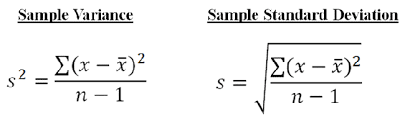

```{r}
sd(v1)
```

**Quartiles** split up the data into four equal parts. Here, we call the
quantile function to get the quartiles of the data.

```{r}
library(gapminder)

quantile(gapminder$pop)
```

```{r}
quantile(gapminder$pop, probs = c(0, 0.2, 0.4, 0.6, 0.8, 1))
```

```{r}
quantile(gapminder$pop, probs = seq(0, 1, 0.1))
```

**Interquartil Range (IQR):**

The interquartile range tells you the spread of the middle half of your
distribution.

Quartiles segment any distribution that's ordered from low to high into
four equal parts. The interquartile range (IQR) contains the second and
third quartiles, or the middle half of your data set.

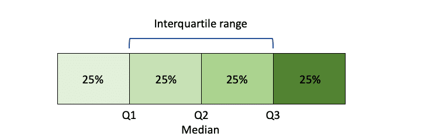

**IQR = Q3 - Q1**

```{r}
IQR <- quantile(gapminder$pop, 0.75) - quantile(gapminder$pop, 0.25)
IQR

IQR(gapminder$pop)
```

**Outliers** are data points that are substantially different from the
others.

**outier: Q1 - 1.5 \* IQR ó outier: Q3 + 1.5 \* IQR**

```{r}
lower_threshold <- quantile(gapminder$pop, 0.25) - 1.5*IQR
lower_threshold
```

```{r}
upper_threshold <- quantile(gapminder$pop, 0.75) + 1.5*IQR
upper_threshold
```

```{r}
library(gapminder)
library(dplyr)

gapminder %>% 
filter(pop < lower_threshold | pop > upper_threshold)
```

# 3. Bivariate analyses

The dividing line between a univariate and a bivariate study lies in the
fact that the latter strictly seeks to analyze two variables together,
which we could well denote as "X" and "Y" seeking to prove simple
relationships of causality or association.

In statistics, a specific variant of bivariate studies is called
**"correlational analysis"**, through which it is sought to demonstrate
that there is a significant direct or inverse relationship between two
variables.

There is a direct correlation between two variables when an increase in
the "control variable" (independent) causes a similar change in the
"outcome variable" (dependent).

In bivariate studies, discrimination between dependent and independent
variables is not a mandatory requirement.

With a correlation analysis we test hypotheses that we might think as
obvious as that a student's grade point average (dependent variable or
outcome) is correlated with the time spent studying (independent or
predictor).

## 3.1. Coefficient of determination

A coefficient or statistical ratio that measures the degree of
correlation is the coefficient of determination or "R squared".

**Coefficient of Correlation (r):**

It measures the strength and the direction of a linear relationship
between two variables (x and y) with possible values between -1 and 1.

-   Positive Correlation: It indicates that two variables are in perfect
    harmony. They rise and fall together. +1 is perfect

-   Negative Correlation: It indicates that two variables are perfect
    opposites. One goes up and other goes down. -1 is perfect

-   No correlation: If there is no linear correlation or a weak linear
    correlation, r is close to 0.

    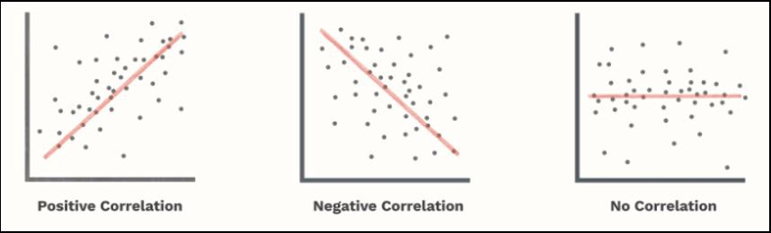

**Coefficient of determination (R2):**

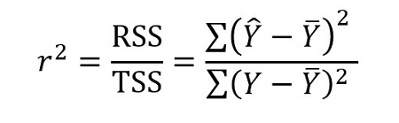

We will use a equation to describe the academic performance of the
students, where X are the hours of study and Y is the is the academic
qualification obtained

Y = X + 1

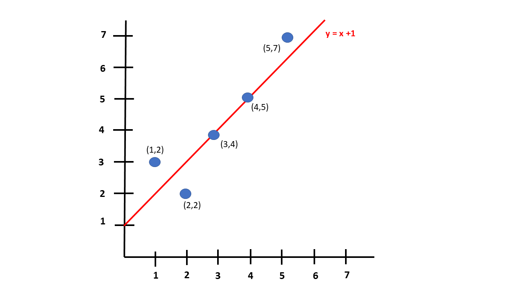

The closer the line is to the points, the better the prediction.

Two aspects to consider:

1)  how well is the line (model) predicting the values

2)  how different is the predicted value vs the actual value = Residual

    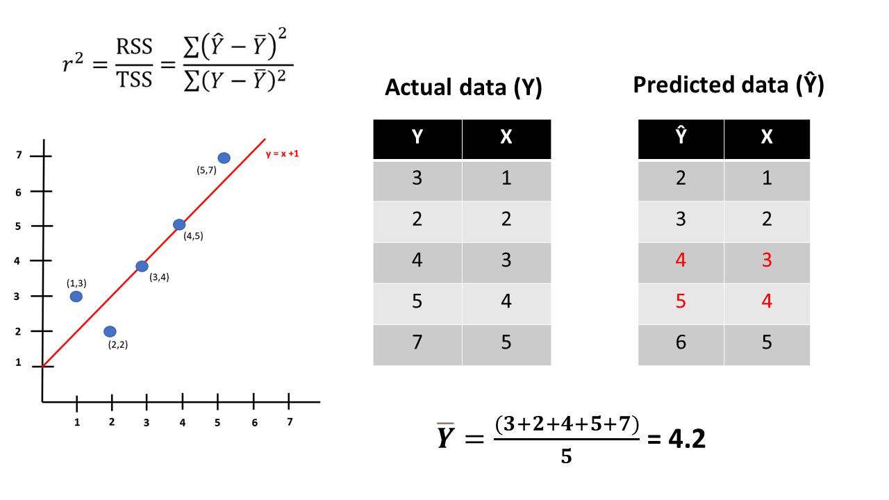

We need to tabulate the actual and predicted data vs X. and then
calculate the mean of actual data.

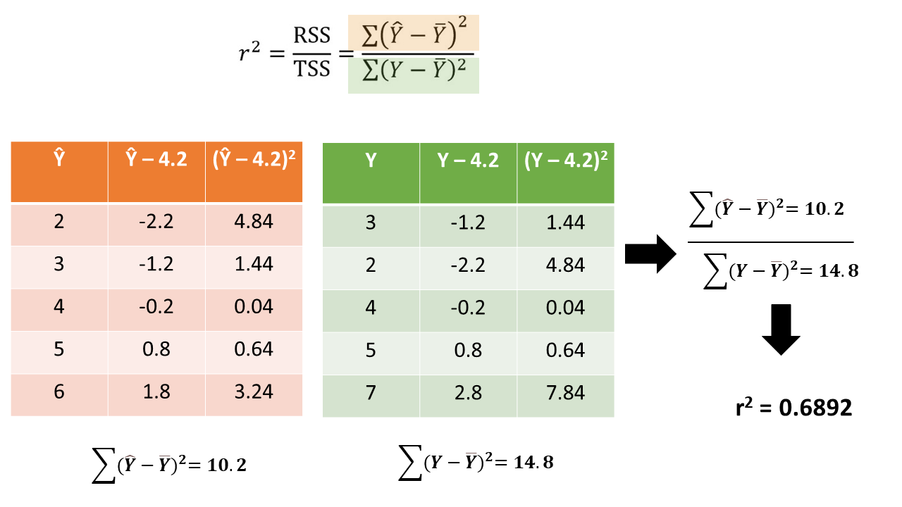

**As conclusion:**

**The 68.92% of the variance of school scores can be explained due to
the hours of study**

Finding the coefficient of determination for the simple linear
regression model of the data set faithful.

```{r}
a <- faithful
str(faithful)
```

```{r}
eruption.lm = lm(eruptions ~ waiting, data=faithful)
```

```{r}
summary(eruption.lm)
```

```{r}
summary(eruption.lm)$r.squared


print(paste0("R^2= ", summary(eruption.lm)$r.squared))
```

## 3.2. Covariance

In statistics, the covariance is a measure of the join variability of
two random variables.

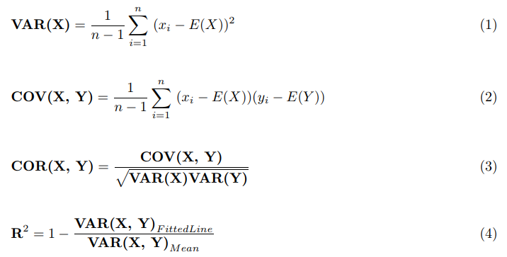

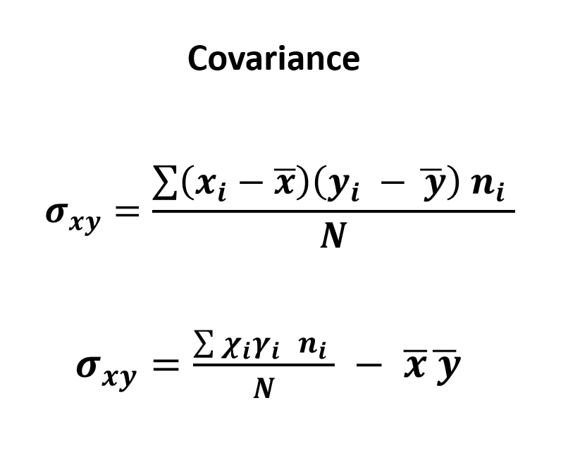

Now, we will analyse positive covariance between school scores and hours
of study.

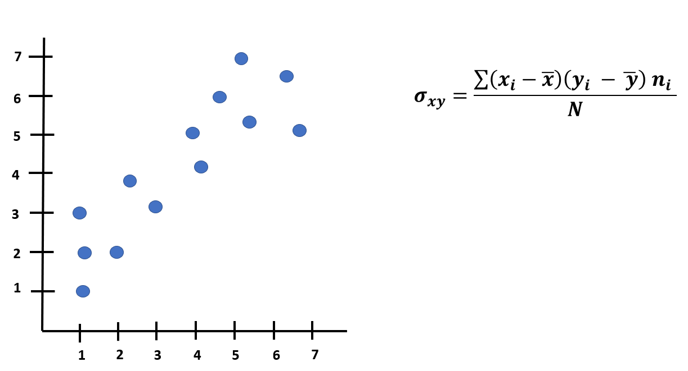

lets plot the average in x and y

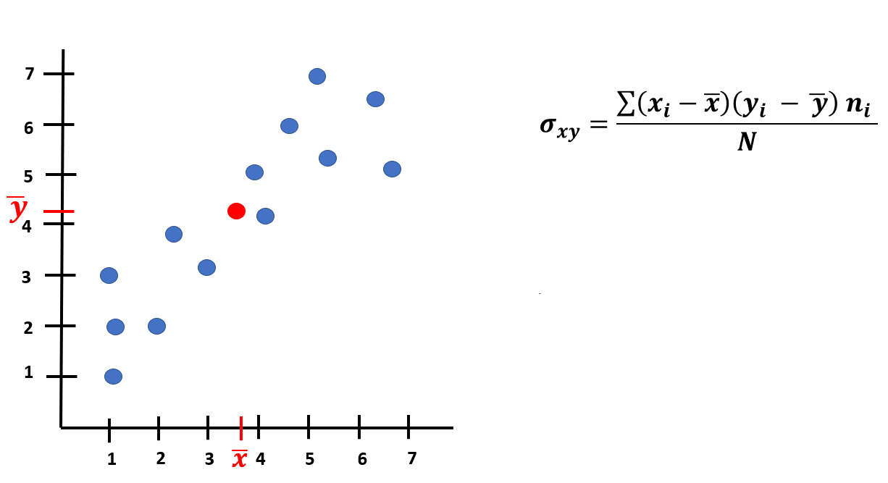

If we select one random value (x,y)

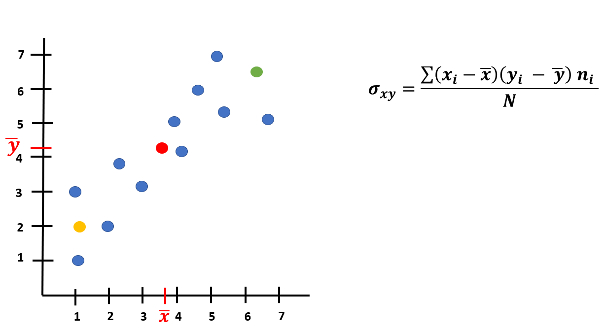

How are the yellow and green points positioned with respect to the mean
of x and y?

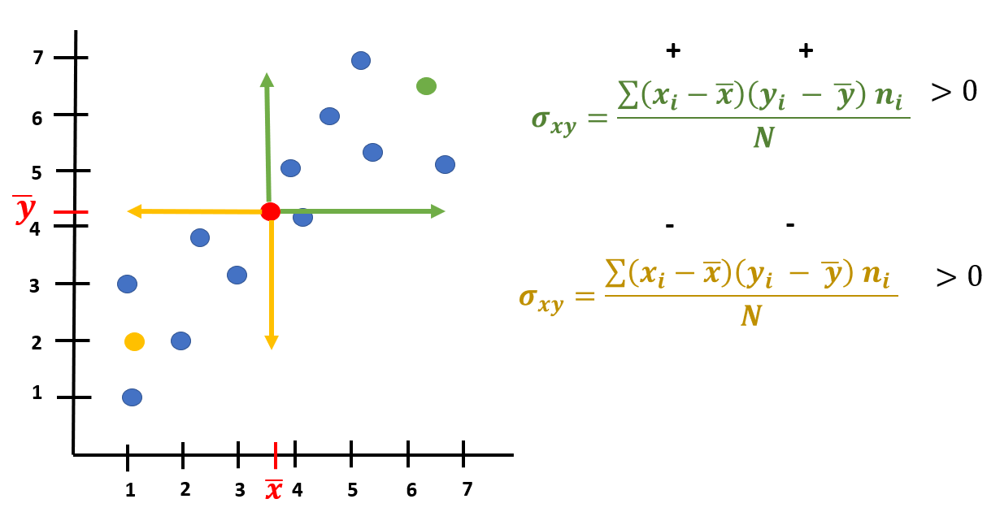

**When there is a direct relationship between two variables, the
covariance gives a positive value.**

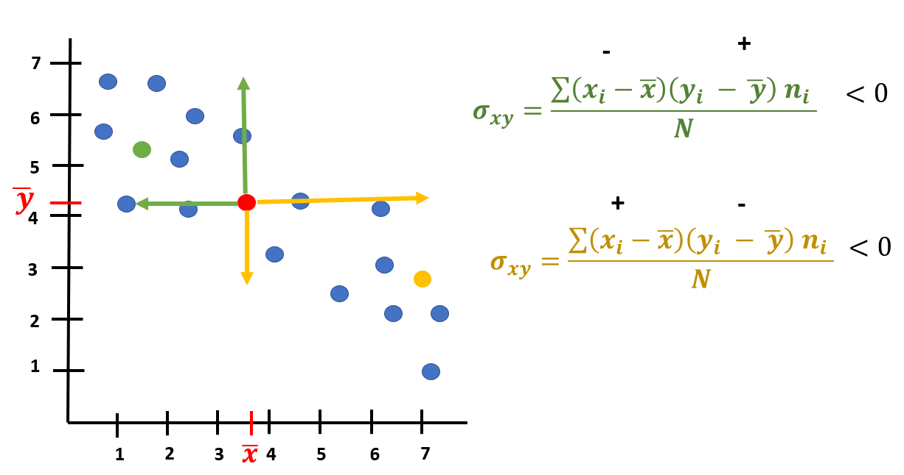

**When there is a inverse relationship between two variables, the
covariance gives a negative value.**

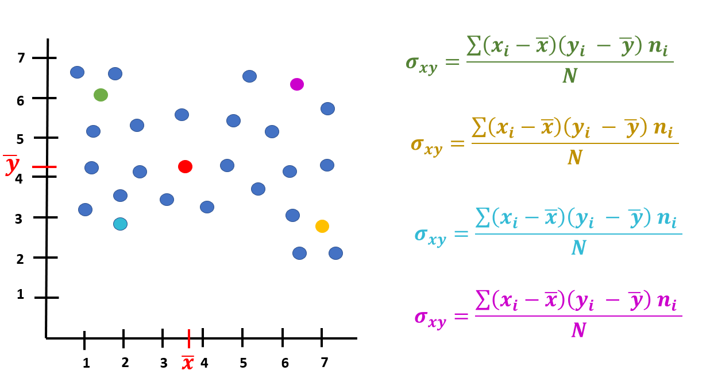

**When there is NOT a relationship between two variables, the covariance
gives a value near to zero.**

```{r}
library(gapminder)
```

```{r}
summary(gapminder)
```

```{r}
cov(gapminder$pop, gapminder$year)
```

```{r}
duration = faithful$eruptions   # eruption durations 
waiting = faithful$waiting      # the waiting period 
cov(duration, waiting)
```

## 3.3. Pearson's correlation coefficient

What problem can we see when comparing the covariance of both data shown
above? 13.977 vs 150858448.310

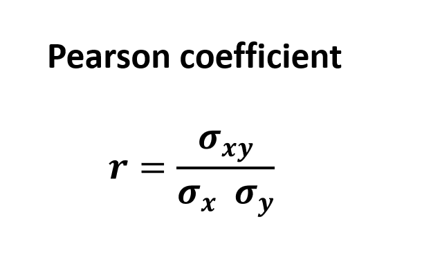

**The Pearson parameter allow us to compare between different measures
since it has no units! because is a coefficient**

**-1** $\le$ **r** $\le$ **1**

If r $\approx$ 1, then there exist a strong direct correlation

If r $\approx$ -1, then there exist a strong inverse correlation

If r = -1 or r = 1, then there exist a function correlation where it is
possible to find a mathematical function to describe the relationship

If r $\approx$ 0, then there is not exist a lineal correlation

```{r}

cor.test(faithful$eruptions, faithful$waiting, 
                    method = "pearson")


cor.test(gapminder$pop, gapminder$year, 
                    method = "pearson")
```

```{r}
library(ggplot2)

ggplot(gapminder, aes(x=year, y=pop))+
geom_point()

ggplot(faithful, aes(x=eruptions, y=waiting))+
geom_point()
```

```{r}
library(dplyr)

gapminder_year <- gapminder %>%
group_by(year) %>%
summarise(totalpop = sum(as.numeric(pop)))

gapminder_year
```

```{r}
#Covariance faithful
cov(faithful$eruptions, faithful$waiting)

#Covariance gapminder modified
cov(gapminder_year$totalpop, gapminder_year$year)

#Pearson faithful
cor.test(faithful$eruptions, faithful$waiting, 
                    method = "pearson")

#Pearson gapminder modified
cor.test(gapminder_year$totalpop, gapminder_year$year, 
                    method = "pearson")
```

Now both Pearson coefficients are comparable

## 3.4. Spearman's rho coefficient

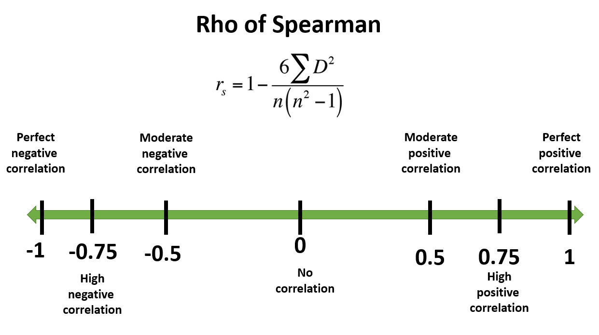

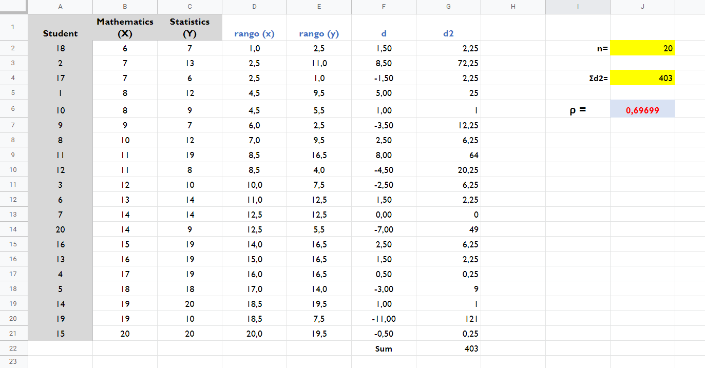

```{r}
library(gapminder)

#Pearson gapminder modified
cor.test(gapminder_year$totalpop, gapminder_year$year, 
                    method = "pearson")

#Spearman gapminder modified
cor.test(gapminder_year$totalpop, gapminder_year$year, 
                    method = "spearman")
```

You should use Spearman's Rho in the following scenario:

-   You want to know the relationship between two variables

-   Your variables of interest are continuous with outliers or ordinal

-   You have only two variables

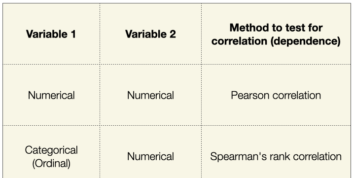

```{r}


```

# 4. Multivariate analysis

In a multivariate analysis, we do not speak of "simple correlation" or
descriptive statistics by themselves, but rather we use other
statistical tools called "multivariate", such as:

-   Analysis of variance (ANOVA)

-   Multiple variance analysis

-   Principal component analysis (PCA)

-   Trajectory analysis

-   Multifactorial study

-   Multiple regression analyses

## 4.1. p-value

**What is a hypothesis in statistics?**

It is a question that admits a **yes** or **no** answer.

For example:

Is the average salary in Chile higher for men than for women? ----\> it
is a **comparison**

Helicobacter pylori infection is associated with gastric cancer? ---\>
it is a **relation or association**

The number of hours of autonomous study is the cause of success in a
doctoral program? ----\> it is a **causality**

The questions posed before can be answered with the ***p-value***

Is the average salary in Chile higher for men than for women?

So, we have two options:

***H1*****:** average salary is **NOT equal** between men and women.

***H0:*** average salary is **equal** between men and women.

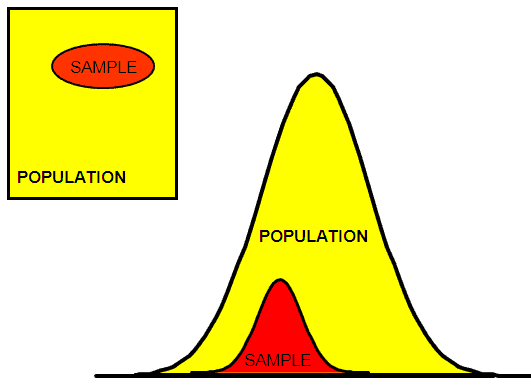

The *p-value* is the error probability of accepting H1 as true and
actually being false

Is the average salary in Chile higher for men than for women?

So, we have two options:

***H1:*** average salary is **NOT equal** between men and women.

***H0:*** average salary is **equal** between men and women.

***p-value*** = 0.08 ----\> 8 out of 100 times we will accept
differences between salaries and in reality IT IS NOT TRUE

What about p-value = 0.08 vs p-value = 0.03? Which generates more
confidence (less error)?

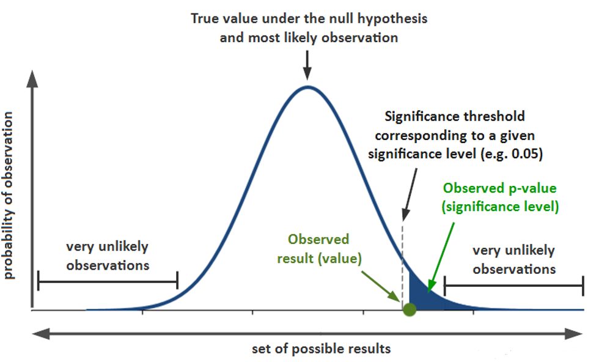

**The p-value means that the probability of the null hypothesis will be
true**

**When:**

**p \< 0.05 : The null hypotesis (H0) is False / The alternative
hypothesis (H1) is True**

**p \> 0.05 : The null hypothesis (H0) is True**

**The smaller the p-value, the more reliable the study result.**

## 4.2. ANOVA

An "Analysis of Variance" (ANOVA) tests three or more groups for mean
differences based on a continuous (i.e. scale or interval) response
variable (a.k.a. dependent variable). The term "factor" refers to the
variable that distinguishes this group membership. Race, level of
education, and treatment condition are examples of factors.

There are two main types of ANOVA: (1) "one-way" ANOVA compares levels
(i.e. groups) of a single factor based on single continuous response
variable (e.g. comparing test score by 'level of education') and (2) a
"two-way" ANOVA compares levels of two or more factors for mean
differences on a single continuous response variable(e.g. comparing test
score by both 'level of education' and 'zodiac sign').

The ANOVA test allows a comparison of more than two groups at the same
time to determine whether a relationship exists between them. The result
of the ANOVA formula, the F statistic (also called the F-ratio), allows
for the analysis of multiple groups of data to determine the variability
between samples and within samples.

If no real difference exists between the tested groups, which is called
the null hypothesis, the result of the ANOVA's F-ratio statistic will be
close to 1.

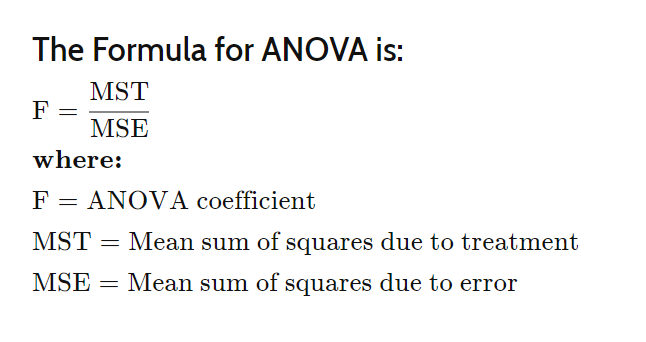

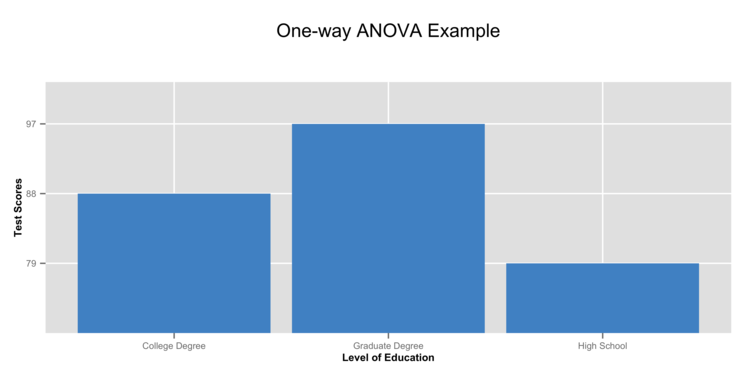

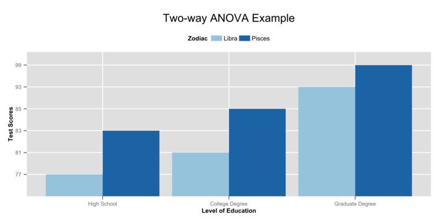

## 4.3. ANCOVA

The obvious difference between ANOVA and ANCOVA is the the letter "C",
which stands for 'covariance'. Like ANOVA, "Analysis of Covariance"
(ANCOVA) has a single continuous response variable. Unlike ANOVA, ANCOVA
compares a response variable by both a factor and a continuous
independent variable (e.g. comparing test score by both 'level of
education' and 'number of hours spent studying'). The term for the
continuous independent variable used in ANCOVA is "covariate".

ANCOVA is also commonly used to describe analyses with a single response
variable, continuous IVs, and no factors. Such an analysis is also known
as a regression.

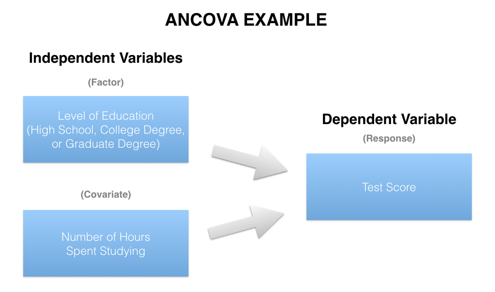

## 4.4. MANOVA

The obvious difference between ANOVA and a "Multivariate Analysis of
Variance" (MANOVA) is the "M", which stands for multivariate. In basic
terms, A MANOVA is an ANOVA with two or more continuous response
variables. Like ANOVA, MANOVA has both a one-way flavor and a two-way
flavor. The number of factor variables involved distinguish a one-way
MANOVA from a two-way MANOVA.

When comparing two or more continuous response variables by a single
factor, a one-way MANOVA is appropriate (e.g. comparing 'test score' and
'annual income' together by 'level of education'). A two-way MANOVA also
entails two or more continuous response variables, but compares them by
at least two factors (e.g. comparing 'test score' and 'annual income'
together by both 'level of education' and 'zodiac sign').

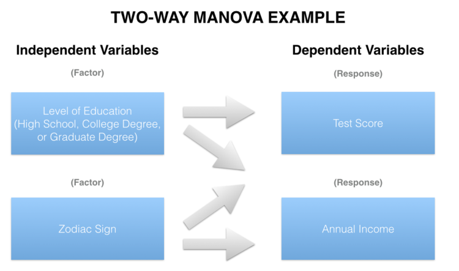](ONE-WAY+MANOVA+figure.001.png)

## 4.5 MANCOVA

Like ANOVA and ANCOVA, the main difference between MANOVA and MANCOVA is
the "C," which again stands for "covariance." Both a MANOVA and MANCOVA
feature two or more response variables, but the key difference between
the two is the nature of the Independent variables. While a MANOVA can
include only factors, an analysis evolves from MANOVA to MANCOVA when
one or more covariates are added to the mix.

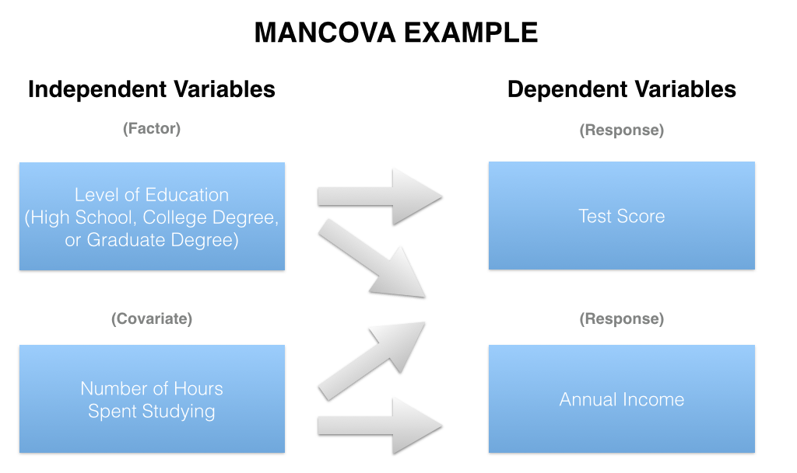

## 5. Examples ANOVA

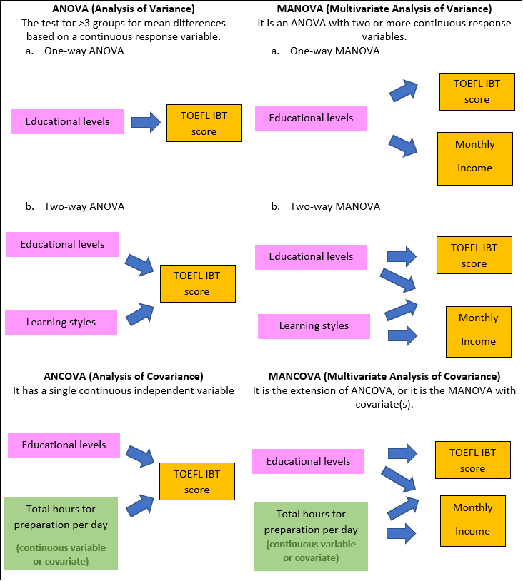

### 5.1 The IRIS data set

This is perhaps the best known database to be found in the pattern
recognition literature. Fisher's paper is a classic in the field and is
referenced frequently to this day. The data set contains 3 classes of 50
instances each, where each class refers to a type of iris plant.

Predicted attribute: class of iris plant.

**Attribute Information:**

1.  sepal length in cm
2.  sepal width in cm
3.  petal length in cm
4.  petal width in cm
5.  class: Iris Setosa, Iris Versicolour, Iris Virginica

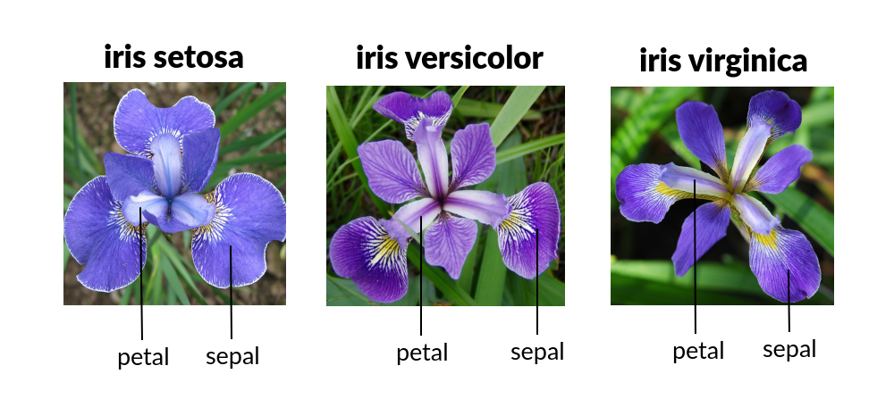

```{r}
iris
```

```{r}
summary(iris)
```

```{r}
str(iris)
```

```{r}
plot(iris)
```

```{r}
# install.packages("psych")
library(psych)

head(iris)
data <- iris[, 1:4] # Variables numéricas
grupos <- iris[, 5] # Variable factor (grupos)

head(data)
corPlot(data, cex = 1.2, main = "Matriz de correlación")


#https://r-coder.com/grafico-correlacion-r/
```

```{r}
pairs(data,                     # Data frame de variables
      labels = colnames(data),  # Nombres de las variables
      pch = 21,                 # Símbolo pch
      bg = rainbow(3)[grupos],  # Color de fondo del símbolo (pch 21 a 25)
      col = rainbow(3)[grupos], # Color de borde del símbolo
      main = "Iris",            # Título del gráfico
      row1attop = TRUE,         # Si FALSE, cambia la dirección de la diagonal
      gap = 1,                  # Distancia entre subplots
      cex.labels = NULL,        # Tamaño del texto de la diagonal
      font.labels = 1)          # Estilo de fuente del texto de la diagonal
```

```{r}
library(ggplot2)
library(dplyr)


sl <- iris %>%
group_by(Species)  %>%
summarise(Sepal.Length_mean = mean(Sepal.Length))
#ma


# Change density plot fill colors by groups
#ggplot(iris, aes(x=Sepal.Length, fill=Species)) +
#  geom_density()


# Use semi-transparent fill
p<-ggplot(iris, aes(x=Sepal.Length, fill=Species)) +
  geom_density(alpha=0.4)
#p
# Add mean lines
p+geom_vline(data=sl, aes(xintercept=Sepal.Length_mean, color=Species),
             linetype="dashed")
```

```{r}
#install.packages("viridis", dep = T)
```

```{r}
# Vertical box plot by group
# boxplot(Sepal.Length ~ Species, data = iris, col = "white")

# Points
# stripchart(Sepal.Length ~ Species,
#            data = iris,
#             method = "jitter",
#             pch = 19,
#             col = 2:4,
#             vertical = TRUE,
#             add = TRUE)

# ##############################################
# # Vertical box plot by group
# boxplot(Sepal.Width  ~ Species, data = iris, col = "white")

# # Points
# stripchart(Sepal.Width  ~ Species,
#            data = iris,
#             method = "jitter",
#             pch = 19,
#             col = 2:4,
#             vertical = TRUE,
#             add = TRUE)

# ##############################################
# # Vertical box plot by group
# boxplot(Petal.Length ~ Species, data = iris, col = "white")

# # Points
# stripchart(Petal.Length ~ Species,
#            data = iris,
#             method = "jitter",
#             pch = 19,
#             col = 2:4,
#             vertical = TRUE,
#             add = TRUE)
# ##############################################
# # Vertical box plot by group
# boxplot(Petal.Width  ~ Species, data = iris, col = "white")

# # Points
# stripchart(Petal.Width  ~ Species,
#            data = iris,
#             method = "jitter",
#             pch = 19,
#             col = 2:4,
#             vertical = TRUE,
#             add = TRUE)
```

**These 3 species can be considered different in relation to the length
or width of the petals?**


What types of variables do we have?

```{r}
##############################################
# Vertical box plot by group
boxplot(Petal.Length ~ Species, data = iris, col = "white")

# Points
stripchart(Petal.Length ~ Species,
           data = iris,
            method = "jitter",
            pch = 19,
            col = 2:4,
            vertical = TRUE,
            add = TRUE)
##############################################
# Vertical box plot by group
boxplot(Petal.Width  ~ Species, data = iris, col = "white")

# Points
stripchart(Petal.Width  ~ Species,
           data = iris,
            method = "jitter",
            pch = 19,
            col = 2:4,
            vertical = TRUE,
            add = TRUE)
```

ANOVA will report if there are significant differences between the
populations of evaluated species

```{r}
results.aov <- aov(iris$Petal.Length ~ iris$Species, data=iris)

summary.aov(results.aov)

#pairwise.t.test(iris$Petal.Length, iris$Species, p.adjust.method = "BH")

```

```{r}
TukeyHSD(results.aov)
```

### 5.2 The Cars data set

In this example, we will take a look at how to implement an ANOVA model
to analyse car sales data.

The purpose of this analysis is to determine whether factors such as
engine size, horsepower, and fuel efficiency differ across groups of
cars based on both vehicle type and country of origin.

A one-way ANOVA is used to determine effects when using just one
categorical variable.

A two-way ANOVA is used to determine effects across multiple categories
(also known as a factorial ANOVA) and also whether interaction effects
are present.

```{r}
### importing the dataset

file <- "Car_sales.csv"

df <- read.csv(file, header = TRUE, sep = ",")

head(df)
```

```{r}

df$Country <- as.factor(df$Country)
summary(df$Country)
```

```{r}
str(df)
```

Vehicule type vs other variables

```{r}
one.way <- aov(df$Power_perf_factor ~ Vehicle_type, data = df)
summary(one.way)

one.way <- aov(df$Engine_size ~ Vehicle_type, data = df)
summary(one.way)

one.way <- aov(df$Horsepower ~ Vehicle_type, data = df)
summary(one.way)

one.way <- aov(df$Fuel_capacity ~ Vehicle_type, data = df)
summary(one.way)

one.way <- aov(df$Fuel_efficiency ~ Vehicle_type, data = df)
summary(one.way)
```

We can see that for vehicle type (which is specified as either Passenger
or Car) in the dataset, the results are not significant for horsepower
or power performance factor, i.e. the means of these variables do not
show a statistically significant difference depending on whether the
vehicle is classified as Passenger or Car.

Let's now take a look at whether the means of these variables differ
across country.

Country vs other variables

```{r}
one.way <- aov(Power_perf_factor ~ df$Country, data = df)
summary(one.way)

one.way <- aov(df$Engine_size ~ df$Country, data = df)
summary(one.way)

one.way <- aov(df$Horsepower ~ df$Country, data = df)
summary(one.way)

one.way <- aov(df$Fuel_capacity ~ df$Country, data = df)
summary(one.way)

one.way <- aov(df$Fuel_efficiency ~ df$Country, data = df)
summary(one.way)
```

We can see that the p-values for the F-statistic come back as
insignificant for all but engine size, meaning that there are
statistically significant differences across the mean engine size
depending on the country of manufacturer.

**It is important to note that one limitation of using ANOVA is that the
test will only indicate whether the mean differences across groups are
statistically significant - they do not particularly reveal which group
is responsible for the differences in means.**

For instance, we may observe that mean engine size indicated to differ
across countries --- but ANOVA itself cannot tell us which country shows
a larger mean engine size across manufacturers as compared to vehicles
from other countries.

**Two-way ANOVA**

Moreover, a limitation of one-way ANOVA is that it cannot test for the
effects of interactions. For instance, a vehicle type and manufacturing
country may not affect the horsepower of a vehicle individually, but
what about when the two factors are combined?

In this regard, a two-way ANOVA is used to 1) test the effect of
multiple factors on the dependent variable and 2) the effect of
combining these factors, i.e. an interaction effect.

```{r}
model_1 = lm(Engine_size ~ Vehicle_type + Country + Vehicle_type*Country, data = df)
model_2 = lm(Fuel_efficiency ~ Vehicle_type + Country + Vehicle_type*Country, data = df)
model_3 = lm(Fuel_capacity ~ Vehicle_type + Country + Vehicle_type*Country, data = df)
model_4 = lm(Sales_in_thousands ~ Vehicle_type + Country + Vehicle_type*Country, data = df)
```

A two-way ANOVA test is run on each of the four models:

```{r}
#install.packages("car")
```

```{r}
library(car)
Anova(model_1, type = "II")
Anova(model_2, type = "II")
Anova(model_3, type = "II")
Anova(model_4, type = "II")
```

We can see that for model 4, the interaction between vehicle type and
country is statistically significant.

This indicates that the sales value is significantly influenced by both
vehicle type and the country of the manufacturer. Moreover, the two
variables also interact with each other.

### 5.3 Examples ANCOVA


Now imagine you wanted to do the above analysis but while controlling
for other features of the flower's size.

After all, it might be that the species does not influence petal.length
specifically, but more generally, the species influences the overall
size of the plant.

So the question is: **Controlling for other plant size measures, does
species still influence the length of the petal?**

In our analysis, the other metric that represents plant size will be the
variable Sepal.Length, which is also available in the iris dataset. So,
we specify our extended model just by adding this new covariate.

This is the ANCOVA --- we are analyzing the impact of a categorical
independent variable on an interval dependent variable while controlling
for one or more covariates.

```{r}
library(car)

fit2=aov(Petal.Length ~ Species+Sepal.Length, iris)

Anova(fit2, type="III")
```

As you can see in our row Species, column Pr(\>F), which is the p-value,
species still has a significant impact on the length of the petal, even
when controlling for the length of the sepal. This could imply that the
flowers really have different proportions and aren't simply bigger or
smaller because of the species.

### 5.4. Examples MANOVA


```{r}
library(dplyr)
library(tidyverse)

iris2 <- iris %>%
  select(Sepal.Length, Petal.Length, Species) %>%
  add_column(id = 1:nrow(iris), .before = 1)
head(iris2)

```

```{r}
library(car)

model <- lm(cbind(Sepal.Length, Petal.Length) ~ Species, iris2)

Anova(model, type="III")
```

### 5.5. Examples MANCOVA


```{r}
#install.packages("rlang")
#install.packages("jmv")
```

```{r}
library(jmv)

mancova(data = iris,
    deps = vars(Sepal.Length, Sepal.Width, Petal.Length),
    factors = Species)
```

```{r}
summary.aov(manova(cbind(Sepal.Length,Sepal.Width) ~ Species*Petal.Length, iris))
```

<https://www.rdocumentation.org/packages/jmv/versions/2.3.4/topics/mancova>
